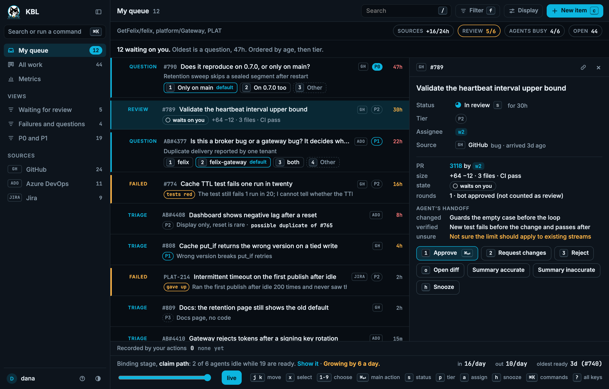
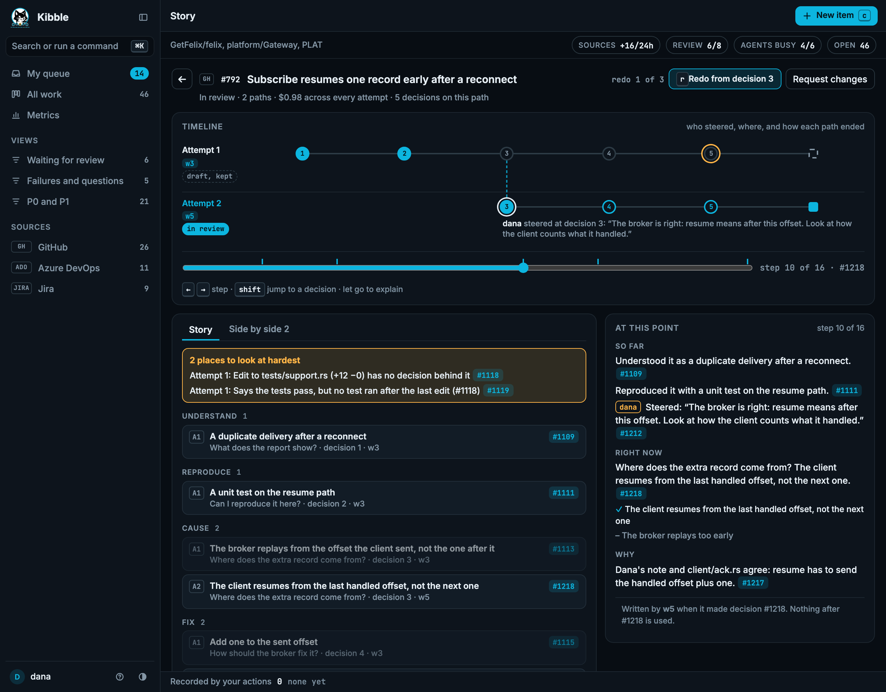

<p align="center"></p>

# KBL

KBL (Kanban By Log, pronounced Kibble) is a work tracker for coding agents, backed by [Felix](https://github.com/GetFelix/felix). It pulls bugs
in from GitHub, Azure DevOps or Jira, hands each piece of work to one agent, keeps dependencies and priorities,
and shows the queue in a dashboard. Agents from any vendor take work from it through an MCP server,
`kbl-mcp`. People guide it from the dashboard.

KBL is not agentic. The tracker, `kbl-mcp` and the dashboard make no model calls and generate no text.
Triage, gathering context, splitting, answering questions and fixing are all work items that an agent or a
person completes.





<sub>Style frames from [prototype/intake-frame.html](prototype/intake-frame.html), drawn from hand-written
fixtures. The tracker does not talk to Felix yet: only the task tools and the [dev stack](#running-felix-locally)
do.</sub>

> **Status:** M0 and M1 are done: the task tools, scripted planner and workers, the death and poison checks, and
> the dashboard and replay style frames. M2, the tracker itself, is in progress. See [Status](#status).

## What it shows about Felix

[felix-arena](https://github.com/GetFelix/felix-arena) uses a log as a live feed and a replay,
[felix-metro](https://github.com/GetFelix/felix-metro) seeks back through a long history, and
[felix-blocks](https://github.com/GetFelix/felix-blocks) is keyed state with many writers. KBL puts them to
work on a backlog that never ends:

- **Each piece of work is claimed once, even when agents die.** A consumer group hands an item to one agent and gives it to another when the first stops answering. An item that keeps failing is dead-lettered instead of retried forever. The tracker publishes a Ready item's record again if Felix dead-lettered it, so the item is not lost.
- **People and agents don't overwrite each other.** Items are keys written with `cache_put_if` at the version read, so a stale write is refused.
- **One log is the record.** `work.events` holds every import, claim, decision and refusal in order, with the broker's record of who wrote it. The queue, an item's history and the replay are folds of it.
- **Budgets hold under a race.** A root's budget only decreases, and a create over it is refused.
- **Agents stay in their lane.** Each agent has its own token and reaches work only through the tracker, which is the only writer of `work.events`, the ready streams and the item keys.

## What you will be able to do

- Bring bugs in from GitHub, Azure DevOps or Jira once each, and add your own work
- See the queue: what needs you, what agents hold, what waits on what
- Let any MCP host (Claude Code, the Claude Agent SDK, another vendor's) ask for the next item it can start, through `kbl-mcp`
- Let agents triage, split and add context as work they claim, with children bounded by a budget per root
- Accept, edit or reject an agent's proposal, or answer its question, from the dashboard
- Open a fix's decision replay: scrub through what the agent decided, with the fields it recorded and the steps behind them
- Redo from a past decision as new work, with your note, without touching the first attempt

## Felix features it uses

| Need | Felix feature |
|---|---|
| Handing each item to one agent | A consumer group: per-record ack, visibility timeout, claim extension, max attempts and dead letters |
| Priority | A ready stream per tier, polled in order |
| Items, edges, context and budgets | A log-backed cache with conditional writes (`cache_put_if`, `cache_delete_if`) |
| Importing an upstream bug once | `cache_put_if` on the upstream id, absent only |
| The record | A durable stream (`work.events`) with the publisher recorded, range reads, subscribe from an offset |
| What each principal may write | RBAC, down to a cache key prefix |
| The browser dashboard | [felix-gateway](https://github.com/GetFelix/felix-gateway) |

Some of this is not yet reachable the way the design wants. The design lists
it under "Felix gaps", and each one has an issue labelled
[`felix-gap`](https://github.com/GetFelix/KBL/labels/felix-gap).

## How it works

Bugs come in as roots from GitHub, Azure DevOps or Jira, and from people. An ingest worker writes each upstream
id once and posts one triage item and one augment item for it. The agent that claims the triage item answers
it with `work_triage` (a tier and why, a duplicate, or what is unclear), and a person accepts or edits that
proposal. An item becomes claimable when its last
dependency is done: the tracker folds `work.events` and publishes it to a ready stream for its priority tier.

Each agent runs `kbl-mcp` with its own token, and every work tool calls the tracker. `work_next` asks the
tracker for the highest-priority ready item: the tracker claims it from the ready streams' consumer group as a
member named after the agent and logs the claim in the same step. `kbl-mcp` extends the claim every 30
seconds while the agent works, and `work_complete`, `work_release` or giving up ends it. A dead agent stops
extending, so its claim lapses and the item goes to another agent. An item has one holder at a time: a release
that lands while the item is being handed on does not cost the next agent its claim. An agent adds children only under an item it holds (`split`, `augment`,
`question` or `test`), within a budget per root. Anything else it finds is a proposal a person accepts. An agent can have at most 16 proposals waiting at once, 8 from one root.

While it works, the agent records `decide` (what it chose and why, with the phase, a running summary and the
steps it rests on), `record_step` and `edit`. The dashboard folds these into the story of a fix and its replay.
A redo from a past decision is a new attempt that starts from that decision's recorded summary and a
reviewer's note, so the first attempt stays as it happened.

The tracker validates every call and does the Felix writes itself, so an agent never writes the work streams or
keys directly. [docs/work-tracker.md](docs/work-tracker.md) and [docs/decision-replay.md](docs/decision-replay.md)
have the details.

## Status

| M | Milestone | Proves |
|---|---|---|
| 0 | The dashboard and the decision replay, locked: style frames drawn from hand-written fixtures | They read well before Felix is involved |
| 1 | Tasks through Felix: `core`, the dev stack, `kbl-tool`, `kbl-mcp` task tools, scripted planner and workers | Demonstrations 1 and 2 |
| 2 | The tracker: GitHub ingest, items and dependencies, ready tiers, `work_next` and the rest of the work tools, triage and augmentation as claimable work | Real issues become claimable work, once each, and people and agents never overwrite each other (demonstration 3) |
| 3 | Real work: Claude Code claims `agent-ok` issues through `kbl-mcp` and opens pull requests | Agents produce reviewed, merged fixes |
| 4 | The dashboard, live, and more sources (My queue, Board, Metrics) with the review limit, and its results: arrival and completion, time waiting on a human, merge rate, cost and human minutes per fix | Anyone can see the queue and what it delivered |
| 5 | Shared state (closed, superseded by KBL: the swarm demo was removed) | Nothing |
| 6 | The reference worker (`kbl-run`): a model API, artifacts, spend and rate limits | Agent-created work stays inside its budget (demonstration 4) |
| 7 | Decision replay, live: the fold, the dashboard on felix-gateway, scrub and follow | The log is a complete record that replays, and a fix's decisions read back with no hindsight (demonstrations 5 and 6) |
| 8 | A hostile agent stays bounded: grants and an injected agent held to its budget | A prompt-injected agent cannot escape its budget or grants (demonstration 8) |
| 9 | Any host, at scale: the Agent SDK as a host, 50 agents, broker restart and failover | Any MCP host can take work (demonstration 7), and it holds under loss |
| 10 | Self-hosting: `kbl-mcp` releases, compose, a quick start | Anyone can run it |

M0 and M1 are done. [`core`](core/) has the record formats and names, [`dashboard/`](dashboard/) follows `work.events` through felix-gateway and folds it with `core` as WebAssembly, `kbl-tool` [creates a run](#creating-a-run),
and [`kbl-mcp`](#giving-an-agent-its-tools) gives an MCP host the [task tools](#the-task-tools). The dashboard
is described in [docs/work-tracker.md](docs/work-tracker.md) and [docs/dashboard-research.md](docs/dashboard-research.md). M2 is in
progress. Records on `work.events` carry a format, so a newer build can take over a running log, and an older build
(from this one on) stops at a record it cannot read instead of misreading it: [docs/upgrades.md](docs/upgrades.md) has the upgrade order. The plan is in [docs/design.md](docs/design.md) and the work is tracked in
[milestones](https://github.com/GetFelix/KBL/milestones).

## Running Felix locally

`dev/up.sh` starts the Felix a run needs, in containers, with nothing to install but Docker (with Compose v2) or
Podman (with a compose provider that honors `depends_on` conditions, such as podman-compose 1.4 or later) and Node 22.
Set `CONTAINER_ENGINE=docker` or `podman` to choose. Podman on macOS can only mount directories its machine shares, so
keep the checkout under your home directory.

```bash
dev/up.sh            # start from scratch and wait until it serves
node dev/check.mjs   # create a run's log, subscribe to it through the gateway, and check a run the viewer was not granted is refused
dev/down.sh          # stop it and delete its data
```

It runs Felix 0.6.2 (a control plane and one broker, with the fleet features that store each record's publisher and allow atomic commits turned on) and
felix-gateway 0.8.0, plus a stand-in identity provider. The stack keeps nothing between starts, so every `up.sh`
begins with a new tenant and an empty log.

| What | Where |
|---|---|
| Control plane (REST) | `http://127.0.0.1:8443`, tenant `agents`, namespace `default` |
| Broker (QUIC) | `127.0.0.1:5000`, certificate written to `dev/state/broker-cert.pem` |
| Gateway (WebSocket) | `ws://127.0.0.1:8787/ws`, configured by [dev/scope.toml](dev/scope.toml) |
| Identity provider | `http://127.0.0.1:9400`; `/token?sub=<name>&aud=kbl` mints an ID token for anyone |

A Felix principal comes from an ID token the tenant trusts, and the stand-in provider signs one for any name, so a
script can be a different agent per name. Exchange the token at the control plane
(`POST /v1/tenants/agents/token/exchange`) for a Felix token. The seed script makes `agents-admin` the tenant's
administrator: `kbl-tool` (see [Creating a run](#creating-a-run)) signs in as that name to create a run's streams and caches. The stack creates no runs itself.
The gateway's scope gives a viewer read-only access to `agents.log.<run>` and `agents.blobs.<run>` for one run at a time, and only for a run it was granted.

The stand-in provider signs in anyone, so never expose these ports beyond localhost.

## Creating a run

A run is one job: a goal, a budget and a team of agents, with its own set of Felix resources. `kbl-tool run create`
makes those resources: the run log, the tasks stream with its `workers` consumer group, the messages stream, and the
board, leases, presence, results, artifacts and spend caches (the nine in [docs/design.md](docs/design.md#resources-per-run);
spend is a cache used as counters). It then writes `run_started` to the log with the goal, the budget and the agents.
The run's id must be new, and creating one that exists is refused.

With the [dev stack](#running-felix-locally) running:

```bash
cargo run -p kbl-tool -- run create demo --goal "Review PR 12" --budget-usd 5 --workers 4
```

```text
created run demo (9 resources)
  log      agents.log.demo (run_started at offset 1)
  tasks    agents.tasks.demo (group workers)
```

The run lists a `planner` and the workers `w1` to `w4`. `--budget-usd` is in dollars (`5` or `0.25`), and a run can
list 1 to 64 workers.

The defaults match the dev stack. Point the tool at another Felix with these, as flags or environment variables
(`kbl-tool --help` has the flag names):

| Variable | Default | What |
|---|---|---|
| `KBL_TENANT`, `KBL_NAMESPACE` | `agents`, `default` | Where the run lives |
| `KBL_FELIX_CONTROL_PLANE` | `http://127.0.0.1:8443` | Creates the resources |
| `KBL_FELIX_BROKER` | `127.0.0.1:5000` | Writes `run_started` and creates the group |
| `KBL_FELIX_CA_FILE` | `dev/state/broker-cert.pem` | The certificate the broker is trusted by, relative to where you run the tool |
| `KBL_FELIX_BROKER_NAME` | `localhost` | The name in the broker's certificate |
| `KBL_IDP` | `http://127.0.0.1:9400` | The stand-in identity provider that signs in `agents-admin` |
| `KBL_ID_TOKEN` | none | An ID token for the tenant, used instead of the stand-in provider |

The tool connects to the broker before it creates anything, so a wrong certificate path or a broker that is down fails
without using up the id. If it stops after that (the broker went away, say), the run is left without `run_started` and
the id cannot be used again, so use a new one.

## Giving an agent its tools

`kbl-mcp` is the server an agent reaches Felix through. It speaks [MCP](https://modelcontextprotocol.io) over stdio, so
any MCP host can start it: Claude Code, the Claude Agent SDK, or a host from another vendor. One `kbl-mcp` process
serves one agent and holds that agent's Felix token, so the agent can do on Felix only what its token allows.

`run_info` reports the run, the agent's name and the tenant, and the [task tools](#the-task-tools) post and work tasks.
On start it connects to the broker, and it exits with the broker's error if the token or address is wrong, so a host
sees a failed server instead of a list of tools that cannot work.

With the [dev stack](#running-felix-locally) running, build it and run the check that starts it the way a host would,
lists its tools and calls one:

```bash
cargo build -p kbl-mcp
node dev/check-mcp.mjs
```

### The task tools

A planner posts tasks and workers take them one at a time. Felix hands each task to one worker of the `workers` group
and to another if that worker goes quiet, so a task can be tried more than once but has one result.

| Tool | Does |
|---|---|
| `task_post` | Puts a task on the run's tasks stream and logs `task_posted`. A body over 4 KiB is stored as an artifact. An `id` you choose is refused if that task already has a result; posting the same id twice before it finishes makes two tasks and one result |
| `task_claim` | Takes the next task, waiting up to 30 seconds (10 by default), and logs `task_claimed`. A worker holds one task at a time |
| `task_complete` | Writes the result under the task's key in the results cache only if no result is there, then acknowledges the task, and warns in its reply if the acknowledgement fails (the result still stands). A first result logs `task_done`; a later one is kept as an artifact and logs `task_duplicate` |
| `task_release` | Hands the task back to the group now (`task_released`) |
| `task_give_up` | Dead-letters the task so it is not handed out again (`task_dead`) |

While a worker holds a task, `kbl-mcp` extends the claim every 30 seconds (it stands for 90), so a model call that
takes minutes keeps its task and a worker that dies loses it within 90 seconds. If Felix answers `stale_claim`, or
extensions fail for a full 90 seconds, `kbl-mcp` logs `task_claim_lost` and the agent's next task tool call says the
claim lapsed and drops the task, except `task_complete`, which still writes the result (only the first write to a task's key lands, so it is safe), never acknowledges the task, and warns that the claim had lapsed. After two failed extensions in a row the next call warns that the claim is at risk.

A worker restarted under the same name gets back the tasks its predecessor held, one per `task_claim` and ahead of new
work. Each counts as another attempt, and one whose claim lapses before it is claimed goes back to the whole group. A
task that already has a result is acknowledged and logged `task_duplicate` instead of being handed to the model. A task
delivered a third time is dead-lettered (`task_dead`) without reaching the model, since Felix's attempt limit is one
setting for the whole broker and a model task is too costly to try five times. A delivery the broker gives no attempt
count for is dead-lettered too, so the limit cannot fail quietly. `task_claim` never takes longer than the wait asked
for. Any operation Felix refuses is logged as `refused` and returned to the model as the tool's error.

A body or result over 1 MiB (1,048,576 bytes) is refused, because the format for splitting larger ones is not defined.

With the dev stack running, this starts a planner and five workers and runs a job, a poison task and a restart:

```bash
cargo build -p kbl-mcp -p kbl-tool
node dev/check-tasks.mjs
```

### Scripted agents

A scripted planner and workers make the same tool calls a model would, so a run needs no model key. A seed decides the
tasks and what happens to each: most are finished, some are handed back once and then finished, some are handed back
every time and dead-lettered, and some are given up at once. Which worker takes a task does not change its fate, so a seed
always ends every task the same way.

```bash
cargo build -p kbl-mcp -p kbl-tool
node dev/scripted.mjs --seed 2 --workers 3   # runs a job and checks each task ended as the seed says
node dev/check-scripted.mjs                  # runs one seed twice with different crews and compares
node --test dev/lib/script.test.mjs          # the seed rules, with no Felix
node dev/check-death.mjs                     # kills workers holding tasks, restarts one, and finishes a task twice
node dev/check-poison.mjs                    # a task that always fails and one that is given up are both task_dead
kbl-tool run log <run>                    # prints a run's log, one JSON record per line
```

The death check kills a worker and lets a stalled claim lapse with a 2 second claim visibility so it finishes quickly, and restarts a worker under the default 90 seconds to show it does not wait for the claim to lapse.

To add it to Claude Code, put this in a project's `.mcp.json` (or use `claude mcp add`):

```json
{
  "mcpServers": {
    "felix": {
      "command": "/path/to/target/debug/kbl-mcp",
      "env": {
        "KBL_RUN": "demo",
        "KBL_AGENT": "w1",
        "KBL_FELIX_TOKEN": "<the agent's Felix token>",
        "KBL_FELIX_CA_FILE": "/path/to/dev/state/broker-cert.pem"
      }
    }
  }
}
```

Three variables are required:

| Variable | What |
|---|---|
| `KBL_RUN` | The run the agent works in |
| `KBL_AGENT` | The agent's name in that run, such as `w1` |
| `KBL_FELIX_TOKEN` | The agent's Felix token for the broker. It is read from the environment only, never from a flag, so it stays out of the process list |

The rest are the variables [`kbl-tool`](#creating-a-run) uses, with the same defaults: `KBL_TENANT`,
`KBL_NAMESPACE`, `KBL_FELIX_BROKER`, `KBL_FELIX_BROKER_NAME` and `KBL_FELIX_CA_FILE`. The default for the
certificate file is relative to the host's working directory, so give an absolute path when a host starts the server.

Issuing a token per agent is not built yet, so for now `dev/check-mcp.mjs` asks the stand-in identity provider for the
administrator's.

## Developing

You need Node 22 or later, Python 3, a Chrome or Chromium, and Rust 1.97 or later for the crates. From the repository root:

```bash
# Syntax of the page and scripts, and no em dashes in the docs
node scripts/lint.mjs

# Rewrite the fixtures; `git diff prototype` should stay empty
python3 prototype/make-intake-fixture.py

# Fold the dashboard fixtures: My queue, the board, the review limit, metrics, actions, the burst,
# and the decision replay (story, explanation at a step, fork, redo limit)
node scripts/check-intake.mjs

# Build and test the Rust crates
cargo test --workspace

# Run the previous build of the tracker and this one over the same log (needs the dev stack, below, and a
# checkout of the previous commit built into its own target directory)
KBL_TRACKER_OLD=<previous>/kbl-tracker KBL_MCP_OLD=<previous>/kbl-mcp node dev/check-upgrade.mjs

# Build and test the dashboard (see dashboard/README.md for the one-time setup)
cd dashboard && npm ci && npm run wasm && npm test && cd ..

# Serve the repository, then open http://localhost:8000/prototype/intake-frame.html (?view=queue|list|board|metrics, ?fixture=fixture-work-capped.json, fixture-work-burst.json or fixture-work-quiet.json, ?select=gh-801, ?theme=light, ?density=compact;
# fixture-work-replay.json with ?story=gh-792 opens the decision replay, ?story=gh-795 the redo limit)
python3 -m http.server 8000
```

`check-intake.mjs` looks for Chrome, Chromium or Edge in the usual install paths; set `CHROME` to a binary
otherwise. Chrome gets 60 s to start (`CHROME_STARTUP_MS` changes that); if it exits or never comes up, the error
includes its exit code and stderr. The launcher is `scripts/lib/browser.mjs`; new checks should use it.
`scripts/shoot-intake.mjs` takes the stills in `docs/screenshots/` from the same page, including every view and state in both themes under `docs/screenshots/ux/`.
Press `?` in the frame for its keys, or `Ctrl+K` for the command palette. [docs/usability-test.md](docs/usability-test.md) is the script for testing it with people.
`prototype/intake-frame.html?demo=1` (add `&theme=light` for the light theme) plays a 30-second scripted story from `prototype/fixture-work-demo.json`: records only, nothing generated. `scripts/record-demo.mjs` records it frame by frame to mp4 and webp; the page owns its clock, so no frame is dropped.

CI runs five jobs: lint (with the fixture regeneration), dashboard frame, the Rust checks (format, clippy, tests), the dashboard build (WebAssembly fold, TypeScript checks, tests, Vite build) and the dev stack (which also creates a run, checks that creating it again is refused, and starts `kbl-mcp` to list its tools), and requires the `CI ok` check.

## Documentation

- [docs/work-tracker.md](docs/work-tracker.md): the tracker, its work kinds, grants, budgets and the dashboard
- [docs/decision-replay.md](docs/decision-replay.md): how an agent's decisions are recorded and read back
- [docs/threat-model.md](docs/threat-model.md): who can reach what, and the check behind every route and record kind
- [docs/upgrades.md](docs/upgrades.md): upgrading a running KBL and going back, and the record format rules behind it
- [docs/dashboard-research.md](docs/dashboard-research.md): the evidence behind the dashboard
- [docs/brand/story.md](docs/brand/story.md): the story of the product
- [docs/design.md](docs/design.md): the design, data model and build order
- [Felix docs](https://docs.getfelix.dev/)

## Contributing

See [CONTRIBUTING.md](CONTRIBUTING.md).

## License

MIT. See [LICENSE](LICENSE).
