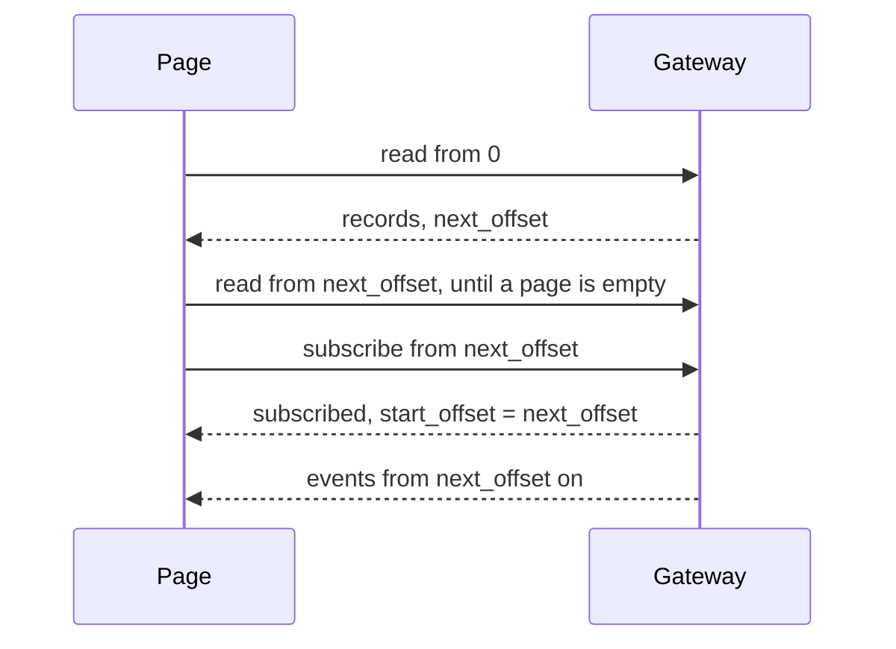

# Dashboard

The KBL (Kanban By Log) dashboard in the browser. It reads `work.events` through
[felix-gateway](https://github.com/GetFelix/felix-gateway), folds it with the `core` crate compiled to
WebAssembly, and lists every item grouped by stage, with a detail panel, search and a command palette. The
Blocked view (sidebar, palette or `?view=blocked`) lists only the items a link holds back, each with what it waits on
and, when that blocker is in a different repo or source, where it lives
([links across repos](../docs/work-tracker.md#links-across-repos-and-sources)). The page
is plain TypeScript built with Vite. The fold already holds the state, so there is no UI framework; a small store
in `src/state.ts` holds only what the view adds (selection, search, open dialogs).

Two open items whose `files` context entries share a path each get a flag on their row and a "Same files"
note in the panel, with the suggested link ([Files that overlap](../docs/work-tracker.md#files-that-overlap)).

A person signed in to the tracker can accept, reject, set the tier of, close and answer items, one at a
time from the panel or in bulk from the marked items ([Writes](#writes)). The design, the conventions it
follows and the plan for later views are in [docs/design/dashboard-ux.md](../docs/design/dashboard-ux.md).

## Run it

You need Node 22.18 or later, Rust with the `wasm32-unknown-unknown` target, and a `wasm-bindgen` CLI at the
version in `Cargo.lock` (`npm run wasm` says which if it differs).

```bash
rustup target add wasm32-unknown-unknown
cargo install wasm-bindgen-cli --version <version in Cargo.lock> --locked
cd dashboard
npm ci
npm run dev     # builds the WebAssembly, then starts Vite
npm test        # the fold against the golden logs, and the read-then-follow join
npm run build   # typecheck and production build into dist/
npm run check   # after build: keyboard flows and axe-core in headless Chrome (set CHROME if it is not found)
```

`npm run check` drives `dist/` against a fake gateway (`check/fixture.mjs`) and fails on a broken flow or a
serious or critical axe-core violation. `node check/browser.mjs <dir>` also writes screenshots to `<dir>`.

The gateway needs a scope that gives the page `subscribe` on `work.events`. `read` is a gateway feature the page
asks for in `join`, not a scope action: a `read` of a stream needs `subscribe` on it, so one grant covers both.

```toml
[scope]
field = "room"

[[scope.streams]]
alias = "events"
name = "work.events"
actions = ["subscribe"]
```

Open the page with the gateway, the scope's value and an ID token in the query string:

```
http://localhost:5173/?gateway=ws://127.0.0.1:8787/ws&room=kbl&token=<ID token>
```

`stream=<alias>` names a different alias than `events`.

The token is read once and then removed from the address with `history.replaceState`. It stays in memory only,
so reloading the page needs the link again. The first GET still carries it in the URL, so it reaches the dev
server's access log. Two cautions: use `wss://` for any gateway but your own machine,
since `ws://` sends the token in the clear; and treat a `?gateway=` link from someone else as untrusted, because
the page sends the token to whatever address it names.

An expired or rejected token (`signed_out`, `forbidden`) or an error a retry cannot fix (`trimmed`, `bad_request`,
`past_end`) stops the page with a message, and for a token it adds that a new sign-in link fixes it. A record of
a newer format than the page's fold reads stops it too: the page asks for a reload instead of skipping it ([docs/upgrades.md](../docs/upgrades.md)). `subscription_ended` (a broker failover) subscribes again at once from
the cursor. Any other failure reconnects from the cursor, which is past records the fold refused, with a growing
delay up to 30 s.

## Writes

Writes go to the tracker's person routes ([the dashboard's actions](../docs/work-tracker.md#running-the-tracker)) with your own
person token, so the page can do exactly what that token can and nothing more. Sign in (in the sidebar, the panel, the bulk
bar or the palette) asks for the token, checks it with `GET /v1/me`, and keeps it in memory for this tab only:
not in the address or local storage, so a reload asks again. The sidebar names who you are signed in as, and
Sign out there forgets the token.

The page calls only `/v1/...` at its own origin, never a tracker address from the link, so serve `dist/` behind
the same host as the tracker. In development, `KBL_TRACKER_URL=http://127.0.0.1:8080 npm run dev` forwards `/v1`
to the tracker. A person token in several teams needs `&team=<team>` in the address, which picks the
`/v1/teams/<team>/` routes.

| Action | Where | Route | Undo |
| --- | --- | --- | --- |
| Accept | Triage, Proposed | `POST /v1/work/proposals/accept` | No: nothing takes an acceptance back. Asks to confirm |
| Reject | Proposed | `POST /v1/work/proposals/reject` | No. Asks to confirm |
| Set tier | Open work | `POST /v1/work/tier` | Yes, once the change is on the log and while the tier is still the one set: a new `tier_changed` back. A first tier on an item that had none cannot be undone, and the activity line says so |
| Close | Open work | `POST /v1/work/close` (`dismissed` or `completed`) | No: open children are cancelled. Asks to confirm |
| Flag for a person | Accepted, open work not already flagged | `POST /v1/work/flag` | Yes, by Unflag: nothing asks first. The item moves to Needs you with the reason "A person moved it here" and agents are not handed it |
| Unflag | Flagged work | `POST /v1/work/unflag` | Yes, by Flag. It clears only the flag: an item that also waits on a question or a failed check stays in Needs you for that |
| Answer | An open question | `POST /v1/work/questions/answer` | No: the answer starts the resumed work. Pick an option or write an answer, not both |

Claiming is not offered: it is an agent's, and the fold refuses `claimed` from a person.

Each write shows as pending on the item and in the activity line above the work, then as written or refused. A request the tracker does not answer within 30 s is given up as failed ("it may or may not have been written"), and the rest of a bulk action still goes.
A refusal shows the tracker's reason and its code (`closed`, `not_open_question`, ...). The list itself changes
only when the record arrives on the log. `X` marks the focused item (each list row also has a checkbox for the mouse), and the
bulk bar acts on the marked items the view shows, one call per item, then clears the marks; `Esc` clears them
too. An accept starts from the item's tier, or the tier triage proposed, and sends the tier the confirm shows (none
if it showed none); a bulk accept keeps each item's own tier unless you pick one. A confirm checks each item again when you send
it, so an item someone else changed meanwhile is refused unsent, with the reason. The Needs you view
(`?view=inbox`) lists what waits on a person and why. Flag and Unflag sit in the panel's actions and the bulk bar,
and as palette commands (`Flag the selected items for a person`, `Unflag the selected items`) for the marked
items, else the selected one. They have no confirm and no key, because each takes the other back. A refusal such as
`no_change` (it was already so) shows in the activity line with the tracker's words. Undo (`Ctrl+Z`) still
covers tier changes only.

## How it follows the log



A publish that lands after the last read page is already in the log when the subscribe registers, so the
subscribe delivers it as history. Nothing is missed, and nothing is read twice, because the subscribe starts
exactly where the read stopped. The page also drops any offset it has already folded, and subscribes again from
its cursor if an event arrives after a gap that `skipped_before` does not explain. The gateway has no
unsubscribe: a second `subscribe` on the stream replaces the first, and the page ignores whatever arrives
before the new `subscribed`, since that belongs to the replaced one. Records the fold does not read are counted
in the status line.

## Keys

| Key | Does |
| --- | --- |
| `Ctrl+K` (`Cmd+K` on a Mac) | Command palette: every command, plus items by id or title |
| `?` | Keyboard shortcuts |
| `/` | Search |
| `J` / `K`, `↓` / `↑` | Next and previous item (on the board, within the column) |
| `H` / `L`, `←` / `→` | Previous and next column on the board |
| `V` | Switch list and board |
| `F` | Go to the filters |
| `Home` / `End` | First and last item; on the board, of the current column |
| `Enter` | Open the selected item in the panel |
| `Esc` | Close the panel or dialog, clear the search, or clear the selection |
| `X` | Select or unselect the focused item for a bulk action |
| `Ctrl+Z` (`Cmd+Z` on a Mac) | Undo the last tier change (in a text field, the field's own undo) |

Single-letter keys do nothing while you type in a field. `src/keys.ts` is the one list: the key handler, the
palette and the `?` overlay all read it. Theme and density are in the palette
only. Clear filters and Save view are buttons above the work as well as palette commands, and the palette also
has one entry per filter value and per saved view.

## Views

- **Board.** One column per stage, in the list's order. Each column is one `Tab` stop; the arrows or `H` `J` `K`
  `L` move inside the board. Below 720 px the columns stack. When a record moves the focused card to another
  column the focus goes with it; when one takes it out of the view, the next card in its column (else the nearest
  card, else the work list) takes the focus. Either is announced. The list does the same with its rows.
- **Filters.** Source, tier and repo, each offering only values the log recorded. A value's count is what picking
  it would show under the other filters. A facet no item recorded is not shown. The bar says how many items the
  search and filters leave, with Clear filters. A select is updated in place and left alone while it has focus.
- **The address.** `view=blocked`, `view=inbox`, `layout=board`, `q=`, `source=`, `tier=`, `repo=` and `item=` are in the
  address, so a link opens the same view. An older `view=board` link still opens the board and is rewritten to
  `layout=board`.
- **Saved views.** Save view names the current view, layout, search and filters and puts it in the sidebar; Edit
  renames or deletes it, and a name another view has is refused. After a rename the focus is back on that view's
  Edit; after a delete, on the next saved view or Save view. Saved views and the density are kept in this
  browser's local storage, per viewer, and the page works without them when storage is blocked. Each change
  re-reads storage first and the page follows changes from other tabs, so two tabs do not drop each other's views.
- **Phones.** Below 720 px the sidebar is a drawer behind the Menu button. While it is open the page behind it
  is inert under a backdrop and `Tab` stays inside it; `Esc`, the backdrop or a choice closes it.

## Files

- `src/follow.ts`: the read-then-subscribe join, written against a small `Transport` so tests can fake the gateway.
- `src/gateway.ts`: the WebSocket transport and the `join` handshake.
- `src/fold.ts`: the shape of the WebAssembly fold, and how a blocked row names its blockers.
- `src/main.ts`: starts the page, runs the gateway loop and dispatches keys.
- `src/state.ts`: the view state, its reducer and the address round-trip (`?view=`, `?layout=`, `?item=`, `?q=`, filters).
- `src/writes.ts`: what each item allows, the request for each write, how the tracker's answer reads, undo,
  and the write list. `src/tracker.ts`: the REST client. Both pure, tested in `test/writes.test.ts`.
- `src/views.ts`: filters, the view in the address, and saved views.
- `src/keys.ts`, `src/palette.ts`, `src/list.ts`: the shortcut registry, palette ranking and stage grouping.
  All pure, tested in `test/`.
- `src/ui/`: the views (shell, filter bar, list, board, panel, palette, shortcuts, saved-view dialog, status line), `tokens.css` for colour, space and
  type, and `app.css`.
- `check/`: the headless Chrome check and its fixture log.
- `../wasm`: the Rust crate that wraps `core`'s fold for the page.
- `../wasm/golden`: logs and the state the native fold gives for each. The wasm fold must match them in
  `test/fold.test.ts`, and the native one in `wasm/tests/golden.rs`.
