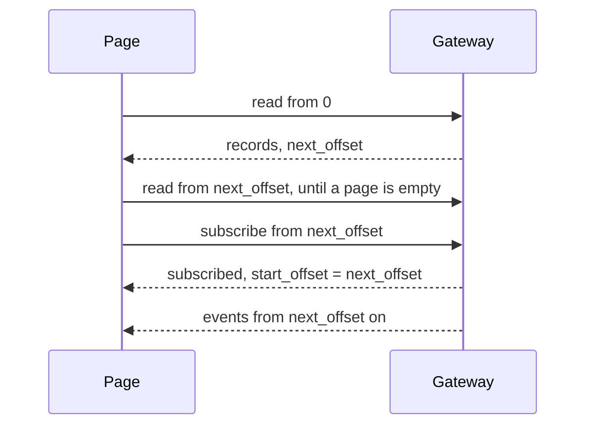

# Dashboard

The Kibble dashboard in the browser. It reads `work.events` through
[felix-gateway](https://github.com/GetFelix/felix-gateway), folds it with the `core` crate compiled to
WebAssembly, and lists every item with its stage. The page is plain TypeScript built with Vite. The fold already
holds the state, so there is no UI framework and no second state layer.

This is the data path only. The page is a list; the real views come from the UX work in
[#132](https://github.com/GetFelix/felix-agents/issues/132). It cannot write: a person's actions will go to the
tracker's REST routes.

## Run it

You need Node 22.18 or later, Rust with the `wasm32-unknown-unknown` target, and a `wasm-bindgen` CLI at the
version in `Cargo.lock` (`npm run wasm` says which if it differs).

```bash
rustup target add wasm32-unknown-unknown
cargo install wasm-bindgen-cli --version <version in Cargo.lock> --locked
cd dashboard
npm ci
npm run dev     # builds the WebAssembly, then starts Vite
npm test        # the fold against the golden logs, and the read-then-follow join
npm run build   # typecheck and production build into dist/
```

The gateway needs a scope that gives the page `subscribe` on `work.events`, and the page asks for the gateway's
`read` feature:

```toml
[scope]
field = "room"

[[scope.streams]]
alias = "events"
name = "work.events"
actions = ["subscribe"]
```

Open the page with the gateway, the scope's value and an ID token in the query string:

```
http://localhost:5173/?gateway=ws://127.0.0.1:8787/ws&room=kibble&token=<ID token>
```

`stream=<alias>` names a different alias than `events`.

## How it follows the log



A publish that lands after the last read page is already in the log when the subscribe registers, so the
subscribe delivers it as history. Nothing is missed, and nothing is read twice, because the subscribe starts
exactly where the read stopped. The page also drops any offset it has already folded, and subscribes again from
its cursor if an event arrives after a gap that `skipped_before` does not explain.

## Files

- `src/follow.ts`: the read-then-subscribe join, written against a small `Transport` so tests can fake the gateway.
- `src/gateway.ts`: the WebSocket transport and the `join` handshake.
- `src/fold.ts`: the shape of the WebAssembly fold.
- `../wasm`: the Rust crate that wraps `core`'s fold for the page.
- `../wasm/golden`: logs and the state the native fold gives for each. The wasm fold must match them in
  `test/fold.test.ts`, and the native one in `wasm/tests/golden.rs`.
