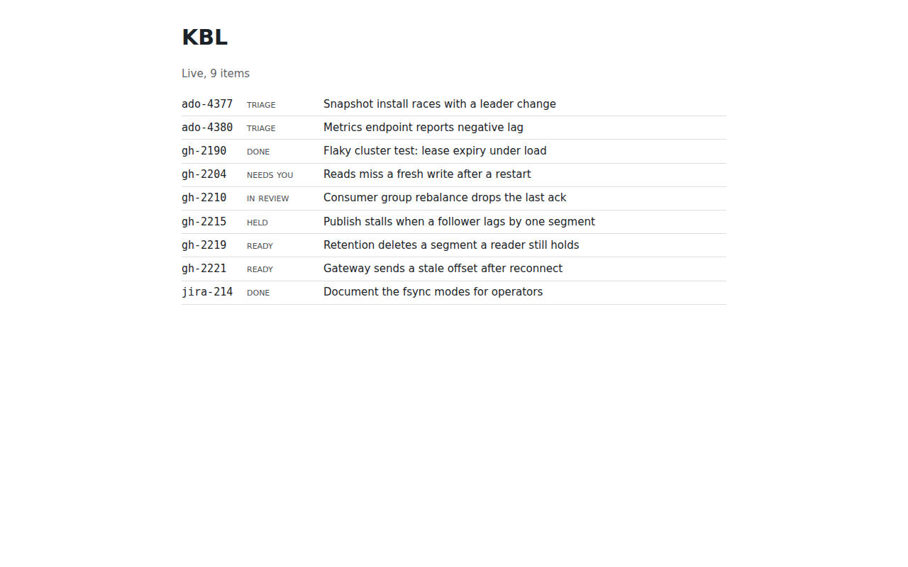
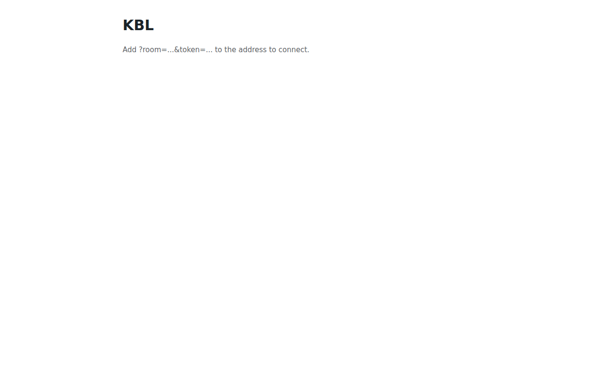
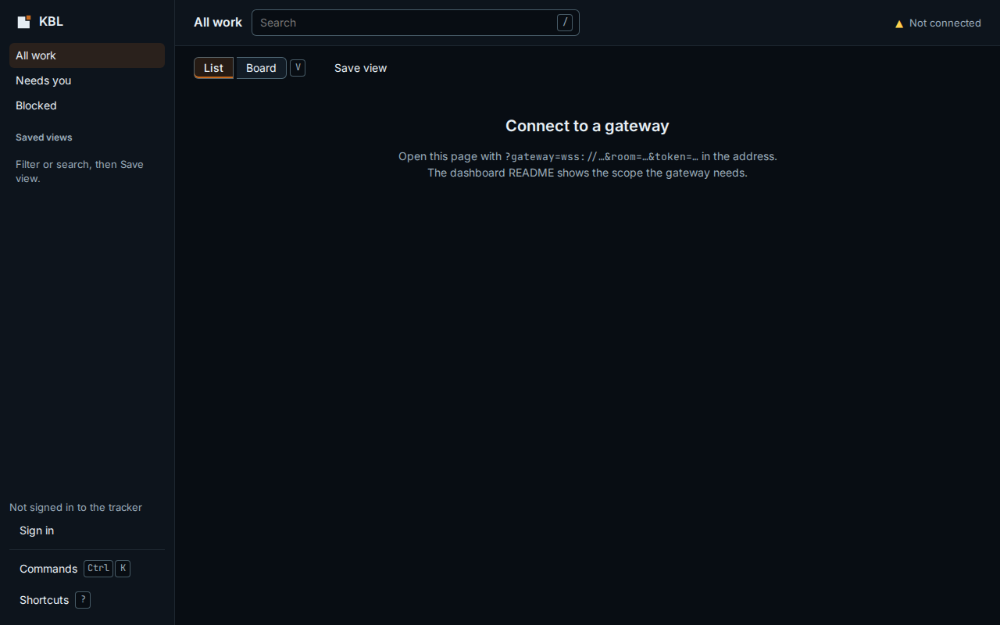

# Dashboard UX

The dashboard in `dashboard/` is the page a person keeps open to see where the work is. Its bar is set in
[work-tracker.md](../work-tracker.md#the-dashboard) and the style frame `prototype/intake-frame.html`: it should
feel like Linear, Jira or GitHub Projects, so nobody has to learn a new model. This page records what was wrong
with the first page, the conventions the dashboard follows now, the checklists it is held to, and the plan for
the rest (issue [#132](https://github.com/GetFelix/KBL/issues/132)).

| Before | After |
| --- | --- |
|  |  |
|  |  |

Phase 2: [board](img/board-dark-comfortable.png), [board, compact, light](img/board-light-compact.png),
[filters](img/filters-dark.png), [saved view](img/saved-view-dark.png), [save dialog](img/save-view-dark.png),
[board with the panel](img/board-panel-dark.png), [phone menu](img/phone-menu-dark.png),
[Blocked](img/blocked-dark.png), [Blocked on the board, filtered](img/blocked-board-dark.png), [Waits on in the panel](img/blocked-panel-dark.png).

Phase 3: [Needs you](img/inbox-dark.png), [sign in](img/sign-in-dark.png), [answer](img/answer-dark.png),
[write pending](img/pending-dark.png), [refused](img/refused-dark.png), [undo](img/undo-dark.png),
[bulk bar](img/bulk-dark.png), [confirm](img/confirm-dark.png), [signed out by the tracker](img/signed-out-dark.png).

More shots: [palette](img/palette-dark.png), [shortcuts](img/shortcuts-light.png), [panel](img/panel-dark.png),
[overlap](img/overlap-dark.png), [loading](img/loading-dark.png), [no match](img/empty-search-dark.png), [stopped](img/error-dark.png), [cannot reach the gateway](img/unreachable-dark.png),
[phone](img/phone-dark.png), [light list](img/list-light.png). `node dashboard/check/browser.mjs <dir>`
regenerates the "after" set.

## What was wrong, worst first

1. **No structure.** One flat list in id order, no stage groups or counts, nothing to select, no detail.
2. **No keyboard model.** No `Cmd+K`, `?`, `/` or `J`/`K`; nothing on the page said what it could do.
3. **States were one grey line.** Setup, loading, empty and a fatal error looked the same and gave no next step.
4. **No tokens or brand.** System font, hard-coded colours, no KBL mark or amber, no theme control, no focus
   styles.
5. **Accessibility gaps.** No landmarks or skip link, the status line was not announced, and stage was shown
   by small caps text only.

Worse than all of these, the built page never got past "Reading history". Rollup decided the transport's
`onMessage` was the empty default it was declared with and dropped the call, so no record reached the fold.
`npm run dev` was fine, which is why nobody saw it. `test/gateway.test.ts` now bundles `gateway.ts` the way the
page does and checks a message gets through, and CI runs the page itself in Chrome (`npm run check`).

## Conventions

- **Keys.** `src/keys.ts` is the one shortcut map. The key handler, the palette and the `?` overlay all read it,
  so a key cannot appear in one and act differently in another. Keys copy Linear and GitHub: `Mod+K` palette,
  `?` shortcuts, `/` search, `J`/`K` and arrows to move, `Home`/`End`, `Enter` to open, `Esc` to close or
  clear. Single letters are ignored while typing. Commands with no key (theme) live in the palette.
- **Palette.** Every command and every item, ranked by a match at a word start (the earliest first), then
  anywhere in a word, then the query's letters in order (`src/palette.ts`). Each command shows its key, so the palette teaches the shortcuts.
- **List.** Items grouped by stage in board order (Needs you first, Done last) with counts. The stage comes from
  `core`'s fold; the page only orders and labels it. The focused row is the selected row; `Enter` opens it in
  the side panel and in the address (`?item=`), so a link opens the same view. Opening moves focus into the
  panel and `Esc` puts it back on the row. Rows are kept per item and only redrawn when the list changes, so a
  live record never takes the focus off the row you are on.
- **Views.** The sidebar lists All work and Blocked, and the palette has a command for each. The view is in the
  address (`?view=blocked`). A sidebar link opens its view plain (no filters or search, as a list); the palette's
  Show commands change only the view, so Blocked composes with filters, search, the board and saved views. The
  sidebar counts every item in each view. Blocked lists only the items a link or prerequisite holds back; on those
  rows and board cards, in either view, the list says what each waits on, with the blocker's repo (or its source
  when it has no repo) only when that differs from the row's, and `release` when the blocker is merged and the
  link waits for its release. The panel lists the same blockers with their titles, each a link that opens it.
- **Board.** Columns are the list's stage groups in the same order, so switching with `V` never reorders
  anything, and the selection and focus stay on the same item. Keyboard pattern: one `Tab` stop per column
  (roving `tabindex` on the selected card, else the column's first), `J`/`K` and up/down inside a column, `H`/`L`
  and left/right across, keeping the row or landing on a shorter column's last card. We picked this over an ARIA
  grid because cards are plain links in a headed list, which every screen reader reads without a mode switch,
  and `Tab` still walks the board column by column. Movement is `moveBoard` in `src/list.ts`.
- **Filters.** Source, tier and repo come from what the log recorded: `tier` from triage or acceptance, `repo`
  from an `owner/repo#n` upstream id (or a target), `source` from the target or the import. A child item shows
  its root's. Values with no items are never offered, and a facet nobody recorded is hidden. Each filter is a
  native `<select>`, which owns its own keys; `Esc` and `Mod` chords still work there. The bar says
  "Showing N of M" with the active filters in words, and no match inside filters offers Clear filters.
- **Saved views.** View, layout, search and filters are the address (`view`, `layout`, `q`, `source`, `tier`,
  `repo`), so a view is a link. The board was once `?view=board`; such a link or saved view still opens the board,
  and the page rewrites it to `?layout=board` when it reads it. Save view stores it by name in local storage, per viewer, and puts it in the sidebar, where the
  current one is `aria-current` and names the page. Edit renames or deletes; a name already in use is refused
  next to the field rather than overwriting a view. Storage is read in `try`/`catch`: blocked or broken storage
  leaves an empty sidebar, never a broken page.
- **Density.** Comfortable or compact, from the palette, remembered per viewer. Only tokens change
  (`--row-height`, card padding and gap, column width); compact rows stay above the 24 px target size.
- **Panel.** One labelled field per entry in `FIELDS` in `src/ui/item-panel.ts` (stage, the recorded facets,
  Waits on, Same files); a new detail is one module under `src/ui/`. "Same files" lists the open items that declare the same paths, with the suggested link, and their
  rows and board cards carry a text flag ("2 file overlaps") rather than colour alone. The notes come from `core` (`src/overlap.ts` only shapes them).
- **States.** Each has a heading, one sentence and the next step: setup (how to connect), loading (placeholder
  rows, `aria-busy`), cannot reach the gateway (nothing read yet, when the next try is), empty, no match
  (Clear search), nothing blocked, no such item, and stopped (the reason; a new sign-in link for a rejected or expired token,
  Reload for a log newer than the page).
- **Writes.** Every write is a tracker person route, sent with the viewer's own person token
  (`src/tracker.ts`), so the page can never do more than that person could with `curl`. The token is
  typed into Sign in, checked with `GET /v1/me`, and kept in memory for the tab only. The sidebar names the
  person signed in, and Sign out there drops the token. The page calls only
  its own origin's `/v1/...`, so no link can point the token somewhere else, and the tracker needs no
  CORS; serve the page behind the same host as the tracker (`npm run dev` proxies `/v1`). The panel
  offers only what the fold would take for that item (`CAN` in `src/writes.ts`): Accept in
  Triage and Proposed, Reject in Proposed only, a tier and Close on open work, and an answer form on an open question. Claim is not
  offered: claiming is an agent's, and the fold refuses `claimed` from a person.
- **Write states.** A write is pending, written, refused or failed (no answer, or not sent). While pending, the item's
  buttons are `aria-disabled` (not `disabled`, which would drop the focus) and say what is in flight. The
  activity line above the work is a status region that says what the last write did and, for a refusal, the
  tracker's own reason and code. It stays until the next write or Dismiss, never on a timer. The record
  then arrives live like any other, so the list shows what the log holds, not what the page hoped for. A
  token the tracker stops taking signs the page out with its reason.
- **Undo.** Only a tier change can be undone (`Mod+Z` or Undo): the undo is a new `tier_changed` record
  setting the old tier back, never a delete, and it is offered only while the item still has the tier the
  write set, and only once that change is back on the log, so it does not undo someone else's later change.
  A first tier on an item that had none has no Undo, and the activity line says so; a bulk Undo says how many
  changes it takes back. The rest cannot be, and the confirm step says
  why: no record takes back an acceptance, a rejected proposal stays rejected, a close cancels the item's
  open children (a reopened root goes back to Triage with them still cancelled), and an answer starts the
  work that resumes from it.
- **Multi-select.** `X` marks the focused item, as in Linear and GitHub; each list row also has a checkbox for the mouse, kept out of the Tab order so Tab still moves row to row,
  beside its link, and board cards say Selected in text. The bulk bar counts the marks and offers only what
  some of them allow, with the count it applies to ("Accept 2…"). It acts only on marks the view shows,
  so a search never hides what it changes. A bulk accept keeps each item's own tier unless one is picked.
  A bulk action is one call per item, in order, the activity line reports each refusal, and the marks
  clear once it is sent, as in GitHub. `Esc` clears the marks once nothing else is open.
- **Needs you.** A sidebar view (`?view=inbox`) of the items waiting on a person, each saying why from the
  fold's `needs` ("An agent asked a question", "A check failed"). The panel shows the same as a field, and an
  open question's text, options and default come from the question record.
- **Tokens.** `src/ui/tokens.css` holds every colour, space, type size and radius, for dark and light.
  Accent is KBL amber `#C86A1E` per [brand/story.md](../brand/story.md), with Inter and JetBrains Mono. Views
  use tokens only.
- **Motion.** None needed to understand anything; `prefers-reduced-motion` turns transitions off.

## Nielsen's heuristics

| Heuristic | Status |
| --- | --- |
| Visibility of system status | Met: live status line (Reading history, Live, Disconnected and retrying in N s, Stopped), counts per stage, skeleton rows while loading. |
| Match with the real world | Met: stage names from the tracker, upstream ids as written upstream. |
| User control and freedom | Met: `Esc` closes or clears everywhere, the address restores views, Clear filters and All work reset the view, a tier change has Undo, and every write the log cannot take back has a confirm step with Cancel. |
| Consistency and standards | Met: Linear/GitHub keys, native `<dialog>`, one shortcut map. |
| Error prevention | Met: actions the fold would refuse are not offered, accept, reject and close ask to confirm and say they cannot be undone, an answer is checked before it is sent, an undo is refused if the tier changed since, and a taken view name is refused. |
| Recognition rather than recall | Met: palette lists every command with its key; `?` lists all keys. |
| Flexibility and efficiency | Met: keys for every action, palette search by id or title, filters by value from the palette, saved views, `X` and bulk actions. |
| Aesthetic and minimalist design | Met: one list, one panel, no chrome beyond the nav. |
| Help users recover from errors | Met: stopped state names the cause, and the next step where the cause backs one (a new sign-in link, or Reload); no-match offers Clear; a refused write shows the tracker's reason and code, and a rejected token offers Sign in. |
| Help and documentation | Met: `?` overlay, README Keys table. |

## WCAG 2.2 AA

`npm run check` runs axe-core (WCAG 2.0 to 2.2 A/AA rules and best practice) on the list, palette, shortcuts,
no-match, setup, stopped and phone views, in both themes, and on the board in both themes and both densities,
the filtered list, the save dialog and the phone menu, and on every write state: the Needs you view, signed
out, the sign-in error, the answer form, a write pending, a refusal, a tier set, the bulk bar and the confirm
dialog, and on the story panel. It fails CI on a serious or critical violation.

Four more checks run in CI beside axe:

- **Contrast tokens** (`dashboard/test/contrast.test.ts`, part of `npm test`) computes the contrast of every text
  colour on every surface and of the focus ring and control edges, from `tokens.css`, in both themes. Text must reach
  4.5:1 and edges and the ring 3:1. It is exact where axe samples rendered pixels, and a translucent edge is
  composited over its surface first.
- **Landmarks and live regions** (browser check): one `main`, one `h1`, every `nav` named, and the connection status
  and announcer present as polite live regions.
- **Keyboard** (browser check): Tab walks the page, and every stop must be on screen and draw a focus indicator.
- **Performance budget**, below.

### Performance budget

A fixture log of 10,000 items (about 38,500 records, `bigLog` in `dashboard/check/fixture.mjs`) is folded two ways. The
numbers live in `dashboard/check/budget.mjs`, and CI fails when one is over.

| Measure | Where | Budget |
| --- | --- | --- |
| Fold of 10,000 items plus reading them back, wasm in node | `npm test` (`test/budget.test.ts`) | 500 ms (measured 140 ms) |
| Time spent in `fold.apply` while the page loads the log | `npm run check` | 1000 ms (measured 220 ms on a CI runner) |
| First useful paint: the first list row on screen | `npm run check` | 5000 ms |
| Live with the whole log | `npm run check` | 15000 ms |

Budgets are a measured baseline plus margin for a shared CI runner. The browser check prints its numbers on a
`perf:` line, so a budget can be tightened from a run. Raising one needs a reason in the change that does it.

| Criterion | Status |
| --- | --- |
| 1.1.1 Non-text content | Met: the mark is decorative (`aria-hidden`), every control has a name. |
| 1.3.1 Info and relationships | Met: nav/main/aside landmarks, headed stage groups, listbox roles in the palette. |
| 1.4.1 Use of colour | Met: stage is a heading, never colour alone. |
| 1.4.3 / 1.4.11 Contrast | Met: axe passes both themes, and the token test holds text to 4.5:1 and the focus ring and control edges to 3:1. |
| 1.4.10 Reflow | Met: one column at 390 px with no horizontal scroll; board columns stack. On wide screens the board scrolls sideways inside its own area, as two-dimensional content may. |
| 1.4.12 Text spacing | Met: no fixed-height text boxes. |
| 2.1.1 Keyboard, 2.1.2 No trap | Met: everything by keyboard; dialogs close on `Esc` and give focus back. |
| 2.1.4 Character key shortcuts | Met: single-letter keys only act when focus is not in a field. Remapping is deferred to settings (phase 4). |
| 2.4.1 Bypass blocks | Met: skip link is the first Tab stop. |
| 2.4.3 Focus order | Met: focus stays on its row or card when records arrive, follows a card a record moves to another column, and when a record or filter takes the focused item away, moves to its neighbour (same column first on the board) or to the work list, never the body; each is announced. `V` keeps it on the selected item. Opening an item moves focus into the panel and `Esc` returns it to the row. Dialogs return focus to where it was; after a saved-view rename it is on that view's Edit, after a delete on the next view or Save view. The open phone drawer keeps focus inside it. The browser check covers each. |
| 2.4.7 Focus visible | Met: visible amber focus ring on every control. |
| 2.4.11 Focus not obscured | Met: the panel sits beside the list, never over the focused row. Below 720 px it sits under the list, and opening an item scrolls it into view. |
| 2.5.8 Target size | Met: controls at least 24 px (`--target-min`). |
| 3.2.6 Consistent help | Met: Shortcuts and Commands sit in the sidebar on every view; below 720 px the sidebar opens from the Menu button, in the same place on every view. |
| 3.3.1 Error identification | Met: a missing token, a token the tracker refuses, an empty answer and a missing or taken view name are each named in text next to the field, which is `aria-invalid` and gets the focus. A refused write is named with the tracker's reason. |
| 3.3.2 Labels or instructions | Met: every field has a visible label; the token field says where the token comes from and where it is sent, the answer form says it cannot be undone. |
| 3.3.3 Error suggestion | Met: each message says what to do ("Pick an option, or write an answer", "Keep the answer under 4 KiB", "open the page with ?team= naming one"). |
| 3.3.4 Error prevention | Met: accept, reject and close open a confirm dialog that lists the items, says what the write does and that it cannot be undone, opening on its first field, or on Cancel when it has none, so a stray Enter cannot send it; a tier change on an item that had a tier can be undone, and Undo names how many changes it takes back. Setting a first tier is not confirmed, since it is not a loss, and the activity line says it has no Undo because no record removes a tier. A confirm checks each item again when it is sent, so one someone else changed meanwhile is refused unsent with the reason. |
| 3.3.7 Redundant entry | Met: the panel and a confirm start from the item's recorded tier, or the tier triage proposed, and show no tier when neither is recorded. An accept left at that tier sends none, so the fold keeps it. The token is asked once per tab. |
| 3.3.8 Accessible authentication | Met: the token field allows paste and password managers; no puzzle or transcription. |
| 4.1.2 Name, role, value | Met: combobox with `aria-activedescendant`, `aria-current` on nav. |
| 4.1.3 Status messages | Met: status line is a polite live region; stopped is `role=alert`. |

## Code organization

- `src/main.ts` is the only place that talks to the gateway; it dispatches to the store in `src/state.ts`.
- Pure logic (`keys.ts`, `palette.ts`, `list.ts`, `state.ts`, `views.ts`) has no DOM and is unit tested in `test/`.
- Views in `src/ui/` render from a state snapshot and send actions back. `dom.ts` builds elements and never
  parses HTML, since titles come from upstream issues.
- `check/browser.mjs` is the end-to-end check; `check/fixture.mjs` is the log it serves.

## Plan

Each phase is one PR.

1. **Shell and reading** (done): tokens, shell, stage-grouped list, panel, palette, `?`, states, the browser
   check in CI, and the bundling fix.
2. **Board and views** (done): board view with `V` to switch, filters by source, tier and repo, saved views in
   the address and sidebar, density setting, and the Menu button below 720 px.
3. **Writes** (done): accept, reject, tier, close and answer through the tracker's person routes with the
   viewer's token, multi-select with bulk actions, undo for tier changes, the Needs you inbox, and the
   3.3.x form criteria. Claim stays with agents, since the fold refuses it from a person.
4. **Spend and settings**: spend per root, tier, repo and model (done, [#219](https://github.com/GetFelix/KBL/issues/219): a
   dialog from the sidebar or the palette, read from the fold), settings with shortcut remapping.
