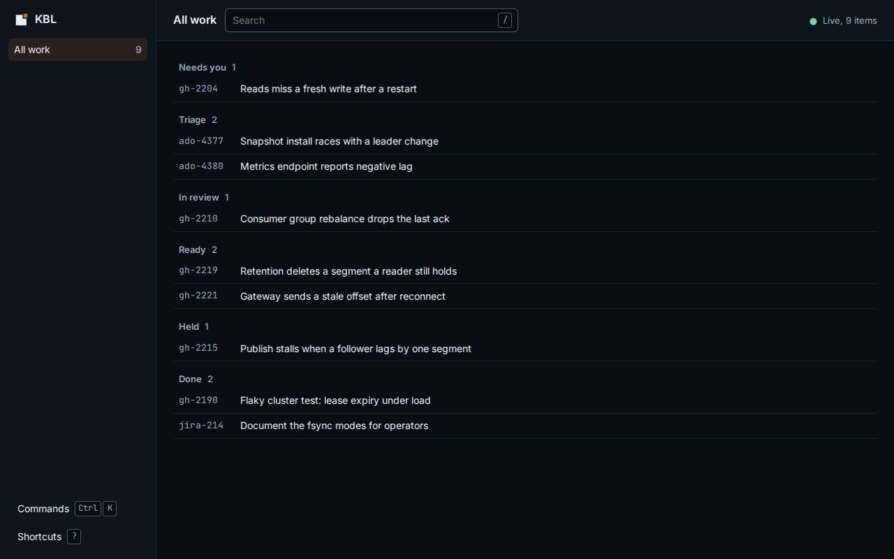

# Dashboard UX

The dashboard in `dashboard/` is the page a person keeps open to see where the work is. Its bar is set in
[work-tracker.md](../work-tracker.md#the-dashboard) and the style frame `prototype/intake-frame.html`: it should
feel like Linear, Jira or GitHub Projects, so nobody has to learn a new model. This page records what was wrong
with the first page, the conventions the dashboard follows now, the checklists it is held to, and the plan for
the rest (issue [#132](https://github.com/GetFelix/KBL/issues/132)).

| Before | After |
| --- | --- |
|  |  |
|  |  |

More shots: [palette](img/palette-dark.png), [shortcuts](img/shortcuts-light.png), [panel](img/panel-dark.png),
[loading](img/loading-dark.png), [no match](img/empty-search-dark.png), [stopped](img/error-dark.png), [cannot reach the gateway](img/unreachable-dark.png),
[phone](img/phone-dark.png), [light list](img/list-light.png). `node dashboard/check/browser.mjs <dir>`
regenerates the "after" set.

## What was wrong, worst first

1. **No structure.** One flat list in id order, no stage groups or counts, nothing to select, no detail.
2. **No keyboard model.** No `Cmd+K`, `?`, `/` or `J`/`K`; nothing on the page said what it could do.
3. **States were one grey line.** Setup, loading, empty and a fatal error looked the same and gave no next step.
4. **No tokens or brand.** System font, hard-coded colours, no KBL mark or amber, no theme control, no focus
   styles.
5. **Accessibility gaps.** No landmarks or skip link, the status line was not announced, and stage was shown
   by small caps text only.

Worse than all of these, the built page never got past "Reading history". Rollup decided the transport's
`onMessage` was the empty default it was declared with and dropped the call, so no record reached the fold.
`npm run dev` was fine, which is why nobody saw it. `test/gateway.test.ts` now bundles `gateway.ts` the way the
page does and checks a message gets through, and CI runs the page itself in Chrome (`npm run check`).

## Conventions

- **Keys.** `src/keys.ts` is the one shortcut map. The key handler, the palette and the `?` overlay all read it,
  so a key cannot appear in one and act differently in another. Keys copy Linear and GitHub: `Mod+K` palette,
  `?` shortcuts, `/` search, `J`/`K` and arrows to move, `Home`/`End`, `Enter` to open, `Esc` to close or
  clear. Single letters are ignored while typing. Commands with no key (theme) live in the palette.
- **Palette.** Every command and every item, ranked by a match at a word start (the earliest first), then
  anywhere in a word, then the query's letters in order (`src/palette.ts`). Each command shows its key, so the palette teaches the shortcuts.
- **List.** Items grouped by stage in board order (Needs you first, Done last) with counts. The stage comes from
  `core`'s fold; the page only orders and labels it. The focused row is the selected row; `Enter` opens it in
  the side panel and in the address (`?item=`), so a link opens the same view. Opening moves focus into the
  panel and `Esc` puts it back on the row. Rows are kept per item and only redrawn when the list changes, so a
  live record never takes the focus off the row you are on.
- **States.** Each has a heading, one sentence and the next step: setup (how to connect), loading (placeholder
  rows, `aria-busy`), cannot reach the gateway (nothing read yet, when the next try is), empty, no match
  (Clear search), no such item, and stopped (the reason; a new sign-in link for a rejected or expired token,
  Reload for a log newer than the page).
- **Tokens.** `src/ui/tokens.css` holds every colour, space, type size and radius, for dark and light.
  Accent is KBL amber `#C86A1E` per [brand/story.md](../brand/story.md), with Inter and JetBrains Mono. Views
  use tokens only.
- **Motion.** None needed to understand anything; `prefers-reduced-motion` turns transitions off.

## Nielsen's heuristics

| Heuristic | Status |
| --- | --- |
| Visibility of system status | Met: live status line (Reading history, Live, Disconnected and retrying in N s, Stopped), counts per stage, skeleton rows while loading. |
| Match with the real world | Met: stage names from the tracker, upstream ids as written upstream. |
| User control and freedom | Partly: `Esc` closes or clears everywhere, the address restores views. Undo waits for writes (phase 3). |
| Consistency and standards | Met: Linear/GitHub keys, native `<dialog>`, one shortcut map. |
| Error prevention | Not applicable until the page writes. |
| Recognition rather than recall | Met: palette lists every command with its key; `?` lists all keys. |
| Flexibility and efficiency | Met for reading: keys for every action, palette search by id or title. |
| Aesthetic and minimalist design | Met: one list, one panel, no chrome beyond the nav. |
| Help users recover from errors | Met: stopped state names the cause, and the next step where the cause backs one (a new sign-in link, or Reload); no-match offers Clear. |
| Help and documentation | Met: `?` overlay, README Keys table. |

## WCAG 2.2 AA

`npm run check` runs axe-core (WCAG 2.0 to 2.2 A/AA rules and best practice) on the list, palette, shortcuts,
no-match, setup, stopped and phone views, in both themes. It reports no violations of any impact, and fails CI
on serious or critical.

| Criterion | Status |
| --- | --- |
| 1.1.1 Non-text content | Met: the mark is decorative (`aria-hidden`), every control has a name. |
| 1.3.1 Info and relationships | Met: nav/main/aside landmarks, headed stage groups, listbox roles in the palette. |
| 1.4.1 Use of colour | Met: stage is a heading, never colour alone. |
| 1.4.3 / 1.4.11 Contrast | Met: axe passes both themes; focus ring and borders are at least 3:1. |
| 1.4.10 Reflow | Met: one column at 390 px with no horizontal scroll. |
| 1.4.12 Text spacing | Met: no fixed-height text boxes. |
| 2.1.1 Keyboard, 2.1.2 No trap | Met: everything by keyboard; dialogs close on `Esc` and give focus back. |
| 2.1.4 Character key shortcuts | Met: single-letter keys only act when focus is not in a field. Remapping is deferred to settings (phase 4). |
| 2.4.1 Bypass blocks | Met: skip link is the first Tab stop. |
| 2.4.3 Focus order | Met: focus stays on its row when records arrive; opening an item moves focus into the panel and `Esc` returns it to the row; dialogs return focus to where it was. The browser check covers each. |
| 2.4.7 Focus visible | Met: visible amber focus ring on every control. |
| 2.4.11 Focus not obscured | Met: the panel sits beside the list, never over the focused row. Below 720 px it sits under the list, and opening an item scrolls it into view. |
| 2.5.8 Target size | Met: controls at least 24 px (`--target-min`). |
| 3.2.6 Consistent help | Met on wide screens: Shortcuts and Commands sit in the sidebar on every view. Below 720 px the sidebar is hidden; a menu button is phase 2. |
| 3.3.x Input and errors | Deferred: the page has no forms until it writes (phase 3). |
| 4.1.2 Name, role, value | Met: combobox with `aria-activedescendant`, `aria-current` on nav. |
| 4.1.3 Status messages | Met: status line is a polite live region; stopped is `role=alert`. |

## Code organization

- `src/main.ts` is the only place that talks to the gateway; it dispatches to the store in `src/state.ts`.
- Pure logic (`keys.ts`, `palette.ts`, `list.ts`, `state.ts`) has no DOM and is unit tested in `test/`.
- Views in `src/ui/` render from a state snapshot and send actions back. `dom.ts` builds elements and never
  parses HTML, since titles come from upstream issues.
- `check/browser.mjs` is the end-to-end check; `check/fixture.mjs` is the log it serves.

## Plan

Each phase is one PR.

1. **Shell and reading** (this one): tokens, shell, stage-grouped list, panel, palette, `?`, states, the browser
   check in CI, and the bundling fix.
2. **Board and views**: board view with `V` to switch, filters by source, tier and repo, saved views in the
   address and sidebar, density setting.
3. **Writes**: claim, accept, close and answer through the tracker's REST routes, multi-select with bulk actions
   and undo, the inbox of Needs you items.
4. **Spend and settings**: spend per root, tier and repo ([#219](https://github.com/GetFelix/KBL/issues/219)),
   settings with shortcut remapping.
