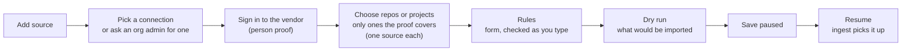

# Sources in the dashboard

Design for issue [#320](https://github.com/GetFelix/KBL/issues/320). Status: proposed, nothing here is built.

Today an operator wires each source (a GitHub repo, a Jira project, an Azure DevOps project) into
`ingest.json` by hand, with one credential, and restarts `kbl-ingest`
([Running the ingest worker](../work-tracker.md#running-the-ingest-worker)). This page designs a
**Sources** view in the dashboard where a team admin adds, verifies, scopes, pauses and removes a source
while everything keeps running.

**Terms**

- **Source:** exactly one upstream repo or project a team imports from: a GitHub repo, a Jira project, an
  Azure DevOps project or a GitLab project. It has an id like `github:GetFelix/felix`, the same string
  `source_added` records today, and exactly one owning team. This page never uses "source" for a group of
  repos; connecting 12 repos makes 12 sources.
- **Connection:** the credential ingest uses for one upstream account (a GitHub organization, a Jira site, an
  Azure DevOps organization, a GitLab group), with what that account's admin consented to. Several sources can
  share one connection.
- **Budget pool:** every connection, across all teams, that spends one upstream rate limit. For GitHub that is
  one App installation; for Jira one site and account; for Azure DevOps one organization and identity.
- **Worker group:** the ingest workers that serve a connection. Each holds leases on some of the connection's sources, so
  the group splits the work and survives losing a worker.
- **Person proof:** a short check, made with the person's own vendor sign-in, that they may connect a source.
  Its token is used for that check and dropped.

## What stays the same

These were decided in the issue and this design keeps them.

1. **One org-approved credential per connection.** Ingest reads and writes with the connection's credential,
   which the upstream admin scoped. What that credential can see is what the team shares.
2. **No per-person sync.** `work.events` is team-wide, and agents read it. Importing with one person's token
   would show everything that person can see to the whole team and its agents.
3. **A person's vendor sign-in only proves they may connect.** The tracker makes the check calls itself and
   drops the token. It is never stored, never logged and never reaches ingest or an agent.
4. **KBL sign-in uses the same identity provider where it can** (Entra, GitHub), so the person who proves
   access upstream and the person signed in to KBL can be compared
   ([#316](https://github.com/GetFelix/KBL/issues/316)).

Ingest keeps its own rules, cursor and write-back logic. What moves is where its sources, rules and
credential references come from: `org.events` instead of a file.

## The flow in the dashboard

The view lives at **Settings > Sources** for a team, like GitHub's "Integrations" settings or Linear's
"Integrations" page: a list, a detail panel, and one "Add source" button. Only team admins and org admins see
the write actions; viewers and the other roles see the list read only. A team admin role always covers the
whole team (the org fold refuses a scoped one), so every admin can edit every source of the team.

**The list.** One row per source: vendor icon, id, connection, status, rules, last poll, and the newest
problem in plain words. Status is one of **Active**, **Paused**, **Checking**, **Needs attention** (a failed
check, a stall, an expired credential) or **Removed** (kept for history, filtered out by default). Filters and
search work as on the board.

**Add.** A dialog with steps, like GitHub's "Install App" or Jira's "Connect app" flow:

1. **Connection.** Pick one of the team's connections. If there is none for that vendor, the dialog says what
   the upstream admin has to do (the per-vendor steps below) and offers a link that opens the vendor's own
   consent page. A team admin can create a connection for an App installation, a service principal or a
   managed identity that the operator already set up. Pasting a token is an org admin action (see
   [Secrets](#where-secrets-live)).
2. **Prove access.** "Sign in with GitHub" (or Microsoft, Atlassian, GitLab) opens the vendor's consent in a
   popup. The vendor sends the popup back to the dashboard, which hands the code to the tracker with the
   person's own KBL token. The tracker finishes the sign-in, runs the checks, and drops the token. The dialog
   shows what was proven, per repo and level ("You can write to 4 of the 12 repos this installation covers").
3. **Scope.** A picker lists only what the proof covers and the connection can read, with search and
   "select all on this page" for an org of hundreds. A repo another team owns is shown disabled with that
   team's name. Each picked repo or project becomes its own source; there is no "every repo" scope (see
   [Open questions](#open-questions)).
4. **Rules.** Pick one of the team's rule templates (see [Rules at scale](#rules-at-scale)) or write rules,
   prefilled from `kbl-tool source init`'s starter (#325). Per-source overrides come later, on the detail panel.
5. **Dry run.** Ingest runs `kbl-ingest check` against the draft, for the proven repos only, and the dialog lists what each rule would
   import, what waits over its cap, and any missing permission. Nothing is written upstream or to the log.
6. **Save.** The sources are saved **paused**, in one record per batch with their rules, so the admin sees
   the first result before any import. "Resume" starts them. GitHub's App install and Linear's integrations both land on a settings page before they act; this
   is the same.

**Verify.** "Check now" on the detail panel runs the same check (credential, permissions per rule, dry run) and
shows each finding with its level, as `check --json` reports it. The detail panel also shows the newest
`source_stalled` and when the credential was last rotated.

**Scope.** Each source records the level its proof showed: read or write. Adding a source, or turning on a
write-back for a source proven read only, needs a new proof by the person saving the change. Narrowing never
needs a proof, widening always does.

**Pause and resume.** Pause stops ingest from polling and writing back for that source before its next repo
read, even inside a poll.
Imported items stay as they are and agents keep working on them; their upstream changes are not seen until
resume. Resume picks up from the saved cursor, so nothing is missed, only late.

**Remove.** A confirm dialog that names the count of open items, like deleting a GitHub webhook or a Jira
integration. Removal stops sync and releases ownership, so another team may claim the source. Imported items
keep their history; open ones show a "Source removed" badge and stay until a person closes them. Ingest's saved
state for the source is deleted. Removal never touches the upstream credential: the dialog links to the
vendor page where the upstream admin uninstalls or revokes it.

## Per vendor

Each section says what the upstream admin consents to once, the least privilege ingest needs, and how the
person proof works. Anything not confirmed against vendor docs is listed under
[Open questions](#open-questions) instead of stated here.

### GitHub

**Connection: a GitHub App installation.** Ingest already mints installation tokens from an App's private key
(`app` in [Running the ingest worker](../work-tracker.md#running-the-ingest-worker)).

1. The operator registers one GitHub App for the KBL instance (or per org) and puts its private key in the
   secret store. The App asks only for: Issues (read, or read and write when a rule comments or opens
   prerequisites), Pull requests (read, or read and write for the draft-on-drop write), Contents (read, for
   release compares), Checks and Commit statuses (read), Metadata (read, always granted). Administration (read)
   is optional and only lets ingest read required checks on branch protection.
2. An org owner installs the App on **selected repositories**, never "all repositories" unless the team means
   it. GitHub shows the requested permissions on the install page; that page is the consent.
3. The team admin creates a connection naming the installation (`installation_org` or `installation_id`).

Ingest asks for every installation token with the `repositories` field set to the sources it holds leases on
([Create an installation access token](https://docs.github.com/en/rest/apps/apps#create-an-installation-access-token-for-an-app)),
so one installation shared by two teams still gives each team's worker a token that reaches only its own repos.
GitHub takes at most 500 repos in that field, so a worker holding more mints one token per chunk of at most
500 and uses the chunk's token for each repo in it. Tokens are cached until a few minutes before they expire,
so chunking costs one mint per chunk per hour.

**Person proof: a user access token from the same App.** The App's "Request user authorization (OAuth) during
installation" or its plain user authorization flow gives a user access token, which GitHub limits to what both
the App and the person may do
([About user access tokens](https://docs.github.com/en/apps/creating-github-apps/authenticating-with-a-github-app/authenticating-with-a-github-app-on-behalf-of-a-user)).
The tracker then:

1. Lists `GET /user/installations/{installation_id}/repositories`, 100 per page: the repos of the installation
   the person can reach, each with the person's `permissions`. A repo outside that list cannot be picked.
   500 repos cost 5 calls, not 500.
2. Takes each picked repo's level from that listing. Read needs `pull`. Write needs `push`: anyone can comment
   on or open issues in a public repo, but turning another person's pull request into a draft needs push, and
   KBL must not do more than the person could. So a person who can only read a public repo cannot make KBL
   write to it under the org's App. A repo listed without `permissions` gets one
   `GET /repos/{owner}/{repo}` as the person, only to read the same `permissions` field from the repo itself.
   If that answer has none either, the repo is shown as "access unknown" and cannot be picked.

The token is dropped once these calls finish. It is never refreshed, so the App's "expire user tokens" setting
does not matter here.

### Azure DevOps

**Connection: a Microsoft Entra service principal or managed identity.** New Azure DevOps OAuth app
registrations are no longer accepted, so Entra is the only OAuth path. Ingest's ADO adapter (#333) already
signs in with Entra client credentials.

1. An Entra admin registers an app (or uses a managed identity when ingest runs in Azure). A workload identity
   federation credential is preferred over a client secret, so there is no secret to rotate; a client secret
   or certificate works too.
2. An Azure DevOps organization admin adds that service principal to the organization (Organization settings >
   Users) and to each project's **Readers** group, or **Contributors** when a rule writes back. Nothing
   org-wide is granted.
3. The token is requested for the Azure DevOps resource
   (`499b84ac-1321-427f-aa17-267ca6975798/.default`), as #333 does.
4. The team admin creates a connection naming the organization, tenant, client id and the secret reference.

**Person proof: the person's Entra token.** The tracker signs the person in with Entra (authorization code with
PKCE) for the delegated Azure DevOps scope, then reads `GET https://dev.azure.com/{org}/_apis/projects/{project}`
as the person for each picked project. A 200 proves they can see it. A rule that writes back needs proof that
the person may edit work items in that project; which call answers that cleanly is an open question, and until
it is answered ADO sources connect read only. The proof uses its own Entra app registration, never the
connection's service principal. When KBL's own sign-in is Entra in the same
tenant, the proof's `oid` must equal the person's KBL subject.

### Jira Cloud

**Connection: a dedicated account, not a person's.** Three ways, best first:

1. **A service account with an API token.** A Jira admin creates an account used only by KBL, gives it Browse
   projects on the chosen projects (plus Add comments, Link issues and Transition issues when a rule writes
   back, the permissions `check` already reads), and issues an API token. This is today's `email` plus
   `token_file` sign-in. Atlassian's managed service accounts may give a better option; see open questions.
2. **OAuth 2.0 (3LO) consented by that dedicated account.** 3LO tokens act as the user who consented, so the
   consent must be given while signed in as the KBL account, never as a person. The refresh token then lives
   in the secret store and something beside ingest refreshes `oauth_token_file`, which ingest re-reads on each
   request.
3. **A Forge app.** Forge apps run inside Atlassian and act as the app. Ingest is a poller outside Atlassian,
   so using one needs a bridge we have not designed. Not in the first milestones.

**Person proof: Atlassian 3LO.** A separate KBL OAuth 2.0 (3LO) app with read scopes only (`read:jira-work`,
`read:jira-user`, `read:me`; the exact set `mypermissions` needs is to be confirmed). The tracker reads
[`GET https://api.atlassian.com/oauth/token/accessible-resources`](https://developer.atlassian.com/cloud/jira/platform/oauth-2-3lo-apps/)
to find the site's cloud id, then `GET /rest/api/3/mypermissions?projectKey=<KEY>&permissions=BROWSE_PROJECTS`
through `https://api.atlassian.com/ex/jira/<cloud id>` for each project (plus `ADD_COMMENTS`, `LINK_ISSUES`
and `TRANSITION_ISSUES` for write). The site in the proof must be the connection's site.

### GitLab

**Connection: a group or project access token.** GitLab has no adapter yet (#129); this section fixes its
credential model so the adapter is built to it.

1. A group Owner or project Maintainer creates a **project access token** (one project) or a **group access
   token** (every project in the group) with role **Reporter** and scope `read_api`. A rule that writes back
   needs scope `api`. GitLab makes each token a bot member with that role.
2. GitLab requires these tokens to expire. The connection stores the expiry and the Sources list shows
   "Needs attention" 14 days before it.
3. An org admin pastes the token (see [Secrets](#where-secrets-live)), or the operator puts it in the secret
   store and the connection names it.

**Person proof: GitLab OAuth.** A KBL OAuth application on the GitLab instance with scope `read_api`. The
tracker reads the person's own id from `GET /user`, then `GET /projects/:id/members/all/:user_id`, which
counts access inherited from groups (the `permissions` field of `GET /projects/:id` can miss it). Reporter or
higher proves read, Developer or higher write. Self-managed instances are a connection setting (`api`).

## Where secrets live

A connection holds a **secret reference**, never a secret. The secret stays where ingest reads it.

| Reference | Who puts it there | Where it lives | Who can read it |
|---|---|---|---|
| `file:<name>` | The operator | A file in ingest's secrets folder, mode 600 or 400, as `private_key_file` and `token_file` are today. Docker and Kubernetes secrets mount as such files | The ingest process |
| `sealed:<id>` | An org admin pasting it in the dashboard | Encrypted in the browser to every active key of the connection's worker group, stored in the team's `work.tracker` cache under `secret/<id>` | The ingest workers that hold one of those private keys |
| `none` | Nobody | A managed identity or workload identity federation needs no stored secret | |

- **Not on the log.** Records on `org.events` carry the reference and a version number. The cache entry is
  overwritten on rotation, so the old ciphertext does not linger the way a log record would.
- **Not in the UI.** The dashboard shows "set" and when it was rotated, never a value, a prefix or a hash.
- **Sealed in the browser.** The dashboard seals a pasted secret to the worker group's active keys before it
  leaves the page, so the tracker, its request logs and the cache only ever see ciphertext. The paste field is a
  plain input that the page clears after sealing. Pasting is still refused while the tracker is not behind TLS,
  since the person's KBL token rides on the same request. The format is multi-recipient: one content key
  wrapped once per recipient, as age does. Which library is an implementation call.
- **Whose keys.** Each connection names a worker group, not one worker, so a second worker gives it
  failover. Every worker makes a key pair at first start, keeps the private key in its secrets folder
  (mode 600) and prints the public key's id and fingerprint. An org admin registers each key
  (`ingest_key_added`, with the key id) after comparing the fingerprint with that worker's output. A group has
  several active keys at once. An ingest token cannot add a key and neither can a team admin, so neither can
  redirect a secret to a key they hold.
- **Keys are pinned on the workers.** The operator lists the fingerprints of the group's keys in each
  worker's `ingest.json` (`trusted_keys`). A worker re-seals only to keys that are both active on the org log
  and pinned in its own file, so a tracker that adds a key to its list cannot get a secret re-sealed to it.
  The paste dialog shows each recipient's fingerprint and the org admin confirms them before sealing, as at
  registration. Together these keep the tracker from ever seeing plaintext, even if it lies about the keys.
- **Adding a key re-seals.** A new key is useless until the group's secrets are sealed to it. A worker that
  already holds an active key of the group opens each sealed secret and seals it again to exactly the active
  keys the org log lists, under the same secret version, with a version-checked cache write. If an active key
  is not pinned on that worker, it does not re-seal and reports which key is missing. The tracker gives each
  secret's recipient list on the config route, so the dashboard shows "sealed to 2 of 3 keys" until the
  re-seal finishes. Nobody pastes again.
- **Retiring a key waits, then re-seals at once.** `ingest_key_retired` (org admin) is refused while a secret of
  the group is not yet sealed to some other active key, so retiring can never leave a secret no worker can
  open. A retirement queues a re-seal straight away, handed to a worker holding another active key through its
  config long poll, which drops the retired key from every secret.
- **A leaked key means rotating at the vendor.** Whoever holds a leaked private key can open every secret
  ever sealed to it, from any copy of the ciphertext, so re-sealing does not help. Each of those secrets must
  be rotated at the vendor (a new App key, client secret or token) and pasted again. A lost or leaked key is
  retired at once with `force`; the confirm lists every connection whose secret was sealed to it, and those
  connections show "Needs attention" until rotated.
- **Files are allowed by the operator.** A team admin cannot point a connection at an arbitrary file: a
  `file:` reference must be listed in that worker's local `allowed_secrets`, so one team cannot name another
  team's App key.
- **Rotation.** An org admin pastes a new value (`connection_rotated`, new version), sealed in the browser to
  every active key of the group, or the operator replaces the file on each worker. Ingest re-reads the secret on each use, as `token_file` already is, so no restart. The vendor-side
  rotation (a new App key, a new client secret) is the upstream admin's. Team admins cannot paste or rotate
  secrets; they can only pick a connection.
- **Proof secrets.** The OAuth client secrets for person proof (one per vendor) belong to the tracker, in its own
  secrets folder, set by the operator. Each is its own app registration with read-only delegated scopes, never
  the registration behind a connection (the GitHub App is the one exception: its user authorization needs only
  the App's client secret, not its private key). They grant nothing on their own: they only let the tracker
  finish a person's sign-in.

## Records and how ingest picks them up

Sources, connections and rules move to `org.events`, which already has `source_added`
([Teams](../work-tracker.md#teams)). The new kinds raise the org log to format 2, following
[upgrades.md](../upgrades.md): an older tracker stops at the first of them instead of serving a team with
rules it cannot read. `org.events` has no `format_raised` yet, so the first milestone adds one, written by an
org admin, as `work.events` has. Existing kinds such as `ingest_added` keep their fields; anything new goes on
new kinds.

| Kind | Who writes it | Holds |
|---|---|---|
| `ingest_key_added` | Org admin | Team, worker group, worker name, key id, the vendor it serves, its public key. Adds to the group's active keys |
| `ingest_key_retired` | Org admin | Team, worker group, key id, and `force` when the re-seal has not finished |
| `budget_set` | Org admin | Budget pool, calls per hour it may spend, the share kept back for write-backs, checks and mints, and the cap on wakes inside it |
| `connection_set` | Org admin; team admin for a connection with no pasted secret | Team, name, vendor, the worker group that uses it, budget pool, account (org, site, organization, group), API and browse addresses, Jira `email` and `pr_url_base`, credential kind, secret reference and version, expiry if known; for a file-managed team, which of its `source_added` sources it serves. Changing `own_logins` is org admin only |
| `connection_rotated` | Org admin | Team, name, new secret version |
| `connection_removed` | Org admin, team admin | Team, name. Refused while a source uses it |
| `sources_connected` | Team admin | Team, connection, and a batch of up to 100 sources, each with its rules (a template name, overrides or a full list), `paused: true`, and its proven level (read or write); the proof once for the batch: vendor, the upstream login and subject proven, when. One record per batch, so a crash cannot leave a source active without its rules. Takes the place of `source_added` for sources added this way, with the same one-team rule per source |
| `proof_added` | Team admin | Team, the sources it covers, a newer proof that widens their levels. Written with the `rules_set` that needs it |
| `rules_template_set` | Team admin | Team, template name, a rule list as ingest's config schema. Every source naming the template picks up the change |
| `rules_set` | Team admin | Team, source, either a template name plus overrides or the whole rule list. Replaces the last one |
| `source_paused`, `source_resumed` | Team admin | Team, source |
| `source_removed` | Team admin, org admin | Team, source. Releases ownership |

The fold refuses a `rules_set` whose rules do not parse, a rule `repo` other than the source itself, a rule
that writes back to a source whose proof shows read only, a template change that would make any source naming
it write back beyond its proof, and a `sources_connected` whose proof does not cover every source in it. A
`rules_set` or `rules_template_set` is capped at 64 KiB and a `sources_connected` at 256 KiB, so no single
record makes the org fold slow. A proof result lives 10 minutes and only for the person who made it; Save checks the
person's role and the source's owner again in the fold, so two teams racing for one source get one owner. A `rules_set` is the only record of the rules:
ingest no longer needs `rules` in its file for a dashboard-managed team. A rule in a template has no `repo`:
it always means the source that uses the template, and the fold refuses a `rules_template_set` whose rules name
one, so a template cannot reach a repo outside the sources that name it.

**Pickup without a restart.** A new ingest route serves the team's effective config:

- `GET /v1/ingest/config` (ingest token) answers the worker's connections (references only), their sources,
  rules (templates resolved) and paused flags, its budget share, its leases, and each sealed secret's recipient
  list, with the offset of the newest record that changed any of them as the `ETag`, so another team's records
  do not break the 304.
- It is a long poll, held by its own task beside the poll loop: `If-None-Match` plus `wait=60` holds the call
  until the config changes, a check is queued for the worker, a webhook wakes one of its sources, or 60 s pass.
  An idle worker costs one held request a minute. A changed config is parsed with the same parser as
  `ingest.json`; if it fails, ingest keeps the last good config and reports the error (it cannot fail, since
  the fold already checked it, unless the builds differ).
- The poll loop reads the newest config before each source, so pause and remove take effect between repos,
  not after a whole poll of 500. Rules for one source never change inside that source's read. Renaming or
  removing a rule takes its items out of scope, as editing `ingest.json` does today.
- A worker's `ingest.json` keeps only what is local: its tracker URL and token, its secrets folder,
  `allowed_secrets`, `trusted_keys` and webhook settings. A worker whose file still has `rules` is file-managed and says so on
  the config call. The tracker answers it `409` with `config_conflict` when its team has any connected source,
  and refuses source routes for a team whose workers declared file mode in the last hour, so the two places
  cannot both act. The dashboard shows a file-managed team's sources read only, "Managed in ingest.json".
- `own_logins` is not a free field for team admins, because it decides whose prerequisite marker ingest
  trusts. Ingest reads its own login from the credential where the vendor answers (a GitHub App's
  `<slug>[bot]`, Jira's `myself`, GitLab's `GET /user` for the bot user); only an org admin can add more.
- `ingest_sources` in the token file becomes the vendor named on the worker's `ingest_key_added`, so the
  source tie still holds.

**Checks.** Network checks need the credential, which only ingest holds, so ingest runs them. The dashboard asks
with `POST /v1/teams/{team}/sources/{source}/check` for a saved source, or with the id of the person's own
pending proof for a draft. Either way the request names only repos the source or the proof covers, so a
dry run cannot read a repo nobody proved. It is stored in the team's `work.tracker` cache.
The config long poll returns early with it, so the worker holding that source's lease runs it at once,
outside the poll loop: it runs #325's checks against the
draft or saved rules through its read-only transport, and writes the report back with
`PUT /v1/ingest/checks/{id}`. Reports are cache entries, not records: they are advice, and repeating one is
harmless.

## Ingest at scale

Today's ingest is built for a few repos per worker. With one org-wide App installation serving 50 teams and
500 repos, it breaks in five places, and none of them needs the Sources view to matter. The parts below fix
them, and the first five milestones build them for file-managed workers too. The numbers are checked in
[Scale targets](#scale-targets).

### Request budget

One installation has one rate limit, however many teams and workers spend it: 5,000 calls an hour for a
GitHub App installation, 15,000 on Enterprise Cloud. Jira charges points per call and Azure DevOps charges
TSTUs per call against the identity. Today each worker polls every 60 s and, per repo, lists issues and
comments, then reads the pull request of every open root, then every 20 polls fetches every open issue again.
At 500 repos and 20,000 open issues that is about 60,000 calls an hour for the listings and 60,000 for the
re-reads, far past any of these limits. Every worker then hits the limit at once and none of them knows the
others did.

- **A budget per pool.** Each budget pool has a budget in the vendor's unit, by default half of the vendor's
  documented limit (GitHub counts it per account, so a personal token shares it with its owner's own tools;
  a bot account or App can go to 90%), set by an org admin (`budget_set`) or, for file-managed workers, in `ingest.json`. A fifth
  of it is kept back for write-backs, checks, token mints and webhook wakes, so polling cannot starve them.
  Wakes spend from their own sub-bucket inside the kept-back share, capped at a third of it by default, and
  are served last: write-backs, checks and token mints take the kept-back share first, so a flood of
  deliveries cannot delay a write-back.
- **The tracker splits it.** The tracker gives each worker in the pool a share in proportion to the sources it
  holds leases on, on the config route, and recomputes it when leases move. A worker spends its share through
  a token bucket and waits rather than overspend.
- **What a call cost is measured.** Where the vendor reports it (GitHub's `x-ratelimit-*` headers, Jira's
  and Azure DevOps' rate limit headers), a worker charges its bucket what the vendor charged, so an
  unchanged GitHub listing answered `304`, which GitHub does not count, lets quiet repos poll more often.
  Otherwise each call is charged one unit.
- **The interval adapts per source.** A source's interval is the time its calls per poll take to earn from
  the worker's share, never shorter than 60 s. A source that answered nothing new for a while is polled less
  often than a busy one, so the share goes where the change is.
- **Backoff is shared per pool.** A worker that gets a rate limit answer (GitHub's secondary limit `403` or
  `429` with `retry-after`, Jira's `429`, Azure DevOps' `Retry-After`) writes `blocked_until` to
  `ingest/budget/{pool}` in the cache, keeping the later time if two race, and every worker in the pool
  checks it before each call. One worker's limit stops the pool at once, instead of each worker learning it
  separately.
- **Reconcile is spread.** Instead of re-reading every open item every 20 polls, each poll of a source
  re-reads the next slice of its open items, about 1/N of them, with N set so every open item is re-read once
  per reconcile period (24 hours by default, shorter when the budget allows). An item a webhook or a listing
  just showed is skipped, since it is fresh. A wake that says an item moved or was deleted re-reads only that
  item. The slice's position is kept in the source's state.
- **Pull request reads follow change.** A root's pull request and its checks are read when a webhook names
  it, when its source's listing shows the root's issue changed, while its checks are pending (once per source
  interval), and in the reconcile slice. Not on every poll. They spend the polling share left after listings
  and the reconcile slice, and wait for the next interval when it is spent, hook-named ones first.

### Webhooks

Webhook first, polling to reconcile. A GitHub App has exactly one webhook URL, so 50 team workers cannot each
listen for its deliveries, and today a webhook wake re-polls every repo the worker reads.

- **The tracker receives them, bound to one connection.** A hook secret is only as narrow as the people who
  know it, and an upstream admin knows the secret of every hook they set up. So no hook secret is shared
  between teams:
  - **GitHub App:** one route per App, `POST /v1/hooks/github/app/{app}`, since an App has one webhook URL for
    all its installations. Its secret is the App's, set by the operator who registered the App, and no
    installing org owner or team admin knows it. After the signature checks, the router takes the
    installation from the payload's `installation.id` and considers only the connections that name it.
  - **GitLab and Azure DevOps:** one route per connection, `POST /v1/hooks/{vendor}/{connection}`, with a
    secret the tracker generates for that connection alone and shows once to the admin who sets up the hook.
    The tracker keeps only its SHA-256, in the team's `work.tracker` cache. One team's upstream admin can then sign deliveries only for that
    team's own connection.

  A large install may run the same routes on a separate router process with the same checks; it needs only
  the hook secrets and read access to connections and leases.
- **Verified first.** The signature is checked before the body is parsed: GitHub's `X-Hub-Signature-256`
  HMAC, GitLab's `X-Gitlab-Token` and Azure DevOps' basic auth password over TLS, each compared in constant
  time. Jira is polled only until its webhook signing is confirmed (see [Open questions](#open-questions)). A
  delivery that fails is dropped and counted. Bodies are size-capped, and the route refuses plain HTTP outside
  loopback, as ingest's own listener does today.
- **Replays are dropped.** GitHub's HMAC covers the body but no timestamp, so a captured delivery stays valid.
  The router keeps each `X-GitHub-Delivery` id it accepted for 24 hours, per App, in the cache, and drops a
  repeat. The set is capped; a replay of an id that aged out only costs a coalesced wake.
- **It wakes only the owner.** The router reads only the repo or project and the item number from the
  payload and maps the repo to a source **among the sources of the connections the delivery was verified
  for**. A repo outside them is dropped and counted, even if another team owns it. It then wakes the source's
  lease holder through its config long poll with the source id and item reference. The wake is a hint: the
  worker reads upstream itself with its own credential, and nothing from the payload reaches the log, as with
  ingest's listener today.
- **It polls only what woke.** A wake polls the named source (and re-reads the named item), not every repo.
  Wakes for one source are coalesced over a short gap (10 s by default) and spend only the wake sub-bucket, so
  a flood of deliveries, forged or real, costs a bounded number of calls and never delays a write-back.
- **A slow interval while hooks are healthy.** A pool's hooks are healthy while every change a poll finds was
  more than a minute old was already announced by a verified delivery. Then each source is polled every 30 minutes at most often, to
  catch a dropped delivery. A poll that finds a change no hook announced marks the pool's hooks unhealthy for
  an hour, and its sources fall back to the budget's interval. The Sources list shows the pool's hook health.
- Ingest's own `--webhook-listen` stays for a single worker without a tracker-side route.

### State, leases and workers

Today a worker keeps its whole state (cursors, ETags, one entry per imported item) in one version-checked blob
per adapter, capped at 4 MiB. About 20,000 open items fill it, and two workers cannot share it, so a
connection has exactly one worker.

- **State per source.** Each source's state is its own cache entry, `ingest/state/{source}` (the same route,
  keyed by source id instead of adapter name), version-checked and capped at 4 MiB each. A poll writes only
  the sources it read. A source whose state passes 75% of the cap shows "Needs attention". On first start the
  new build splits the old blob into per-source entries with version-checked creates, then deletes it. State
  is cache, not records, so no format changes.
- **A lease per source.** `ingest/lease/{source}` names the holding worker, an epoch and an expiry (90 s),
  written with `cache_put_if`. A worker renews all its leases in one `PUT /v1/ingest/leases` every 30 s, apart
  from polling, so a 30 minute interval does not let leases lapse.
- **Sources are spread by lease.** The tracker assigns each source to a live worker of its group by rendezvous
  hashing, so a worker joining or leaving moves only its share of sources. Who is live is one cache entry per
  group, `ingest/members/{group}`, which every heartbeat rewrites with a version check, so every tracker
  computes the same assignment and a worker's share does not flap with the tracker it reaches. A lease moves
  only after its holder releases it or it expires, so a source never has two pollers: a holder whose share
  moved stops renewing it, and its heartbeat answer says how long the lease has left, so it keeps polling
  until then and not after. A stopping worker stops its heartbeat, then releases every lease the cache names
  it as holder of, through whichever tracker it reaches. The config answer lists what the worker is assigned
  and the leases it holds, as the answering tracker last saw them.
- **Fenced by epoch.** A state write and every ingest record for a source carry the lease epoch, and the
  tracker refuses them from a worker that does not hold the current one. A worker that loses a lease stops
  at its next call, and the next holder starts from the last saved state. Across a handoff, `cache_put_if` on
  the upstream id still stops a double import.
- **Fenced upstream by a local deadline.** The tracker cannot refuse a vendor call, so the holder fences
  itself, in the HTTP layer every vendor request passes through. Once its own last successful renew is
  older than 60 s, timed from when the renew was sent, it makes no upstream call for any of those sources
  until a renew succeeds. Every request carries that deadline and is cancelled when it passes, so a paged
  listing stops between pages and a slow request does not run out its 30 s timeout. The age is the larger
  of the monotonic and the wall-clock time since the renew, because the monotonic clock stops while the
  machine sleeps. A write-back checks the deadline right before its request.
- **Only held repos.** A worker with a connection lists, fetches and writes back only to repos whose
  connection source it holds. A configured repo the connection does not name is never polled; the worker
  warns about it when the config arrives. The one call outside the connection is a read of an agent's pull
  request (and its repo's releases) in another repo, and the gate lets only `GET` through for it. Repos
  match sources the way the vendor compares names: GitHub, GitLab and Azure DevOps ignore case, Jira does
  not.
- **Unknown outcomes.** A request the fence cancels may still have landed. Every comment KBL writes carries
  a hidden mark, `<!-- kbl:{item}:{kind}:{key} -->`, and the retry looks for it before it posts. Jira's wiki
  markup hides nothing, so there the exact body, which names the item, the step and the pull request, is
  the mark. A cancelled write-back does not count as a failed try.
- **Joining and leaving.** A lost race on the membership entry backs off, doubling from 10 ms to 2 s with
  a random part of each wait, so a group that starts at once gets in one by one. Renews come every 30 s
  give or take 20%. A leave removes the worker run from the entry and marks it gone for 10 minutes, so a
  renew it sent before leaving that lands afterwards is refused with `409 left` rather than bringing it
  back. The instance is drawn fresh for each run, so a restarted worker is a new member.
- **The margins.** A lease expires 90 s after its last renew, by the tracker's clock, and is free to take
  only 30 s after that. So the old holder's last request starts no later than 60 s after its renew was
  sent, and a new holder starts no sooner than 120 s after it was stamped. The 30 s from fence to expiry
  covers the renew's own travel time and clock rate drift. The 30 s take margin is headroom for what the
  fence cannot see: trackers whose clocks disagree (the stated assumption is that they agree within 30 s),
  a stepped wall clock, and a request the old holder sent before its fence that the vendor is still
  serving.
- **Only its own team's sources.** The tracker grants a lease only to a worker of the source's owning team
  whose group the source's connection names, so a lease cannot widen what a worker token may touch.

N workers per connection then split its sources, and losing one moves its sources to the others within the
lease expiry.

### Roots by source

Every poll lists every root of the team today, and filters to its own afterwards. With 20,000 open roots,
that is the largest response a worker reads each minute.

`GET /v1/ingest/roots?source=<id>&after=<offset>` answers only the roots and prerequisites of the named
sources, plus roots of other sources whose pull request is in one of them (what `foreign_pull_requests`
reads), changed after `offset`, with the new offset. A worker reads a source's roots in full once when it
takes the lease and then asks only for changes. The tracker refuses a source the worker does not hold a lease
on.

## Rules in the UI

The rule editor is a form, one card per rule in match order, dragged to reorder ("first rule that matches
wins" is said above the list, as GitHub says for branch protection rules):

- Filters as chips per vendor (labels all, any and excluded; milestone; assignee; type; JQL for Jira; tags or
  a saved query for ADO), mode (Admit or Propose, with one line on each), cap, default tier, priority mapping,
  target repo, and write-back switches. A switch that needs more upstream permission says which.
- A **JSON** tab shows the same rules as ingest's schema, for review or paste, like GitHub's code view of a
  workflow.
- **As you type** the tracker validates with the shared parser and `static_findings` from #325, so the errors
  are the ones `kbl-ingest check` prints: unknown keys, an open filter with no cap, a rule shadowed by one above
  it, a write-back the connection's permissions do not allow. Errors block Save; warnings do not.
- **Dry run** asks ingest for a check of the draft before Save, and shows per rule what would be imported and
  what waits over the cap.
- Every save is one `rules_set`, so the source's history panel shows who changed the rules and when, with a
  diff, and "Restore" writes the old list back as a new `rules_set`.

This needs the config schema and `static_findings` in a library both the tracker and ingest link, instead of
inside the `kbl-ingest` binary.

### Rules at scale

A team with 40 repos does not want 40 copies of one rule list, and 500 `rules_set` records would make the org
fold and the history panel slow.

- **Templates.** A team admin saves a rule list once as a template (`rules_template_set`), with no `repo`,
  which means "this source"; a template rule naming a repo is refused. A source names a template, and changing the template changes every source using
  it in one record. The editor says how many sources a template change reaches before Save.
- **Overrides.** A source may override a template's cap, tier or write-back switches per rule, or replace the
  list outright. The detail panel shows the effective rules and marks what is overridden.
- **Bulk connect.** Connecting 200 repos writes two `sources_connected` records, not 200, and pause, resume
  and remove take a list of sources (up to 100 a record) the same way.

## The org log at scale

Every tracker folds `org.events` in full at start and when it takes the org lease again. With 50 teams and
500 sources that fold grows with every rule edit.

- **Org snapshots.** The org fold gets snapshots like the team folds' ([Snapshots on disk](../work-tracker.md#snapshots-on-disk)),
  so a start or lease retake folds from the newest snapshot plus the tail.
- **Size caps.** The record caps above bound the cost of one record.
- **A history index per source.** The cache keeps `org/history/{source}`, the offsets of the records that
  touched that source (including the templates it names), so the history panel reads those records and not
  the whole log. It is derived: a missing or stale index is rebuilt from the log.
- **Paged lists.** `GET /v1/teams/{team}/sources` and `/connections` take `limit` (default 50) and an opaque
  `after` cursor, as GitHub's and Linear's APIs do, plus filters by status, connection and vendor.
- **Status from per-source keys.** Each row's last poll, problem and lease holder come from
  `ingest/status/{source}`, which the holding worker writes after each poll of that source, so a list page
  reads 50 small entries instead of every worker's whole state.

## Scale targets

The design is checked against one org: 50 teams, 500 repos (so 500 sources), 20,000 open issues, one org-wide
GitHub App installation, so one budget pool.

| Limit | Today | With this design |
|---|---|---|
| Installation rate limit: 5,000 calls an hour (15,000 on Enterprise Cloud) | About 60,000 an hour for listings (500 repos, 2 listings, every 60 s), 60,000 for the full re-read every 20 polls, plus a pull request read per open root per poll | Budget 4,500, of which 900 is kept back. Hooks healthy: 500 sources polled every 30 minutes is 2,000 an hour, plus 20,000 re-reads spread over 24 hours, about 830, so 2,830 of the 3,600 polling share; pull request and checks reads take the remaining 770 and wait when it is spent. Hooks down: the interval adapts to about 22 minutes per source on 5,000 an hour and about 6 minutes on 15,000, shorter as free `304`s come back |
| A rate limit answer | Each worker finds it alone | `blocked_until` in the pool's cache key stops every worker of the pool before its next call |
| Webhook wakes | One App webhook URL cannot reach 50 workers; a wake re-polls every repo | One App route verifies, takes the installation from the payload and wakes only the lease holder for the named source. Wakes spend a sub-bucket of 300 an hour inside the 900 kept back, after write-backs, checks and mints; more wait for the scheduled poll |
| Installation token `repositories`: at most 500 | One token for the team's repos | One token per chunk of at most 500 leased sources, about one mint per chunk an hour |
| Ingest state: 4 MiB per version-checked entry | One entry per worker, full near 20,000 items | One entry per source: 40 open items each on average here. Only a single repo near 20,000 open items reaches the cap, and it is flagged at 75% |
| Workers per connection | One, so no failover | Any number. Sources spread by lease; a dead worker's sources move within 90 s |
| Adding or replacing a worker key | Every sealed secret pasted again | A re-seal by a worker already in the group, no paste. Retiring waits for it |
| Roots read per poll | All 20,000 of the team's roots, every poll | Changed roots of the worker's leased sources only |
| Config change to effect | An `ingest.json` edit and a restart | Long poll answers within seconds; pause and remove act before the next repo read |
| Person proof for 500 repos | 500 `GET /repos` calls in this page's first draft | 5 pages of `/user/installations/{id}/repositories` |
| Records to connect 500 repos | 500, one per source, in this page's first draft | 5 `sources_connected` plus one `rules_template_set` |
| Tracker start or org lease retake | Folds all of `org.events` | Newest org snapshot plus the tail |
| Sources list and history | Whole fold and every state blob | 50 rows a page from `ingest/status/{source}`; history from `org/history/{source}` |

Jira and Azure DevOps pools follow the same rules in their own units. Neither has free `304`s, so every call
is charged, and their intervals come out longer for the same number of projects.

## New routes

All person routes are team routes and check the role as the org routes do.

| Call | Role | Does |
|---|---|---|
| `GET /v1/teams/{team}/connections`, `/sources` | Viewer | Lists them a page at a time (`limit`, `after`), with status and the latest check. Never a secret |
| `POST /v1/teams/{team}/connections` | Team admin (no paste), org admin | `connection_set` |
| `POST /v1/teams/{team}/ingest/{group}/keys`, `DELETE .../keys/{id}` | Org admin | `ingest_key_added`, `ingest_key_retired` |
| `PUT /v1/org/budgets/{pool}` | Org admin | `budget_set` |
| `PUT /v1/teams/{team}/connections/{name}/secret` | Org admin | Takes ciphertext sealed in the browser, refused unless its recipients are exactly the group's active keys (the re-seal check), writes the cache entry, then `connection_rotated` |
| `POST /v1/teams/{team}/connect/{vendor}` | Team admin | Starts a person proof: answers the vendor's authorize URL with a one-time `state` bound to this person |
| `POST /v1/teams/{team}/connect/finish` `{code, state}` | Team admin, the same person who started it | Finishes the sign-in, runs the checks, drops the token, keeps the result for that person's pending connect only |
| `POST /v1/teams/{team}/sources` | Team admin | `sources_connected` from the caller's pending proof, up to 100 sources a record, with rules and paused |
| `PUT /v1/teams/{team}/rule-templates/{name}` | Team admin | `rules_template_set` |
| `PUT /v1/teams/{team}/sources/{source}/rules` | Team admin | `rules_set` |
| `POST /v1/teams/{team}/sources/pause`, `/resume`, `/remove` `{sources}` | Team admin (remove: org admin too) | `source_paused`, `source_resumed`, `source_removed` for each listed source |
| `POST /v1/teams/{team}/sources/{source}/check` | Team admin | Queues a check |
| `GET /v1/ingest/config` (long poll), `PUT /v1/ingest/checks/{id}` | Ingest | Above |
| `PUT /v1/ingest/leases` | Ingest | Takes, renews and releases the worker's leases |
| `GET /v1/ingest/roots?source=&after=`, `GET`/`PUT /v1/ingest/state/{source}`, `PUT /v1/ingest/status/{source}` | Ingest, holding the source's lease | Above; writes carry the lease epoch |
| `PUT /v1/ingest/backoff/{pool}` `{wait_s}`, `GET /v1/ingest/backoff/{pool}` | Ingest, whose team has a connection in the pool | Sets `blocked_until` for the pool, keeping the later time and at most an hour; answers what is left as `remaining_ms`. A worker tells the tracker on a refusal and reads it every 10 s, so a refusal reaches the pool's other workers in about that time |
| `PUT /v1/ingest/secrets/{id}` | Ingest, holding an active key of the group | Re-seal: the same secret version sealed to exactly the group's active keys |
| `POST /v1/hooks/github/app/{app}` | GitHub, by the App's webhook signature | Verifies, drops a repeated `X-GitHub-Delivery`, maps the repo only within connections naming the payload's `installation.id`, wakes the lease holder |
| `POST /v1/hooks/{vendor}/{connection}` | GitLab or Azure DevOps, by that connection's own hook secret | Verifies in constant time, maps the repo only within that connection's sources, wakes the lease holder |

`kbl-tool source` gains the same verbs for people who script setup, except a person proof, which needs a
browser: `kbl-tool` can connect a source only as an org admin, and the record then says it had no proof.

## Threat model additions

These rows go into [threat-model.md](../threat-model.md) with each milestone that builds them.

| Attack | Check |
|---|---|
| A team admin connects a repo they cannot see, using an org App installation | The picker and the fold accept only repos in the person's `/user/installations/{id}/repositories` (or the vendor's equivalent) at connect time |
| A team admin who can only read a public repo makes KBL write to it | A rule that writes back needs a proof of write-level access (`push` on GitHub, Developer on GitLab, the Jira write permissions), checked per source |
| Connect read only, then switch on write-back in the rules | `sources_connected` records the level proven per source; the fold refuses a `rules_set`, or a `rules_template_set` reaching that source, that writes to a source proven read only until a `proof_added` by the saving person covers it |
| Replay or forge a person proof | The tracker makes the vendor calls itself with a token it got from the vendor's token endpoint. `state` is random, single use, bound to the person, team and pending connect, and expires in 10 minutes. The browser never hands the tracker a token or a result |
| Get someone else to finish your proof (send them the authorize link) | The vendor returns to the clicker's own dashboard, which finishes with the clicker's KBL token; the tracker refuses a `finish` from anyone but the person who started it, on every vendor |
| Read a private repo's issues through a draft dry run | A check names only repos of a saved source or of the caller's own pending proof |
| Prove as one vendor account, sign in to KBL as another | The proof's upstream login is on `sources_connected` for audit. Where KBL sign-in uses the same provider (Entra, GitHub), the subjects must match |
| A proof for one repo is reused to widen the scope | The proof lists the repos it covered; widening a source needs a new proof |
| One team reads another team's repos through a shared installation | Source ownership is one team per source on `org.events`; installation tokens are minted with `repositories` set to the worker's leased sources, in chunks of at most 500; leases go only to the owning team's workers; the tracker refuses ingest records for roots outside the team's sources |
| A team admin points a connection at another team's secret file | `file:` references must be in that worker's local `allowed_secrets`, set by the operator |
| The tracker, a cache reader or a log reader learns a vendor secret | Pasted secrets are sealed in the browser to the worker group's registered keys after the org admin confirms each fingerprint; workers re-seal only to keys pinned in their own `trusted_keys`; no record carries a secret |
| Register your own worker key, then read the next pasted secret | Only an org admin writes `ingest_key_added`, after comparing the fingerprint the worker prints; an ingest token or a team admin cannot |
| Get a secret re-sealed to a key nobody registered | A worker re-seals only to keys that are active on the org log and pinned in its local `trusted_keys`, so a tracker that adds its own key gets nothing. A re-seal is taken only from a worker holding an active key of the group, and the tracker refuses a re-seal or a pasted secret whose recipients are not exactly the group's active keys |
| Retire every key that can open a secret | `ingest_key_retired` is refused until each secret is sealed to another active key, unless an org admin forces it. A retirement queues a re-seal at once that drops the retired key |
| A worker's private key leaks | Its holder can open every secret ever sealed to it, so re-sealing does not help: each such secret is rotated at the vendor and pasted again. The `force` confirm lists every connection whose secret was sealed to the key, and they show "Needs attention" until rotated |
| Add an agent-controlled login to `own_logins` so its prerequisite markers are trusted | Ingest reads its own login from the credential; adding more is org admin only |
| A pasted secret crosses the network in the clear | Paste is refused unless the tracker is behind TLS |
| The person's vendor token is kept or leaks | Held in memory for the check calls only, never stored or logged, errors pass the redactor. No refresh token is asked for where the vendor lets us |
| A person's vendor token reaches agents | Agents never call the connect routes, and nothing from the proof but login, subject and the checked repos goes on the log |
| An attacker who can file issues in a newly connected repo floods the queue | Sources save paused, rules need a cap on an open filter, and the dry run shows the count before resume |
| Ingest keeps syncing after removal | `source_removed` takes the source out of `GET /v1/ingest/config`, whose long poll answers at once; ingest drops it before its next repo read; its lease ends, and the tracker refuses ingest records for a removed source's roots |
| A crafted rule injects into an upstream query | Rules are parsed by ingest's own strict parser; JQL and ADO saved queries run upstream under the connection's own access, as today, and ADO WIQL is never taken from a rule (#333) |
| Forge webhook deliveries to read data or burn the budget | The signature is checked before the body is parsed, in constant time for tokens; a delivery only wakes a poll and its payload never reaches the log; wakes are coalesced per source and spend only a capped wake sub-bucket that write-backs, checks and mints are served before |
| One team's upstream admin forges deliveries for another team's sources | No hook secret is shared between teams: the GitHub App's secret is the operator's, and the router takes the installation from the verified `installation.id`; GitLab and Azure DevOps hooks have a secret per connection. A repo is mapped to a source only among the verified connection's sources, and the rest is dropped |
| Replay a captured GitHub delivery | GitHub's HMAC carries no timestamp, so the router drops a repeated `X-GitHub-Delivery` id for 24 hours; an older replay only costs a coalesced wake |
| A worker writes state or records for a source it does not hold, or takes another team's source | Leases go only to workers of the source's owning team and group; every state write and record carries the lease epoch and is refused without the current one |
| An old lease holder keeps calling upstream, or writes back, after its lease moved | The holder stops every upstream call once its own last successful renew is older than 60 s, inside the 90 s expiry; a write-back checks that deadline right before its call |
| A template writes to a repo outside the sources that use it | The fold refuses a `rules_template_set` whose rules name a `repo` |
| One team's worker spends the shared installation's whole limit | The split only governs honest workers. Each worker reports what the vendor charged it in `ingest/status`, the Sources view shows spend per team, and an org admin can revoke a worker's token. The vendor's limit is per installation, so a separate installation is the only hard wall between teams |
| A worker stalls the pool with a far-future `blocked_until` | Only workers of the pool may set it, it is capped at the vendor's own reset window (one hour), and the writer is logged |
| A template change switches on write-back for sources proven read only | The fold checks every source naming the template against its proof |
| A team admin escalates by self-approving a connection | Pasting or rotating a secret is org admin only. A team admin can use only consent the upstream admin already gave |

## Milestones

Each is one implementation issue. Drafts are in the pull request that adds this page. The first five fix
today's ingest at scale for file-managed workers with no Sources view, and each one ships on top of the ones
before it.

1. **Groups, pools and the config route.** The org `format_raised` and org format 2. `connection_set` (org
   admin, with no secret reference yet: a file-managed worker keeps its credential in `ingest.json`) naming
   the worker group, the budget pool and which of the team's `source_added` sources it serves; `budget_set`.
   A minimal `GET /v1/ingest/config` long poll that answers the worker's connection, sources, budget share and
   leases; `PUT /v1/ingest/leases` with epochs, the batch heartbeat, rendezvous assignment over a group's
   live workers and the local 60 s upstream fence. Rules stay in `ingest.json`.
2. **Per-source state and fencing.** `ingest/state/{source}` with the blob split on first start, epoch
   fencing on state and records, per-source status keys, installation tokens in chunks of at most 500.
3. **Request budget and adaptive polling.** The tracker's split per worker on the config route, token buckets
   charged what the vendor reports, an interval per source, shared `blocked_until` per pool, reconcile spread
   over polls, pull request and checks reads that follow change and stay within the share.
4. **Roots by source.** `GET /v1/ingest/roots?source=&after=`, filtered to leased sources and the roots whose
   pull requests are in them.
5. **Webhook router.** `POST /v1/hooks/github/app/{app}` and per-connection GitLab and Azure DevOps routes
   with their own hook secrets, constant-time checks, `X-GitHub-Delivery` dedupe, repo mapping within the
   verified connection, wakes through the long poll, per-source coalescing, the capped wake sub-bucket, hook
   health and the slow interval.
6. **Sources and rules on `org.events`.** Move ingest's config schema and `static_findings` into a shared
   crate; add the remaining records above, with templates (no `repo`), bulk connect and the size caps;
   secret references with `allowed_secrets`; tracker routes for connections, sources, rules, pause, resume
   and remove, with paged lists; org snapshots and the per-source history index; `kbl-tool source` verbs.
   The config route then also answers rules and paused flags, with pause and remove between repos, and
   file-managed versus tracker-managed teams.
7. **Checks on request.** The check queue, ingest running #325's checks and dry run against draft rules,
   reports in the cache.
8. **Dashboard Sources view.** List, detail, add (with an existing connection, no person proof yet: org admins
   only), templates, rules editor with validation and dry run, bulk pause, resume and remove, history, hook
   health and spend per team.
9. **Person proof for GitHub.** The connect routes, `state` handling, the App user authorization and levels
   read from the paginated installation listing; team admins may then connect.
10. **Person proof for Azure DevOps.** The delegated Entra sign-in and the project access check.
11. **Person proof for Jira.** The OAuth 2.0 (3LO) sign-in and the project permission check.
12. **Sealed secrets.** Worker key pairs with ids and fingerprints, `trusted_keys` pinning, several active keys
    per group, org admin key registration and retirement with an immediate re-seal, sealing in the browser to
    every active key after a fingerprint confirm, the recipient check on paste and re-seal, the forced
    retirement's list of connections to rotate, expiry warnings.
13. **GitLab.** Credential and proof as above, with the adapter in #129.
14. **KBL sign-in through the vendor's provider.** With #316, so a proof's subject can be matched to the person.

## Open questions

- A scope over a whole GitHub org, Jira site or GitLab group, which would pick up repos created later, is left
  out: it would need an admin proof and could not narrow installation tokens (the `repositories` field takes a
  list, of at most 500 repos, so even a listed org scope means one token per chunk of 500). Whether to add it,
  and with what proof, is open.
- Jira: whether a site's webhooks can be signed with a secret on every plan. Until that is confirmed, Jira
  sources are polled only, on the budget's interval.
- A single repo with more than about 20,000 open items would fill its 4 MiB state entry. Splitting one
  source's state is not designed here.
- Azure DevOps: whether the delegated Azure DevOps scope needs tenant admin consent, and whether the proof app
  must be multi-tenant to serve organizations in another tenant.
- Azure DevOps: which access level (Stakeholder or Basic) a service principal needs to read and comment on
  work items in a private project, and which REST call proves a person may edit work items in a project.
- Jira: whether Atlassian's managed service accounts (with their own OAuth client credentials) are available on
  every plan and work with the REST v3 search ingest uses. If so, they replace the dedicated-account option.
- GitLab: whether Reporter is enough for ingest to comment and set labels, or write-back needs Developer, and
  whether access tokens are available on the instance's tier.
- Write-backs attributed to the person who caused them (the issue allows storing their token encrypted for
  that) are not designed here; every write-back stays under the connection's own name.
- Whether a removed source's open items should get `left_scope`, which would put each in Needs you, or the
  badge alone is enough.
