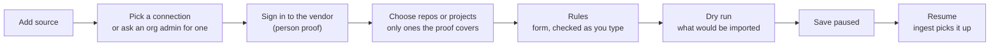

# Sources in the dashboard

Design for issue [#320](https://github.com/GetFelix/KBL/issues/320). Status: proposed, nothing here is built.

Today an operator wires each source (a GitHub repo, a Jira project, an Azure DevOps project) into
`ingest.json` by hand, with one credential, and restarts `kbl-ingest`
([Running the ingest worker](../work-tracker.md#running-the-ingest-worker)). This page designs a
**Sources** view in the dashboard where a team admin adds, verifies, scopes, pauses and removes a source
while everything keeps running.

**Terms**

- **Source:** one upstream container a team imports from: a GitHub repo, a Jira project, an Azure DevOps
  project or a GitLab project. It has an id like `github:GetFelix/felix`, the same string
  `source_added` records today, and exactly one owning team.
- **Connection:** the credential ingest uses for one upstream account (a GitHub organization, a Jira site, an
  Azure DevOps organization, a GitLab group), with what that account's admin consented to. Several sources can
  share one connection.
- **Person proof:** a short check, made with the person's own vendor sign-in, that they may connect a source.
  Its token is used for that check and dropped.

## What stays the same

These were decided in the issue and this design keeps them.

1. **One org-approved credential per connection.** Ingest reads and writes with the connection's credential,
   which the upstream admin scoped. What that credential can see is what the team shares.
2. **No per-person sync.** `work.events` is team-wide, and agents read it. Importing with one person's token
   would show everything that person can see to the whole team and its agents.
3. **A person's vendor sign-in only proves they may connect.** The tracker makes the check calls itself and
   drops the token. It is never stored, never logged and never reaches ingest or an agent.
4. **KBL sign-in uses the same identity provider where it can** (Entra, GitHub), so the person who proves
   access upstream and the person signed in to KBL can be compared
   ([#316](https://github.com/GetFelix/KBL/issues/316)).

Ingest keeps its own rules, cursor and write-back logic. What moves is where its sources, rules and
credential references come from: `org.events` instead of a file.

## The flow in the dashboard

The view lives at **Settings > Sources** for a team, like GitHub's "Integrations" settings or Linear's
"Integrations" page: a list, a detail panel, and one "Add source" button. Only team admins and org admins see
the write actions; members see the list read only.

**The list.** One row per source: vendor icon, id, connection, status, rules, last poll, and the newest
problem in plain words. Status is one of **Active**, **Paused**, **Checking**, **Needs attention** (a failed
check, a stall, an expired credential) or **Removed** (kept for history, filtered out by default). Filters and
search work as on the board.

**Add.** A dialog with steps, like GitHub's "Install App" or Jira's "Connect app" flow:

1. **Connection.** Pick one of the team's connections. If there is none for that vendor, the dialog says what
   the upstream admin has to do (the per-vendor steps below) and offers a link that opens the vendor's own
   consent page. A team admin can create a connection for an App installation, a service principal or a
   managed identity that the operator already set up. Pasting a token is an org admin action (see
   [Secrets](#where-secrets-live)).
2. **Prove access.** "Sign in with GitHub" (or Microsoft, Atlassian, GitLab) opens the vendor's consent in a
   popup. The tracker finishes the sign-in, runs the checks for the vendor, and drops the token. The dialog
   shows what was proven ("You can triage 4 of the 12 repos this installation covers").
3. **Scope.** A picker lists only what the proof covers and the connection can read. A source another team owns
   is shown disabled with that team's name. Picking an org-wide scope ("every repo in the installation") needs
   an admin proof upstream.
4. **Rules.** The rule form (below), prefilled from `kbl-tool source init`'s starter (#325).
5. **Dry run.** Ingest runs `kbl-ingest check` against the draft and the dialog lists what each rule would
   import, what waits over its cap, and any missing permission. Nothing is written upstream or to the log.
6. **Save.** The source is saved **paused**, so the admin sees the first result before any import. "Resume"
   starts it. GitHub's App install and Linear's integrations both land on a settings page before they act; this
   is the same.

**Verify.** "Check now" on the detail panel runs the same check (credential, permissions per rule, dry run) and
shows each finding with its level, as `check --json` reports it. The detail panel also shows the newest
`source_stalled` and when the credential was last rotated.

**Scope.** Adding a repo to a source needs a new person proof that covers the new repo. Removing one does not.
Narrowing never needs a proof, widening always does.

**Pause and resume.** Pause stops ingest from polling and writing back for that source at its next poll.
Imported items stay as they are and agents keep working on them; their upstream changes are not seen until
resume. Resume picks up from the saved cursor, so nothing is missed, only late.

**Remove.** A confirm dialog that names the count of open items, like deleting a GitHub webhook or a Jira
integration. Removal stops sync and releases ownership, so another team may claim the source. Imported items
keep their history; open ones show a "Source removed" badge and stay until a person closes them. Ingest's saved
state for the source is deleted. Removal never touches the upstream credential: the dialog links to the
vendor page where the upstream admin uninstalls or revokes it.

## Per vendor

Each section says what the upstream admin consents to once, the least privilege ingest needs, and how the
person proof works. Anything not confirmed against vendor docs is listed under
[Open questions](#open-questions) instead of stated here.

### GitHub

**Connection: a GitHub App installation.** Ingest already mints installation tokens from an App's private key
(`app` in [Running the ingest worker](../work-tracker.md#running-the-ingest-worker)).

1. The operator registers one GitHub App for the KBL instance (or per org) and puts its private key in the
   secret store. The App asks only for: Issues (read, or read and write when a rule comments or opens
   prerequisites), Pull requests (read, or read and write for the draft-on-drop write), Contents (read, for
   release compares), Checks and Commit statuses (read), Metadata (read, always granted). Administration (read)
   is optional and only lets ingest read required checks on branch protection.
2. An org owner installs the App on **selected repositories**, never "all repositories" unless the team means
   it. GitHub shows the requested permissions on the install page; that page is the consent.
3. The team admin creates a connection naming the installation (`installation_org` or `installation_id`).

Ingest asks for every installation token with the `repositories` field set to the repos its team's sources
name ([Create an installation access token](https://docs.github.com/en/rest/apps/apps#create-an-installation-access-token-for-an-app)),
so one installation shared by two teams still gives each team's worker a token that reaches only its own repos.

**Person proof: a user access token from the same App.** The App's "Request user authorization (OAuth) during
installation" or its plain user authorization flow gives a user access token, which GitHub limits to what both
the App and the person may do
([About user access tokens](https://docs.github.com/en/apps/creating-github-apps/authenticating-with-a-github-app/authenticating-with-a-github-app-on-behalf-of-a-user)).
The tracker then:

1. Lists `GET /user/installations/{installation_id}/repositories`: the repos of the installation the person can
   reach. A repo outside that list cannot be picked.
2. For each picked repo, reads `GET /repos/{owner}/{repo}` and its `permissions`. A read-only rule needs `pull`.
   A rule that writes back (comments, prerequisites, drafts) needs `triage` or higher, so a person who can only
   read a public repo cannot make KBL write to it under the org's App.
3. For an org-wide scope ("all repos of the installation"), the person must be an org owner. The check is
   `GET /user/memberships/orgs/{org}` with `role: admin`; whether the App's user token can read it without an
   extra permission is an open question.

The token is dropped once these calls finish. It is never refreshed, so the App's "expire user tokens" setting
does not matter here.

### Azure DevOps

**Connection: a Microsoft Entra service principal or managed identity.** New Azure DevOps OAuth app
registrations are no longer accepted, so Entra is the only OAuth path. Ingest's ADO adapter (#333) already
signs in with Entra client credentials.

1. An Entra admin registers an app (or uses a managed identity when ingest runs in Azure). A workload identity
   federation credential is preferred over a client secret, so there is no secret to rotate; a client secret
   or certificate works too.
2. An Azure DevOps organization admin adds that service principal to the organization (Organization settings >
   Users) and to each project's **Readers** group, or **Contributors** when a rule writes back. Nothing
   org-wide is granted.
3. The token is requested for the Azure DevOps resource
   (`499b84ac-1321-427f-aa17-267ca6975798/.default`), as #333 does.
4. The team admin creates a connection naming the organization, tenant, client id and the secret reference.

**Person proof: the person's Entra token.** The tracker signs the person in with Entra (authorization code with
PKCE) for the delegated Azure DevOps scope, then reads `GET https://dev.azure.com/{org}/_apis/projects/{project}`
as the person for each picked project. A 200 proves they can see it. A rule that writes back needs proof that
the person may edit work items in that project; which call answers that cleanly is an open question, so until
it is answered such a rule needs a Project Administrator proof. When KBL's own sign-in is Entra in the same
tenant, the proof's `oid` must equal the person's KBL subject.

### Jira Cloud

**Connection: a dedicated account, not a person's.** Three ways, best first:

1. **A service account with an API token.** A Jira admin creates an account used only by KBL, gives it Browse
   projects on the chosen projects (plus Add comments, Link issues and Transition issues when a rule writes
   back, the permissions `check` already reads), and issues an API token. This is today's `email` plus
   `token_file` sign-in. Atlassian's managed service accounts may give a better option; see open questions.
2. **OAuth 2.0 (3LO) consented by that dedicated account.** 3LO tokens act as the user who consented, so the
   consent must be given while signed in as the KBL account, never as a person. The refresh token then lives
   in the secret store and something beside ingest refreshes `oauth_token_file`, which ingest re-reads on each
   request.
3. **A Forge app.** Forge apps run inside Atlassian and act as the app. Ingest is a poller outside Atlassian,
   so using one needs a bridge we have not designed. Not in the first milestones.

**Person proof: Atlassian 3LO.** A separate KBL OAuth 2.0 (3LO) app with read scopes only (`read:jira-work`,
`read:me`). The tracker reads
[`GET https://api.atlassian.com/oauth/token/accessible-resources`](https://developer.atlassian.com/cloud/jira/platform/oauth-2-3lo-apps/)
to find the site's cloud id, then `GET /rest/api/3/mypermissions?projectKey=<KEY>&permissions=BROWSE_PROJECTS`
for each project (plus `ADD_COMMENTS`, `LINK_ISSUES` and `TRANSITION_ISSUES` for a rule that writes back),
and `ADMINISTER_PROJECTS` for a scope over every project the account can see. The site in the proof must be
the connection's site.

### GitLab

**Connection: a group or project access token.** GitLab has no adapter yet (#129); this section fixes its
credential model so the adapter is built to it.

1. A group Owner or project Maintainer creates a **project access token** (one project) or a **group access
   token** (every project in the group) with role **Reporter** and scope `read_api`. A rule that writes back
   needs scope `api`. GitLab makes each token a bot member with that role.
2. GitLab requires these tokens to expire. The connection stores the expiry and the Sources list shows
   "Needs attention" 14 days before it.
3. An org admin pastes the token (see [Secrets](#where-secrets-live)), or the operator puts it in the secret
   store and the connection names it.

**Person proof: GitLab OAuth.** A KBL OAuth application on the GitLab instance with scope `read_api`. The
tracker reads `GET /projects/:id` as the person; the answer's `permissions` gives their access level. Reporter
or higher proves read, Developer or higher a write-back rule. A group-wide scope needs Owner on the group
(`GET /groups/:id/members/all/:user_id`). Self-managed instances are a connection setting (`api`).

## Where secrets live

A connection holds a **secret reference**, never a secret. The secret stays where ingest reads it.

| Reference | Who puts it there | Where it lives | Who can read it |
|---|---|---|---|
| `file:<name>` | The operator | A file in ingest's secrets folder, mode 600 or 400, as `private_key_file` and `token_file` are today. Docker and Kubernetes secrets mount as such files | The ingest process |
| `sealed:<id>` | An org admin pasting it in the dashboard | Encrypted to the ingest worker's public key, stored in the team's `work.tracker` cache under `secret/<id>` | The ingest worker that holds the matching private key |
| `none` | Nobody | A managed identity or workload identity federation needs no stored secret | |

- **Not on the log.** Records on `org.events` carry the reference and a version number. The cache entry is
  overwritten on rotation, so the old ciphertext does not linger the way a log record would.
- **Not in the UI.** The dashboard shows "set" and when it was rotated, never a value, a prefix or a hash. A
  pasted secret goes from the browser to the tracker over TLS in one request; the tracker seals it at once and
  keeps no copy. A paste is refused while the tracker is not behind TLS.
- **Sealed to the worker.** Each ingest worker generates a key pair at first start and keeps the private key in
  its secrets folder (mode 600). `ingest_added` carries the public key. The tracker can seal, but cannot open, so
  a tracker bug or a reader of the cache does not reveal the secret. The format (an X25519 sealed box, or
  age) is an implementation call.
- **Files are allowed by the operator.** A team admin cannot point a connection at an arbitrary file: a
  `file:` reference must be listed in that worker's local `allowed_secrets`, so one team cannot name another
  team's App key.
- **Rotation.** An org admin pastes a new value (`connection_rotated`, new version) or the operator replaces
  the file. Ingest re-reads the secret on each use, as `token_file` already is, so no restart. The vendor-side
  rotation (a new App key, a new client secret) is the upstream admin's. Team admins cannot paste or rotate
  secrets; they can only pick a connection.
- **Proof secrets.** The OAuth client secrets for person proof (one per vendor) belong to the tracker, in its own
  secrets folder, set by the operator. They grant nothing on their own: they only let the tracker finish a
  person's sign-in.

## Records and how ingest picks them up

Sources, connections and rules move to `org.events`, which already has `source_added`
([Teams](../work-tracker.md#teams)). The new kinds raise the org log to format 2, following
[upgrades.md](../upgrades.md): an older tracker stops at the first of them instead of serving a team with
rules it cannot read.

| Kind | Who writes it | Holds |
|---|---|---|
| `connection_set` | Org admin; team admin for a connection with no pasted secret | Team, name, vendor, account (org, site, organization, group), API address, credential kind, secret reference and version, expiry if known |
| `connection_rotated` | Org admin | Team, name, new secret version |
| `connection_removed` | Org admin, team admin | Team, name. Refused while a source uses it |
| `source_connected` | Team admin | Team, source id, connection, and the proof: vendor, the upstream login and subject proven, what was checked, when. Takes the place of `source_added` for sources added this way, with the same one-team rule |
| `rules_set` | Team admin | Team, source, the whole rule list as ingest's config schema. Replaces the last one |
| `source_paused`, `source_resumed` | Team admin | Team, source |
| `source_removed` | Team admin, org admin | Team, source. Releases ownership |

The fold refuses a `rules_set` whose rules do not parse, a rule `repo` that is not one of the source's repos,
and a `source_connected` whose proof does not cover its repos. A `rules_set` is the only record of the rules:
ingest no longer needs `rules` in its file for a dashboard-managed team.

**Pickup without a restart.** A new ingest route serves the team's effective config:

- `GET /v1/ingest/config` (ingest token) answers the token's team's connections (references only), sources,
  rules and paused flags, and the `org.events` offset they were folded at, as an `ETag`.
- Ingest calls it at the start of every poll with `If-None-Match`. An unchanged config costs one 304. A changed
  one is parsed with the same parser as `ingest.json`; if it fails, ingest keeps the last good config and
  reports the error (it cannot fail, since the fold already checked it, unless the builds differ).
- A change applies between polls, never inside one, so a poll sees one config. Renaming or removing a rule
  takes its items out of scope, as editing `ingest.json` does today.
- A worker's `ingest.json` keeps only what is local: its tracker URL and token, its secrets folder,
  `allowed_secrets` and webhook settings. A team whose file still has `rules` is file-managed: the dashboard
  shows its sources read only with "Managed in ingest.json", and the tracker refuses source routes for it. One
  team is one or the other, never both, so two places cannot disagree.
- `ingest_sources` in the token file becomes the vendor named on `ingest_added`, so the source tie still holds.

**Checks.** Network checks need the credential, which only ingest holds, so ingest runs them. The dashboard asks
with `POST /v1/teams/{team}/sources/{source}/check`, which stores a request in the team's `work.tracker` cache.
Ingest takes it at its next poll (or at once when it waits on the config route), runs #325's checks against the
draft or saved rules through its read-only transport, and writes the report back with
`PUT /v1/ingest/checks/{id}`. Reports are cache entries, not records: they are advice, and repeating one is
harmless.

## Rules in the UI

The rule editor is a form, one card per rule in match order, dragged to reorder ("first rule that matches
wins" is said above the list, as GitHub says for branch protection rules):

- Filters as chips per vendor (labels all, any and excluded; milestone; assignee; type; JQL for Jira; tags or
  a saved query for ADO), mode (Admit or Propose, with one line on each), cap, default tier, priority mapping,
  target repo, and write-back switches. A switch that needs more upstream permission says which.
- A **JSON** tab shows the same rules as ingest's schema, for review or paste, like GitHub's code view of a
  workflow.
- **As you type** the tracker validates with the shared parser and `static_findings` from #325, so the errors
  are the ones `kbl-ingest check` prints: unknown keys, an open filter with no cap, a rule shadowed by one above
  it, a write-back the connection's permissions do not allow. Errors block Save; warnings do not.
- **Dry run** asks ingest for a check of the draft before Save, and shows per rule what would be imported and
  what waits over the cap.
- Every save is one `rules_set`, so the source's history panel shows who changed the rules and when, with a
  diff, and "Restore" writes the old list back as a new `rules_set`.

This needs the config schema and `static_findings` in a library both the tracker and ingest link, instead of
inside the `kbl-ingest` binary.

## New routes

All person routes are team routes and check the role as the org routes do.

| Call | Role | Does |
|---|---|---|
| `GET /v1/teams/{team}/connections`, `/sources` | Team member | Lists them, with status and the latest check. Never a secret |
| `POST /v1/teams/{team}/connections` | Team admin (no paste), org admin | `connection_set` |
| `PUT /v1/teams/{team}/connections/{name}/secret` | Org admin | Seals the pasted value, writes the cache entry, then `connection_rotated` |
| `POST /v1/teams/{team}/connect/{vendor}` | Team admin | Starts a person proof: answers the vendor's authorize URL with a one-time `state` |
| `GET /v1/connect/callback` | None (bound by `state`) | Finishes the sign-in, runs the checks, drops the token, keeps the result for the pending connect only |
| `POST /v1/teams/{team}/sources` | Team admin | `source_connected` from a pending proof, then `rules_set` and `source_paused` |
| `PUT /v1/teams/{team}/sources/{source}/rules` | Team admin | `rules_set` |
| `POST /v1/teams/{team}/sources/{source}/pause`, `/resume` | Team admin | `source_paused`, `source_resumed` |
| `DELETE /v1/teams/{team}/sources/{source}` | Team admin | `source_removed` |
| `POST /v1/teams/{team}/sources/{source}/check` | Team admin | Queues a check |
| `GET /v1/ingest/config`, `PUT /v1/ingest/checks/{id}` | Ingest | Above |

`kbl-tool source` gains the same verbs for people who script setup.

## Threat model additions

These rows go into [threat-model.md](../threat-model.md) with each milestone that builds them.

| Attack | Check |
|---|---|
| A team admin connects a repo they cannot see, using an org App installation | The picker and the fold accept only repos in the person's `/user/installations/{id}/repositories` (or the vendor's equivalent) at connect time |
| A team admin who can only read a public repo makes KBL write to it | A rule that writes back needs a proof of write-level access (`triage` on GitHub, Developer on GitLab, the Jira write permissions), checked per repo |
| Replay or forge a person proof | The tracker makes the vendor calls itself with a token it got from the vendor's token endpoint. `state` is random, single use, bound to the person, team and pending connect, and expires in 10 minutes. The browser never hands the tracker a token or a result |
| Prove as one vendor account, sign in to KBL as another | The proof's upstream login is on `source_connected` for audit. Where KBL sign-in uses the same provider (Entra, GitHub), the subjects must match |
| A proof for one repo is reused to widen the scope | The proof lists the repos it covered; widening a source needs a new proof |
| One team reads another team's repos through a shared installation | Source ownership is one team per source on `org.events`; installation tokens are minted with `repositories` set to the team's own sources; the tracker refuses ingest records for roots outside the team's sources |
| A team admin points a connection at another team's secret file | `file:` references must be in that worker's local `allowed_secrets`, set by the operator |
| The tracker, a cache reader or a log reader learns a vendor secret | Pasted secrets are sealed to the ingest worker's public key; the tracker cannot open them; no record carries a secret |
| A pasted secret crosses the network in the clear | Paste is refused unless the tracker is behind TLS |
| The person's vendor token is kept or leaks | Held in memory for the check calls only, never stored or logged, errors pass the redactor. No refresh token is asked for where the vendor lets us |
| A person's vendor token reaches agents | Agents never call the connect routes, and nothing from the proof but login, subject and the checked repos goes on the log |
| An attacker who can file issues in a newly connected repo floods the queue | Sources save paused, rules need a cap on an open filter, and the dry run shows the count before resume |
| Ingest keeps syncing after removal | `source_removed` takes the source out of `GET /v1/ingest/config`; ingest drops it at its next poll; the tracker refuses ingest records for a removed source's roots |
| A crafted rule injects into an upstream query | Rules are parsed by ingest's own strict parser; JQL and ADO saved queries run upstream under the connection's own access, as today, and ADO WIQL is never taken from a rule (#333) |
| A team admin escalates by self-approving a connection | Pasting or rotating a secret is org admin only. A team admin can use only consent the upstream admin already gave |

## Milestones

Each is one implementation issue. Drafts are in the pull request that adds this page.

1. **Config schema as a library, and sources on `org.events`.** Move ingest's config schema and
   `static_findings` into a shared crate; add the records above at org format 2; tracker routes for
   connections, sources, rules, pause, resume and remove, org admin and team admin; `kbl-tool source` verbs.
2. **Ingest reads its config from the tracker.** `GET /v1/ingest/config` with `ETag`, pickup between polls,
   file-managed versus tracker-managed teams, `allowed_secrets`, installation tokens narrowed to the team's
   repos.
3. **Checks on request.** The check queue, ingest running #325's checks and dry run against draft rules,
   reports in the cache.
4. **Dashboard Sources view.** List, detail, add (with an existing connection, no person proof yet: org admins
   only), rules editor with validation and dry run, pause, resume, remove, history.
5. **Person proof for GitHub.** The connect routes, `state` handling, the App user authorization and the repo
   permission checks; team admins may then connect.
6. **Person proof for Azure DevOps and Jira.** One issue each.
7. **Sealed secrets.** Worker key pairs on `ingest_added`, paste and rotate in the dashboard, expiry warnings.
8. **GitLab.** Credential and proof as above, with the adapter in #129.
9. **KBL sign-in through the vendor's provider.** With #316, so a proof's subject can be matched to the person.

## Open questions

- GitHub: whether a GitHub App user access token can read `GET /user/memberships/orgs/{org}` with no extra
  permission, or the App must ask for organization Members (read).
- Azure DevOps: which access level (Stakeholder or Basic) a service principal needs to read and comment on
  work items in a private project, and which REST call proves a person may edit work items in a project.
- Jira: whether Atlassian's managed service accounts (with their own OAuth client credentials) are available on
  every plan and work with the REST v3 search ingest uses. If so, they replace the dedicated-account option.
- GitLab: whether Reporter is enough for ingest to comment and set labels, or write-back needs Developer, and
  whether access tokens are available on the instance's tier.
- Write-backs attributed to the person who caused them (the issue allows storing their token encrypted for
  that) are not designed here; every write-back stays under the connection's own name.
- Whether a removed source's open items should get `left_scope`, which would put each in Needs you, or the
  badge alone is enough.
