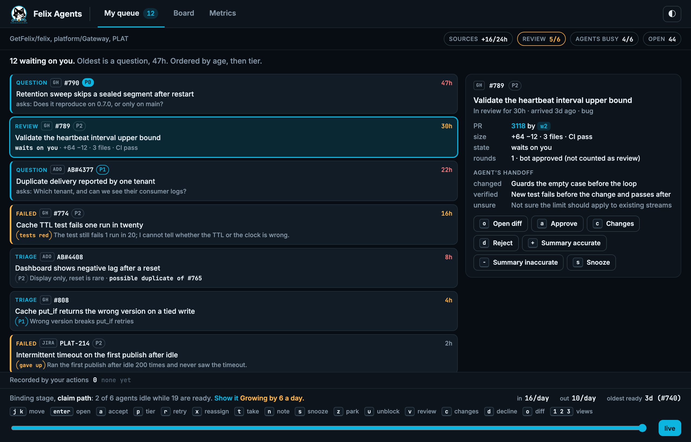
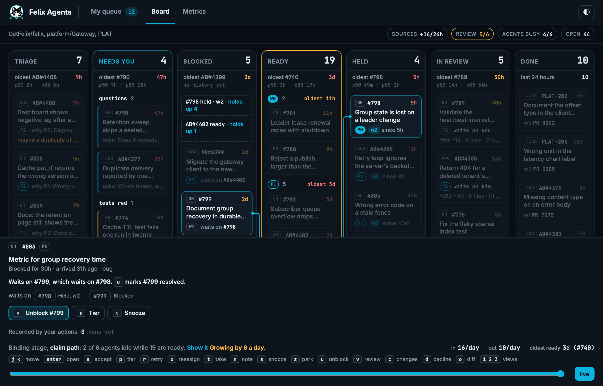

# A work tracker for coding agents

It applies the swarm in
[design.md](design.md) to a job that never ends: bugs arrive from an upstream
tracker, an agent triages them, and coding agents ask for the next piece of
work, fix it and hand it back.

## The problem

Bugs arrive in GitHub Issues or Azure DevOps. Agents fix them, but three
things are missing:

- **Asking for the next piece of work.** An agent has no way to say "give me
  the most important item I can start now" and know nobody else got it.
- **Seeing the queue.** What is waiting, what is blocked, who holds what, and
  what an agent did with it.
- **Dependencies.** Item B cannot start until A is done. A large bug splits
  into chunks that run in order or in parallel.

People also need to add what they know about a bug, and agents need to read
it before they start.

## What it is

A service, `agents-tracker`, with a REST API for people and tools and the same
operations as MCP tools in `felix-mcp` for agents:

| Tool | Does |
|---|---|
| `work_next` | Claims the highest-priority ready item the agent can take |
| `work_extend` | Keeps the claim while the agent works (done by `felix-mcp`, as for tasks) |
| `work_context` | Reads or adds context on an item |
| `work_link` | Adds a dependency, or splits an item into child items |
| `work_progress` | Records a step: a plan, a branch, a PR |
| `work_complete` / `work_release` | Finishes the item or hands it back |

An ingest worker pulls new and changed items from GitHub or ADO. A triage
agent then dedupes them, sets priority, links dependencies, splits large items
and writes its reading of each bug as context. People edit any of that through
REST or the viewer.

## The Felix mapping

It reuses the pieces the swarm already has. No database.

- **`work.events` is the record.** Every change is a record: imported,
  triaged, linked, context added, claimed, progress, done. The board view and
  the per-item history are folds of this stream, built the way the run log
  replay is.
- **Items and edges are keys.** An item's fields and its context entries are
  keys in a cache, written with `cache_put_if` at the version read, so a
  person and an agent editing the same item cannot overwrite each other. This
  is the board pattern.
- **Only ready items are claimable.** The tracker folds `work.events`, and when
  an item's last dependency is done it publishes the item to a ready stream.
  Agents claim from that stream through a consumer group, with the 90 second
  visibility and 30 second extension that tasks use. A dead agent's item goes
  back to the queue.
- **Priority is a stream per tier.** A group hands records out in offset order,
  so `work_next` polls `work.ready.p0` first, then `p1`, and so on.
  Reprioritizing a ready item publishes it again on its new tier. The old
  record is acked and skipped when claimed, because its item version no
  longer matches.
- **Upstream ids dedupe.** Ingest writes each upstream id with `cache_put_if`
  absent, so a re-polled or redelivered bug is imported once.
- **Writing back to GitHub or ADO carries the claim's version.** That version
  is the fencing token, as with leases: the tracker refuses a comment or
  status change from an agent whose claim has lapsed.

A fixing agent's work is a run, so the existing replay shows why it did what
it did. The tracker links each item to its runs.

## The dashboard

The swarm view shows one run. The dashboard shows everything before and around
runs: what waits on you, where work is piling up, and what the team delivered.
It is the page someone opens first in the morning. It has three tabs.

### My queue

The landing view. It lists everything that waits on the person looking:

- a question triage asked,
- a failure that needs a decision,
- a triage proposal to accept,
- a PR to review, or an approved one to merge.

Items are ordered by how long they have waited, oldest first, with tier as the
tie-break. The count is in the tab title, so it shows without opening the page.
Snoozed and parked items drop out of the count.

Every card is keyboard first. `j` and `k` move, `enter` opens, and one letter
acts. A legend shows the keys.

| Key | On a card | Records |
|---|---|---|
| `a` | Accept a proposal, approve a PR, answer a question | `triaged` and `linked`, `approved`, `answered` |
| `p` | Change the tier (on a proposal: edit it before accepting) | `tier_changed` |
| `d` | Reject or close | `rejected` |
| `g` | Merge a duplicate into the item it duplicates | `rejected` with the original |
| `r` | Retry a failure (with the note, if one is typed), or stop a held item | `retried`, `released` |
| `x` | Reassign to another agent | `reassigned` |
| `t` | Take it yourself, so no agent claims it | `taken` |
| `n` | Write a note: for the next attempt, or steering a running agent | `steered` |
| `s` / `z` | Snooze for four hours / park | `snoozed`, `parked` |
| `u` | Unblock: mark a dependency resolved | `unblocked` |
| `v` / `c` | Request a reviewer / send a PR back with changes | `review_requested`, `changes_requested` |
| `m` | Record a merge done upstream | `done` |
| `o` | Open the diff or PR | nothing |
| `+` / `-` | Mark the agent's summary accurate or inaccurate | `summary_rated` |

In the style frame these actions are local. Each one appends a `work.events`
record to a list on the page and the view folds again, so the board is still
a fold of the log and the list shows exactly what would be written. Live, the
same actions go through the tracker's REST API and MCP tools.

### Board

The stages, left to right. An item sits in exactly one and moves right as
`work.events` records it.

- **Triage** holds items nobody has accepted yet. The triage agent attaches a
  proposal: a tier with one line of why, dependencies, and a possible
  duplicate, including one from another tracker. You accept, edit or reject
  it. An item the agent has not read yet says so.
- **Needs you** groups failures by cause (tests red, timeout, claim lost, gave
  up) under the agent's last message, next to questions.
- **Blocked** leads with the root blockers: the unfinished items that hold the
  rest, each with "holds up N". Selecting any item draws its dependency chain
  across the columns.
- **Ready** is grouped by tier.
- **Held** names the agent and links to its run. You can stop it, send it a
  note, reassign it or take the item.
- **In review** is an agent PR waiting on a person. A card shows the PR, its
  size (lines and files), CI state, review rounds, who it waits on and for how
  long. Two states have their own wording and action: "CI green, no reviewer"
  (request a review) and "approved, not merged" (open it to merge). The tracker
  never merges. It records the merge it sees. A PR also carries the agent's
  handoff: what it changed, what it checked, what it is unsure of. The
  reviewer can mark the summary accurate or not.
- **Done** is the last day's merges.

Each column shows its count, its oldest item, and the team's own p50 and p85
for that stage. An age turns amber past the p50 and red past the p85 of
finished visits to that stage. Until a stage has five of them, a fixed
fallback is used and the column says it has no history.

Where the items come from is a chip in the header: arrivals in the last day,
and per source on click.

### The review limit

Agents open PRs faster than people review them, and a claim that only adds to
the review pile makes every PR wait longer. So the tracker has a limit on
agent PRs in In review. At the limit agents stop claiming, and the header says
so: "review full: agents paused, 6/6". Triage, answers and reviews carry on, and
the Ready column explains why nothing is moving.

The limit is a setting. There is no evidence behind any default: the
research found nothing that says how many open PRs a reviewer can handle. Pick
a number, watch the review column, and change it.

### The footer names the constraint

One sentence names the stage that is slowest to move and why, for example
"review: 6 PRs waiting, oldest 31h". It picks the stage whose oldest item is
furthest past its own p85, and it never blames agents in general. Idle agents
with work ready is reported as a claim path problem, since that is a defect
and not a lack of capacity. The in and out rates sit beside it.

### Metrics

The third tab is for the team and the flow. It has no per-person number, and
none will be added: ranked individuals turn a measure into a target. Bot
approvals are never counted as review.

- Time in each stage, p50 and p85.
- Time waiting on a human, per merged fix.
- Time to the first human action on My queue and on In review.
- Throughput against arrivals, and a cumulative flow chart. A band that widens
  is the constraint.
- Blocked time and the items that hold the most up.
- Rework: fixes that needed a second attempt or a second review round,
  reverts within 14 days, and merges after human edits.
- Merged against rejected, by task class.
- Cost per merged fix, with failed attempts counted against it, and human
  minutes per merged fix. Minutes are an estimate.

These come from `work.events` alone. Cost and minutes arrive as `cost` and
`human` records. The numbers are published as they are, not picked.

[dashboard-research.md](dashboard-research.md) says why each part is there and
how much evidence stands behind it.

The look is fixed the same way as the swarm view's: `prototype/intake-frame.html`
folds a hand-written `work.events` fixture (three trackers, a blocked chain, items
waiting on a person, held items, PRs in review, two weeks of finished work), a
copy with the review limit reached, and a generated burst of 320 items.
`node scripts/check-intake.mjs` checks them, including that My queue matches
what waits on the viewer and that actions append records.

## Where Felix stops

- **Queries over the graph live in the tracker's fold.** "What does this
  block", "everything waiting on a person" and the board's filters are
  answered from the tracker's in-memory projection of `work.events`, rebuilt
  on start. That is fine for thousands of items. If the queue needs ad hoc
  queries or grows past what a fold rebuilds quickly, the projection moves to
  Postgres and `work.events` stays the record.
- **Dependency cycles are the tracker's check.** `work_link` refuses an edge
  that closes a cycle. Felix has no view of the graph.

## Risks

- **The tracker becomes a dependency of the daily bug loop.** Felix is alpha,
  and 0.8 replaces its replication engine. Run the tracker on a single broker
  until 0.8 settles, and keep an export of `work.events`, so an outage stops
  the board but loses nothing.
- **Gaps it hits.** Gap 1 (max attempts is broker-wide) matters more here: an
  item that keeps failing should go to a person after two attempts. Gap 8
  means the tracker, like `felix-mcp`, is Rust. Gaps 5 to 7 limit the viewer
  as they do for runs.

## Order

M2 and M3 in the [build order](design.md#build-order): GitHub ingest,
`work_next` and the ready tiers, then triage and dependencies, then Claude Code
working `agent-ok` issues. The dashboard goes live in M4. ADO ingest comes
after GitHub.

The first source is GetFelix/felix. Only issues labelled `agent-ok` are
imported as claimable, and replication and storage safety work stays out. An
agent works in its own worktree and opens a pull request, which goes through
the same review and CI as any other. The tracker never merges.
