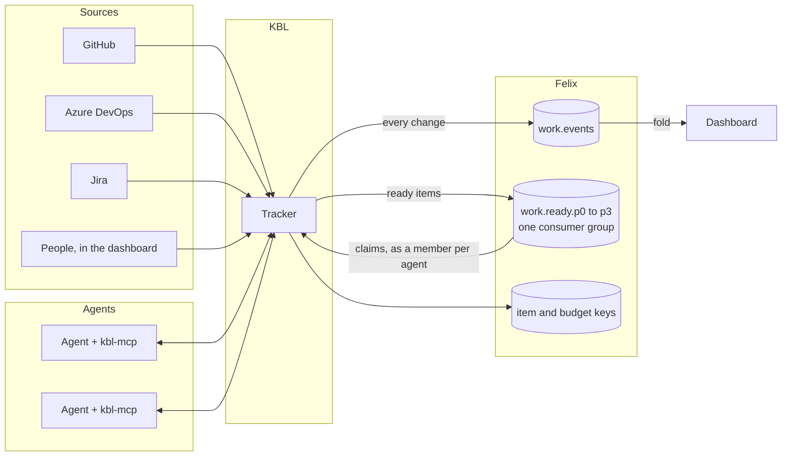
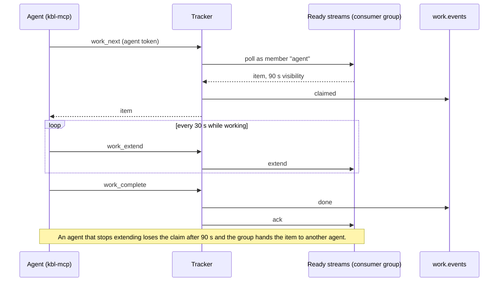
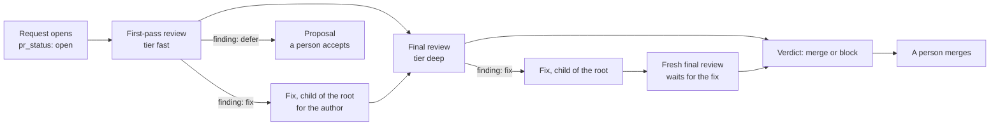
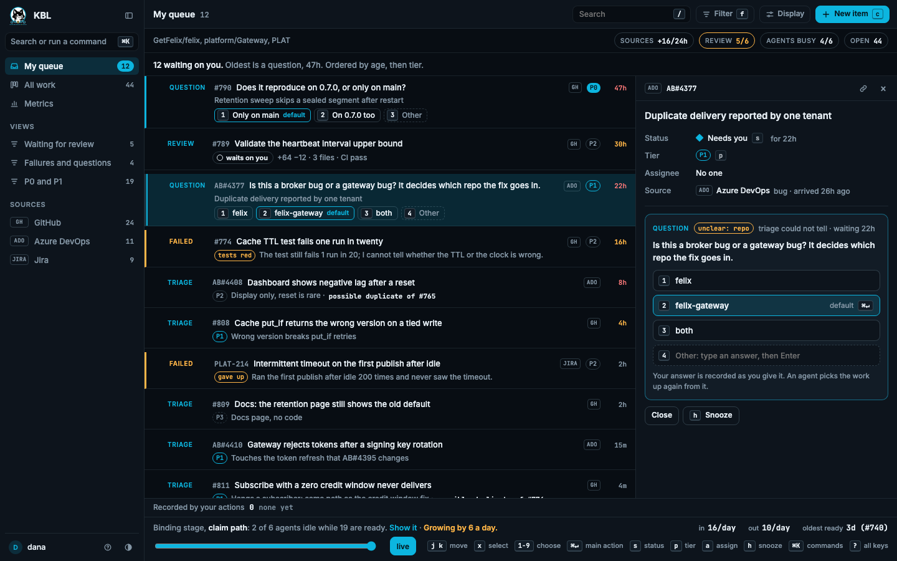
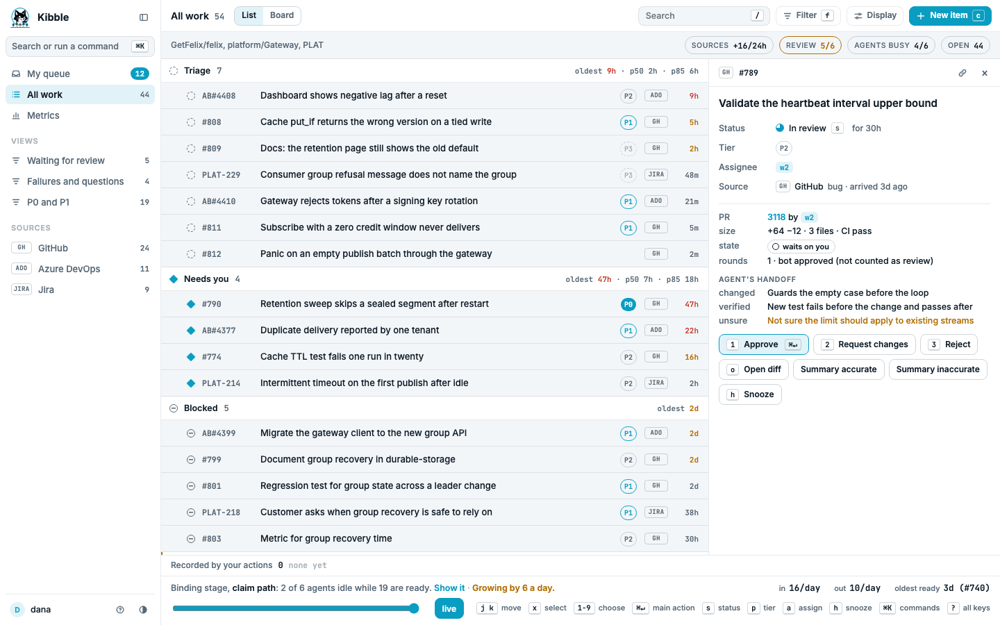
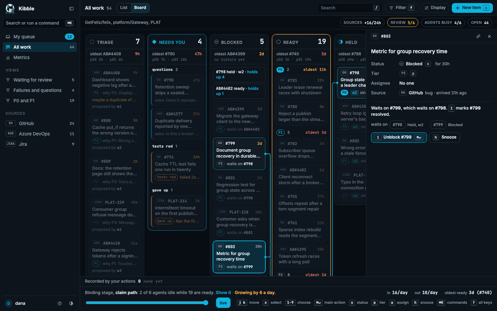
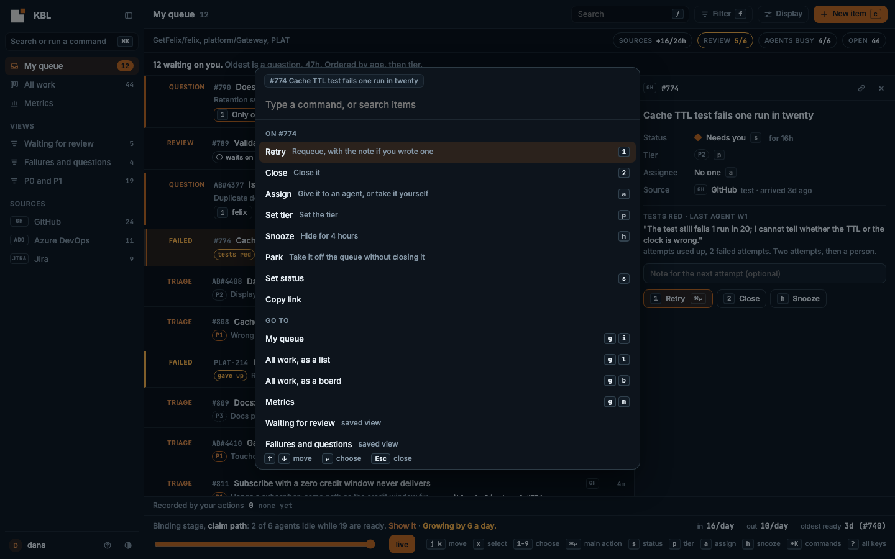
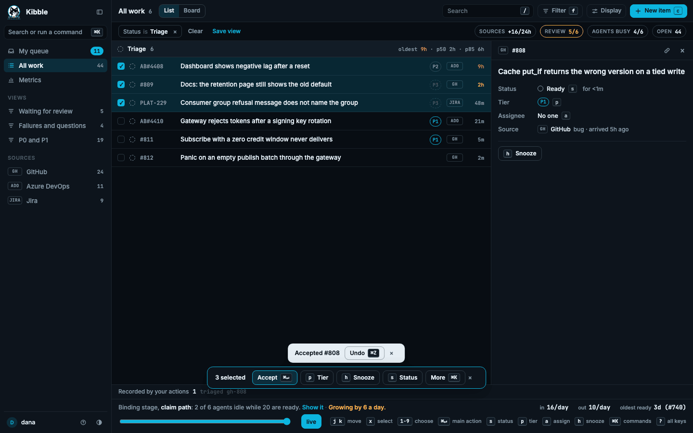
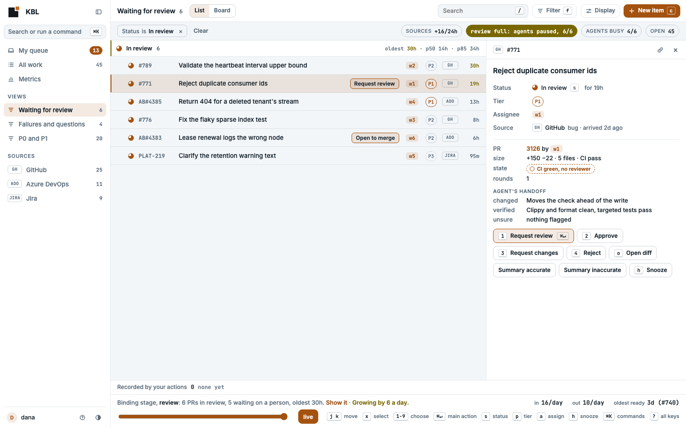
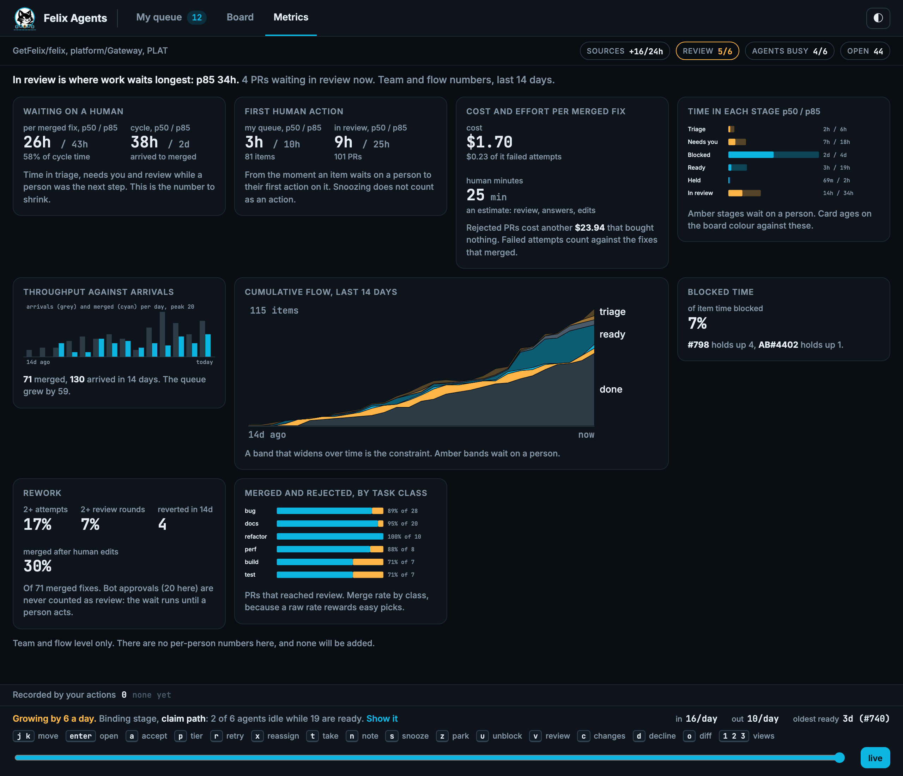

# A work tracker for coding agents

It applies the Felix pieces in
[design.md](design.md) to a job that never ends: bugs arrive from an upstream
tracker, agents pick up the triage, and coding agents ask for the next piece
of work, fix it and hand it back.

**The tracker is not agentic.** KBL (Kanban By Log, pronounced Kibble) is a Felix-backed work tracker. It stores,
orders, hands out and displays work, and it makes no model calls and writes no
text. Every kind of judgement it shows (triage, augmentation, splits, answers,
fixes, redos) is a work item that an agent or a person completes. Agents from
any vendor take that work through `kbl-mcp`, and people guide it from the
dashboard. Anything a person adds (a redo, a note, a split, a question, a
priority change) becomes regular work or a record the tracker already keeps.
`kbl-mcp` and the dashboard make no model calls either.

## The problem

Bugs arrive in GitHub Issues, Azure DevOps or Jira. Agents fix them, but three
things are missing:

- **Asking for the next piece of work.** An agent has no way to say "give me
  the most important item I can start now" and know nobody else got it.
- **Seeing the queue.** What is waiting, what is blocked, who holds what, and
  what an agent did with it.
- **Dependencies.** Item B cannot start until A is done. A large bug splits
  into chunks that run in order or in parallel.

People also need to add what they know about a bug, and agents need to read
it before they start.

## What it is

A service, `kbl-tracker`, with a REST API for people and tools and the same
operations as MCP tools in `kbl-mcp` for agents:

| Tool | Does |
|---|---|
| `work_next` | Claims the highest-priority ready item the agent can take. The reply carries the [standing rules](#standing-rules) in effect and a `loop` line telling the host to call `work_next` again after each item and to stop when nothing is ready. With `review_tiers` it also takes [reviews](#review-as-work) of those tiers |
| `work_extend` | Keeps the claim while the agent works (sent by `kbl-mcp` every 30 seconds) |
| `work_context` | Reads or adds context on an item |
| `work_link` | Adds a dependency between items in one tree |
| `work_post` | Creates a child under the item the agent holds: `split`, `augment`, `question` or `test`. Anything else is a proposal, except `prerequisite`, which is work another repo must do first |
| `work_rules` | Reads the standing rules in effect for the held item. Read-only |
| `work_progress` | Records a plan, a branch or a PR |
| `work_ask` / `work_answer` | Asks a person a question, which parks the item in Needs you, with optional `options` and a `default`. Answers one, with `chosen` or free text, while holding a `question` item under it. See [Questions with choices](#questions-with-choices) |
| `work_complete` / `work_release` | Finishes the item or hands it back. Completing reports the attempt's cost |
| `decide`, `record_step`, `edit` | Record a decision, a command it ran, or a code change, on the item ([decision-replay.md](decision-replay.md#what-gets-recorded)). A fix's decision can carry a revert check |
| `work_triage` | Answers the triage item the agent holds with a proposal for the item under triage: `tier` and `why`, an optional `duplicate_of`, `depends_on` and `split`, or `unclear`. See [Kinds of work](#kinds-of-work) |
| `work_finding`, `work_verdict` | Record a finding of the review the agent holds, and end a final review with a recommendation. See [Review as work](#review-as-work) |

Every `kbl-mcp` work tool, claiming included, calls the tracker over REST
with the agent's own token. The tracker checks the token, does the Felix work
itself and logs it in the same step, so an agent never touches the work
streams or keys. `work_next` polls the ready streams' consumer group as a
member named after the agent; `work_extend`, `work_complete` and
`work_release` extend, ack or nack that delivery. A claim is never held
without a `claimed` record, and an item is never acked before its `done`
record is written. An agent that dies stops extending, its claim lapses, and
the group hands the item to another agent.

The agent named on each record is the one the tracker authenticated. Felix
records the tracker as the publisher of every `work.events` record, so the
agent's identity is the tracker's attestation, written into the record.

An ingest worker pulls new and changed items from GitHub, ADO or Jira. For each
root it posts one triage item and one augment item, once. Triaging again is a
person's action. People edit any record through REST or the viewer.



Everything goes through the tracker: imports, people's actions and every
agent call. It is the only writer of `work.events`, the ready streams and the
keys, and the dashboard is a fold of `work.events`.



### Running the tracker

`kbl-tracker` signs in to Felix as its own principal, creates `work.events`,
`work.ready.p0` to `p3`, `work.review.r0` to `r3` and the consumer group on each if
they are not there, and folds `work.events` from the start (with seek snapshots) before it
serves. It appends a record only when the fold accepts it, so a refused call
leaves no trace in the log.

Each record carries a format. A tracker that finds a record of a newer format
than it reads does not serve, instead of skipping the record.
[upgrades.md](upgrades.md) has the upgrade order, how to go back, and the
rules for changing a record.

Felix cannot yet tell the tracker which principal a token belongs to, so the
tracker reads a token map from a JSON file (`--tokens-file`, or
`KBL_TRACKER_TOKENS_FILE`). The file must be mode 600 or 400, a token may be listed
once only, and tokens are compared in constant time:

```json
{
  "agents": { "<token>": "w1" }, "people": { "<token>": "gabriel" }, "ingest": { "<token>": "ingest-gh" },
  "grants": { "w1": ["github:GetFelix/felix-gateway"] }
}
```

`grants` is optional. It lists, per agent, the repositories it may file a
[prerequisite](#prerequisites-in-another-repo) in or link to, beyond the
repository of the tree it is working in. Each entry is `source:owner/repo`, so a
grant for `github:GetFelix/felix-gateway` does not reach a repository with the
same name in another source. The source is the name ingest records, such as
`github`, and is compared exactly. An agent with no grant can reach only its own
tree's repository.

An agent's token maps to its name, which goes on every record it causes and is
the consumer-group member name. `kbl-mcp` reads `KBL_TRACKER_URL` and
`KBL_TRACKER_TOKEN`; without them the work tools say they are not set up.

| Call | Token | Does |
|---|---|---|
| `POST /v1/work/next` `{wait_seconds}` | agent | Polls `p0` to `p3` as the agent, writes `claimed`, answers with the item. An agent that already holds one gets it again, marked `resumed` |
| `POST /v1/work/extend` `{item}` | agent | Extends the delivery. `409` with `why: lost` means the claim lapsed |
| `POST /v1/work/complete` `{item, cost_micros}` | agent | Writes `done`, then acks |
| `POST /v1/work/release` `{item, reason, cost_micros}` | agent | Writes `released`, then hands the delivery back |
| `POST /v1/work/give_up` `{item, reason, cost_micros}` | agent | Writes `gave_up`, then hands the delivery back, or acks it when the item is out of tries |
| `POST /v1/work/records` `{record}` | person | Appends a record a person may write, if the fold accepts it |
| `POST /v1/ingest/records` `{record}` | ingest | Appends an upstream sync record (`imported`, `accepted`, `context`, `linked`, `updated`, `left_scope`, `reopened`, a `triage` or `augment` `proposed`, a `closed` as completed or upstream) as the tracker's role under ingest's name, if the fold accepts it |
| `GET /v1/ingest/roots` | ingest | Every imported root: item, source, upstream id, stage, whether it is closed and whether upstream sync (not a person) closed it, and its pull request |
| `GET`, `PUT /v1/ingest/state/{source}` | ingest | Ingest's saved state (cursor and bookkeeping), kept in the `work.tracker` cache. A `PUT` names the version it read and is refused with `stale_state` if another save came first |
| `GET /v1/me` | person | The person's teams and role in each. A person in the token file is an org admin: `{"person": "gabriel", "org_admin": true, "teams": [{"team": "default", "role": "admin"}]}` |

Every work and ingest route is also served under `/v1/teams/{team}/`, for
example `/v1/teams/default/work/next`. See [Which team a call is for](#teams).
A team takes at most `KBL_TEAM_INFLIGHT` calls at once (64 by default). A call
over that answers `503` with `why: team_busy` and `Retry-After: 1`. Waiting
`work_next` calls have a pool of the same size of their own, so agents waiting
for work never hold up a holder's `extend` or `complete`.

The other work tools are one route each, all with an agent's token. Every one
writes a single record attributed to that agent and answers with the record's
`offset`, which `decide` and `record_step` hand back so a later `edit` or
citation can name them. A refusal is a `409` with a `why` (`not_held`,
`over_budget`, `limit_reached`, `cycle`, `missing_field` and so on); a body that
does not parse, an unknown kind of work or text over the inline limit is a
`400` or `422` and tries nothing.

| Call | Does |
|---|---|
| `POST /v1/work/post` `{item, key, work, title}` | `work` is `split`, `augment`, `question` or `test` for a child under the held `item`, or `proposal` for out-of-scope work. The item's id comes from the key, so the same key again answers with the first item (`created: false`) and writes nothing |
| `POST /v1/work/post` `{item, key, work: "prerequisite", ...}` | Work another repo must do first. See [Prerequisites in another repo](#prerequisites-in-another-repo) |
| `POST /v1/work/link` `{item, to}` | `item` waits on `to`. The agent must hold `item`, a child of it, or its parent, and both must be in one tree. The edge is refused with `cycle` if `to` already waits on `item`, directly or through other items |
| `POST /v1/work/rules/read` `{item}` | Reads the rules in effect for the held item |
| `POST /v1/work/context` `{item}` | Reads an item's context entries and the notes people left for the attempt |
| `POST /v1/work/context/add` `{item, entry, text}` | Writes a context entry on an item the agent holds, or on the parent of a child it holds. An agent replaces only entries it wrote itself: upstream text, the fold's entries and a person's notes stay as written |
| `POST /v1/work/progress` `{item, note, branch, pr}` | Records progress on the held item |
| `POST /v1/work/decide` | A decision: `phase`, `so_far`, `why` and `commit` are required; `evidence` is a list of `{stream, offset}` (see Evidence below) |
| `POST /v1/work/step` `{item, command, exit_code, output}` | A command the agent ran |
| `POST /v1/work/edit` `{item, file, hunk, decision}` | A code change and the offset of the decision it carries out |
| `POST /v1/work/ask` `{item, text, options?, default?}` / `POST /v1/work/answer` `{item, question, text?, chosen?, evidence}` | Asks a person, or answers as the holder of a `question` item. An answer starts resume work; see [Questions with choices](#questions-with-choices) |

**Evidence.** A decision, an answer and a new prerequisite can cite evidence: records that
show why, as `{stream, offset}`. A person reads them as support, so the
tracker holds them to the item's own tree. Each one must be a `work.events`
record that names an item with the same root, written before the record that
cites it. Anything else is refused: another tree's record answers
`evidence_outside_tree`, another stream `evidence_stream`, a later offset
`evidence_from_the_future`. The check runs before the append, so logs written
before it fold as they did.

Text in a record stays inline up to 4 KiB. Longer text is an artifact the
caller stored first and names by its hash; `kbl-mcp` does that for the
agent, and the tracker refuses long inline text.

The dashboard's actions are routes with a person's token. Each appends one
record if the fold accepts it:

| Call | Records |
|---|---|
| `POST /v1/work/proposals/accept` `{item, tier?}` | `accepted`. A proposal's tier comes from the edit, then this call, then triage |
| `POST /v1/work/proposals/edit` `{item, title?, tier?}` | `edited`, for an item nobody has accepted yet |
| `POST /v1/work/proposals/reject` `{item}` | `rejected`, for an item nobody has accepted |
| `POST /v1/work/questions/answer` `{item, text?, chosen?, moves_to?, question?, evidence?}` | `answer`. The question defaults to the open one. `moves_to` is `{source, repo, title}` |
| `POST /v1/work/tier` `{item, tier}` | `tier_changed`. A ready item is published again on its new tier |
| `POST /v1/work/close` `{item, why?}` | `closed`, with `merged`, `completed`, `dismissed` or `upstream` (default `dismissed`). Open descendants are cancelled |
| `POST /v1/work/unlink` `{item, to}` | `unlinked` |
| `POST /v1/work/budget` `{root, items_left, max_depth, cost_left_micros, redos_per_item}` | `budget_set`, the only way a budget goes up |
| `POST /v1/work/rules` `{source, repo, root?, text?, checks?}` (`text` is a string) | `rules_set`, the [standing rules](#standing-rules) for a repo or one root |

Ready records carry a stamp. When the tracker sees an item become Ready it
publishes a record, and a record that is not the newest for its item (a tier
changed, the tracker restarted, the item was closed or blocked meanwhile) is
acked and skipped when it is delivered. When Felix hands an item to a second
agent while the log still shows the first as holding it, the claim lapsed: the
tracker writes `released` with the reason `lapsed`, then the new `claimed`.
The log is the truth for holds. Before each call the tracker checks that the log
still shows the agent holding the item. If a person closed the item or the
attempt, or another agent took it, the agent's next `extend`, `complete` or
`release` answers `lost`. The tracker settles a delivery in Felix only when it
still stands behind that exact delivery for that agent, because a group ack
names an offset, not a delivery: a stale holder's late call cannot ack the next
holder's.

A nack names an offset too. An agent that stalled past the visibility can
release at the moment Felix hands its record to the next poller, and its nack
then takes that poller's lease as well. So a delivery that was polled before the
last holder's hand-back ended is not turned into a claim. The record is free
again, or lapses, and the next poll claims it. Without this the new holder
would be claimed, lose its delivery at once and be lapsed while it worked.
The hand-back runs to its end even when the caller's request is dropped, and
no other call ends it early. If the task sending the nack panics, the hand-back
still ends, so the item can be claimed again once the old lease lapses and Felix
hands the record out.

Felix dead-letters a ready record after five handouts, and the tracker is not told. So a Ready item
whose record has stood for six visibility periods gets a new record with a new stamp; the old one,
if it is still in the lane, is acked when it is delivered.

A sweep (every few seconds) writes `released` with the reason `lapsed` for a
hold whose delivery the tracker no longer has, or that has not been extended
for the visibility period, so the item is Ready without another agent having to
poll. After a restart the tracker takes back, for each agent the log shows
holding, the delivery Felix still has for that name; if it is not there the
hold is released at once. Until then `work_next` answers that the agent has no
current claim.

The tracker is the only writer, and it holds that role with a lease: a key in
the `work.tracker` cache, written with a time to live and renewed every third
of it. A team whose tracker cannot renew answers 503 on its routes, stops
renewing after ten seconds, and checks the lease before each append. The
process exits when no team holds its lease; with one team, that is ten
seconds after it lost it. This narrows the window in
which a second tracker could write but does not close it: that needs an append
conditioned on the lease key's version, which Felix does not offer yet
(felix#1051).

The tracker keeps no Felix call under its main lock, and every call has a
10 second limit, so one slow call stalls the agent that made it and nobody
else. If a write to `work.events` fails, the tracker rebuilds its state from
the log before it serves again, and refuses with 503 while it cannot.

**Connection cost.** The broker reclaims a member's deliveries only in a
connection's first poll, so each active agent has a QUIC connection of its own
to the broker, opened on its first call and closed after ten minutes without
one. A connection that fails is opened again with a fresh token on the next
call.

### Running the ingest worker

`kbl-ingest` is a separate binary. It never writes to Felix: it reads
GitHub, then writes through the three `ingest` calls above under its own token,
and it makes no model calls. `kbl-ingest --config ingest.json` polls every
`poll_seconds` (default 60); `--once` polls once. `--webhook-listen` adds an
endpoint whose only effect is to wake the poll (a `check_suite`,
`pull_request` or `pull_request_review` event makes the next poll read the
pull request states at once): it checks `X-Hub-Signature-256`
against the secret named by `--webhook-secret-env`, and a `transferred` or
`deleted` event also forces a reconcile. An empty secret is refused, a repeated
`X-GitHub-Delivery` id is dropped, and wakes are at least
`--webhook-min-gap-seconds` apart (default 10).

The ingest token can act only on roots ingest imported. A pull request an agent
reports is written to (made a draft) only when it is in the same repository as
the upstream issue, and that repository is one a rule names. A root a person
dismissed stays closed when its issue is reopened. Whether a close was
ingest's is read from the log (`GET /v1/ingest/roots`), not from saved state, so
a poll that stopped between the close and its save does not lose it.

Ingest's saved state keeps an entry for each open issue, each transferred
issue, and each closed issue still waiting on its pull request. An issue that is closed
and settled (its root is closed, and a dropped issue's pull request has been
dealt with) is forgotten, so the state does not grow toward the 4 MiB limit.
Reopening such an issue still reopens its root, because the root says whether
ingest closed it.

```json
{
  "tracker": { "url": "http://127.0.0.1:8790", "token_env": "KBL_INGEST_TOKEN" },
  "github": { "token_file": "/run/secrets/github-token", "own_logins": ["kbl[bot]"] },
  "rules": [
    {
      "name": "agent-ok", "repo": "GetFelix/felix", "mode": "admit",
      "labels_all": ["agent-ok"], "labels_excluded": ["wontfix"],
      "priority_labels": { "p0": 0, "p1": 1 }, "default_tier": 2, "cap": 5
    }
  ]
}
```

A rule's `repo`, `labels_all`, `labels_any`, `labels_excluded`, `milestone`,
`assignee` and `type` are ANDed; `mode` is `admit` or `propose`; `cap` limits
open roots; `target_repo` names where agents work (default: the issue's repo).
The first rule that matches takes the issue. The GitHub credential is a token
read from `token_file` or `token_env`; the file is read again for every
request, so a GitHub App installation token can be refreshed beside the worker
(the worker does not mint installation tokens itself).

What it does with GitHub:

- **Cursor.** Each repo has its own cursor. Issues and comments are listed
  `since` that repo's cursor, oldest first. Re-listing is safe, because each
  step is idempotent. A repo that answers 403 or 404 (removed, renamed, or the
  App lost access) keeps its cursor and stalls only itself: the tracker gets a
  `source_stalled` record, shown in Needs you for that source, and a second
  record when the repo can be read again. State saved with the older single
  cursor is read once: every repo starts from it. A single-page
  listing is requested with `If-None-Match`, so an unchanged repo costs no rate
  limit. A spent budget or `retry-after` makes every later call wait.
- **Import once.** The item id is derived from the upstream id, and the fold
  refuses a second `imported` for it. A poll that stops before it saves finds
  its root again on the next poll and adds nothing.
- **Admit** writes `imported`, context for the issue text and the rule,
  `accepted` with the tier, and a triage and an augment item. **Propose**
  writes `imported` and the context, and leaves the root in Triage.
- **Cap.** A match over its rule's cap is not imported and is looked at again
  on later polls, oldest first, as roots close.
- **Comments** become `context` entries (`gh-c<id>`) that name the author.
  Comments by ingest's own logins are skipped, and an edited comment replaces
  its entry. Comments made while an issue waited over its rule's cap are read
  from the issue when it is admitted.
- **Transfers and deletions** show in no listing, so every `reconcile_every`
  polls (default 20) each open imported issue is fetched. A redirect is a move
  (`context` entry `moved`, new id, same item); a missing issue is dropped.
- **Dropped with an open pull request.** After `closed` (dropped), the worker
  makes the pull request in the item's `pr` a draft and comments on it, once.
  It is the only write to GitHub.
- **Pull request state.** Each poll reads the pull request in an open root's
  `pr`, and writes a `pr_status` record when its phase, reviews or checks
  changed. The agent names the request, so it is read only if all of these
  hold: it is in the issue's repo and a rule names that repo; one of
  `own_logins` opened it; it was created after the item's first claim; and it
  is tied to the item, either by a closing reference to the issue in its body
  (`Fixes #812`) or by its head branch, which is `kbl/<item id>`. The claim
  reply gives the agent that name as `item.pr_branch`. The branch the agent
  reported in `work_progress` is not a link, and the fold refuses a `pr` that
  another open item already reports.
  Reviews count only from the repo's owners, members and collaborators, the
  latest per reviewer; a dismissed review no longer counts. Checks are the
  check runs and the commit statuses on the head commit, with statuses paged
  so none are lost; a status written by one of `own_logins` is ignored. When
  the credential may read the base branch's protection, only the required
  checks count, and a required one with no result yet is pending; an empty
  list means unknown and every check counts. A listing that failed or was cut
  short is pending, never green and never "no checks"; a red result is kept.
  A merge counts only into the repo's default branch and by someone other
  than `own_logins` (agents never merge their own work, a person does), and
  then closes the root as merged (`closed` with reason merged, which the
  ingest token may write only for a merged status of the item's own request).
- **Links.** Blocked-by and sub-issues become `linked` edges once both issues
  are imported.

An issue that leaves its rule and later returns stays in Needs you on purpose:
`left_scope` has no matching record to clear it, so a person confirms the item
still belongs. A record that clears it would be a new record kind and so a new
format (see [upgrades](upgrades.md)).

### Grants

| Principal | May do |
|---|---|
| The tracker | The only publisher of `work.events` and `work.ready.*`, and the only writer of item and budget keys |
| An agent | Call the tracker with its own token, for claims and everything else. Read items and the stream. No access to `work.ready.*` |
| A person | Use the dashboard and REST. Their actions reach `work.events` through the tracker |
| The viewer | Read only |

With [teams](#teams), each row holds per team: the tracker publishes to a team's streams only through a Felix token narrowed to that team's namespace, and a viewer reads only the teams they belong to.

### Teams

Partly built: the `org.events` records and fold exist in `kbl-core`. The tracker keeps a team table and serves the `/v1/teams/{team}/` paths and `GET /v1/me`. With `KBL_ORG_NAMESPACE` set it reads `org.events`, and `POST /v1/org/teams` (with `kbl-tool team create`) adds a team while it runs. Members, agents, sources, ingest tokens and grants are not on `org.events` yet: the token file's people are the org admins, and its agents and ingest workers belong to `KBL_NAMESPACE`. This is the sketch for [Teams in design.md](design.md#teams)
([#185](https://github.com/GetFelix/KBL/issues/185)). One tracker serves
several teams, each in its own Felix namespace with its own `work.events`.

**Settings.** One new setting turns teams on. Without it the tracker runs as
it does today.

| Variable | Default | What |
|---|---|---|
| `KBL_ORG_NAMESPACE` | unset | The namespace that holds `org.events`, and it must be `kbl`. Set, the tracker serves every team the org log lists. Built |
| `KBL_NAMESPACE` | `default` | The first team. With teams on, it is adopted as a team the first time the tracker finds `org.events` empty |
| `KBL_TRACKER_TOKENS_FILE` | required today, optional with teams | Read as today. Its entries belong to the first team, and its people are org admins |
| `KBL_TEAM_INFLIGHT` | 64 | Calls in flight per team, so one busy team cannot starve the others. Built |

Teams, people, roles, agents, sources, ingest workers and grants come from
`org.events`, not from a file, so they change without a restart. Each holds a
token's SHA-256, never the token. A record on `org.events` looks like this:

```json
{"kind": "agent_added", "team": "payments", "agent": "w1",
 "token_sha256": "<hex>", "by": "ana", "at_ms": 1762900000000}
```

**Which team a call is for.** An agent or ingest token is bound to one team,
so its calls go to that team and `kbl-mcp` and `kbl-ingest` need no change.
A person can be in several teams, so person calls name the team in the path:

| Path | Team |
|---|---|
| `/v1/teams/{team}/work/...` | `{team}`. Every route under `/v1/work/` and `/v1/ingest/` has this form too |
| `/v1/work/...`, `/v1/ingest/...` | The token's team. A person in more than one team gets `400` with `why: team_required` |

A team the caller does not belong to answers `404` with `why: unknown_team`,
the same as a team that does not exist. An agent or ingest token used with
another team's path gets the same answer.

**Org and team routes.** All take a person token. The tracker checks the
role, appends to `org.events` if the org fold accepts the record, and answers
with the record's offset.

| Call | Role | Records |
|---|---|---|
| `GET /v1/me` | Any person | Nothing. Answers the person's teams and role in each |
| `GET /v1/org/teams` | `org_admin` | Nothing. Every team, whether it was adopted, and whether it is serving. Built |
| `POST /v1/org/teams` `{team, display_name?}` | `org_admin` | `team_created`. The tracker then creates the team's streams and group if they are missing, takes its lease and serves it. Answers `{team, created, offset, serving}`; a team already on the log answers `created: false`. Built |
| `POST /v1/teams/{team}/members` `{person, role, repos?, subject?}` | Team `admin` | `person_added` for a new person, with a new token answered once; then `role_granted`. `repos` narrows the role to some of the team's repos |
| `DELETE /v1/teams/{team}/members/{person}` | Team `admin` | `role_revoked` |
| `POST /v1/teams/{team}/agents` `{agent}` | Team `triager` | `agent_added`, with a new token answered once |
| `GET /v1/teams/{team}/agents` | Team `viewer` | Nothing. Names, who added each, and what each holds |
| `DELETE /v1/teams/{team}/agents/{agent}` | Whoever added it, or team `admin` | `agent_revoked`, then a `released` with the reason `revoked` on the team's log for each hold |
| `POST /v1/teams/{team}/sources` `{source, repo}` | Team `admin` | `source_added`. `409` with `why: source_owned` when another team owns it |
| `POST /v1/teams/{team}/ingest` `{name}` | Team `admin` | `ingest_added`, with a new token answered once |
| `POST /v1/teams/{team}/grants` `{from_team, agents?, repos?, max_pending?}` | Team `admin` of the receiving team | `grant_added`: agents of `from_team` may file prerequisites here |
| `DELETE /v1/teams/{team}/grants/{from_team}` | Team `admin` | `grant_removed`. Proposals already filed stay |

`org_admin` passes every team role check. `kbl-tool team create`,
`member add`, `agent add` and the rest call these routes; `team create` and
`member add --subject` also write the Felix side
([Adding a team with no restart](design.md#adding-a-team-with-no-restart)).

**Ingest.** A config names its team, and only sources the team owns are
read. One process may hold several blocks:

```json
{
  "teams": [
    {
      "team": "payments",
      "tracker": { "url": "http://127.0.0.1:8790", "token_env": "KBL_INGEST_TOKEN_PAYMENTS" },
      "github": { "token_file": "/run/secrets/github-token", "own_logins": ["kbl[bot]"] },
      "rules": [ { "name": "agent-ok", "repo": "acme/payments", "mode": "admit", "labels_all": ["agent-ok"] } ]
    }
  ]
}
```

Today's single-team config, with `tracker`, `github` and `rules` at the top,
stays valid and means the first team.

**Prerequisites in another team.** `work_post` with `work: "prerequisite"`
takes an optional `target_team`. Without it the target is the agent's own
team, as today. With it, the receiving team must have a grant for the agent's
team, and the rest works as in
[Prerequisites in another repo](#prerequisites-in-another-repo).

### Limits per attempt

The fold caps what one attempt may write: 200 decisions, 500 steps, 500
edits, 100 progress records, 100 context entries, 20 questions, 10
answers, 100 links, 4 different triage answers (a changed dependency list or split counts as a different answer), and 24 children and proposals together. A call over a cap is refused, and the first refusal in an
attempt is logged as refused, so a looping agent cannot fill the stream with
records or with refusals. Each field is also limited in size: text over 4 KiB
must be an artifact, and a title, command or reason is at most 4 KiB. A
question offers at most 8 options of at most 200 bytes each.

### Splitting and ordering

A large item is split by posting `split` children under it. They are live at
once and draw from the root's budget. To run them in order, the agent links
each child to the one it waits on with `work_link`; children with no edge
between them run in parallel. A child with an unfinished dependency is
Blocked, and becomes Ready the moment that dependency is done, because
readiness is recomputed from the fold and never stored. A person splits by
hand with the same records, which draw nothing from the budget. The parent
cannot complete while a child is open.

### Prerequisites in another repo

An agent sometimes finds that its item needs a change in another repo first: a
`felix-blocks` task needs a `felix-gateway` feature. `work_post` with
`work: "prerequisite"` handles it in one call:

| Field | Meaning |
|---|---|
| `target_source`, `target_repo`, `title`, `why`, `evidence` | A new proposal in that repo's Triage, with the reason and the steps that show it, records of the same tree as for a decision. `why` is shown with the proposal |
| `existing` | Instead of the five above: an item that already exists, to avoid a duplicate |
| `done_when` | `merged` (default) or `released`. `released` also waits for the release that carries the work |

One record does all of it:

- The proposal is created as an agent's proposal, so a person accepts it into
  the target repo like any other.
- The held item is linked to it and waits on it.
- The claim ends as `blocked`. It is not a release or a give-up, so it
  spends none of the item's two tries. The next claim resumes the same attempt
  with its decisions and `so_far`.
- It counts toward the attempt's 24 posts.

When the prerequisite is closed as merged, a link that waits for a merge frees
the item, and it is Ready again. `work_context` then lists what the item
waited on, with each prerequisite's stage, pull request and release. A link
that waits for a release stays blocked until a person records
`{"kind": "shipped", "item": ..., "release": "0.4.0"}` on the finished
prerequisite. The fold takes that record from people only and only for an item
that is done; ingest does not write it yet. If a person rejects or dismisses
the prerequisite, the held item goes to Needs you as "dependency dropped".

This is the only cross-tree link an agent can make, and the tracker checks it
before the fold sees the record. A new prerequisite must target a source and
repository the agent's [grants](#running-the-tracker) name, or those its own
tree works in. An `existing` item must be in its own tree or in a source and
repository its grants name, and an item it cannot see is refused as
`unknown_item`, the same answer as one that does not exist. The plain
`work_link` call still refuses another tree (`cross_root`). Cycles are refused across trees too.

### Questions with choices

A question can offer options. `work_ask` takes `options` (at most 8, each at
most 200 bytes, none repeated) and a `default`, which must be one of them. A
person picks one with a key, or types something else. Free text is always
offered, and it is stored exactly as typed. Nothing reads it: the tracker runs
no model, so it never decides what a person meant.

An answer, from the dashboard or from `work_answer`, is one `answer` record
with either `chosen` (one of the options) or text, never both. An answer with
neither takes the question's `default`. The fold then does two things:

- It appends one claimable `resume` item under the asking item. The item
  carries three context entries: `question`, `answer` and `so_far`, which is
  the asker's last decision on that attempt. Any eligible agent may claim it,
  not only the one that asked, and `work_context` reads the three entries.
- It ends the asker's hold on the item at no cost to its tries. The asking
  item stays out of Ready while its resume item is open, so no one claims it
  beside the agent doing the resume work. When that is done, the item is Ready
  again.

Asking ends the attempt's hold once answered, so `work_ask` takes the
attempt's `cost_micros` since its claim or its last ask, and the fold charges
it then, like a release does. A later release or give-up reports only the cost
spent after the ask, so nothing is charged twice. A resume item sits one level below the asking item and obeys the root's
depth cap (`too_deep`). If the asking item was never accepted, as with an
unclear triage, its resume item exists but is not claimable until a person
accepts the item.

A second answer to the same question appends nothing: the question is no
longer open, and the call is refused.

If the answer says the work belongs in another repo, the person sends
`moves_to` with the source, repo and a title. The fold then creates a
[prerequisite](#prerequisites-in-another-repo) there instead of a resume item:
a proposal in that repo's Triage, with the asking item waiting on it. The
answer's text is the reason shown with the proposal. Routing a question to the
people who own a repo waits for roles (#120); until then every question goes
to My queue.

Triage can mark an item `unclear` with a reason, `scope`, `repo` or
`acceptance`. The item then reaches a person as a question in Needs you
("unclear"), not as Ready work, even after someone accepts it. The person's
answer starts resume work like any other.

Questions that fold before this existed carry no options and their answers
start no work, so older logs fold as they did.

What each new route and record lets a caller do:

| Route or record | Who can write it | What an agent could steer |
|---|---|---|
| `question` with `options` and `default` | The agent holding the item | The wording a person sees. Counts and sizes are bounded, and the existing 20 questions per attempt still apply |
| `answer` with `chosen` | A person, or an agent holding a `question` item under the asking item | Which option is recorded. It must be one the question offered |
| `answer` that starts resume work | The same | The text the resume agent reads, as any answer can. There is one resume item per question |
| `answer` with `moves_to` | A person only. The agent route refuses it (403) and the fold refuses it from an agent (`actor_not_allowed`) | Nothing directly. An agent can shape the question a person reads, but only the person puts work in another repo's Triage |
| `triaged` with `unclear` | The agent holding the triage item, or a person | That an item waits for a person. It cannot make an item Ready or move it to another repo |
| the `resume` item | The fold only. `work_post` does not accept it | Nothing: no caller creates it |

### Standing rules

A repo has rules every agent on it must follow: where to work, where builds go,
which git commands are off limits, what to run before a push. Without a place
to keep them, each brief repeats them and drifts. The tracker stores them once
and sends them with every claim, so a brief carries only the issue.

Rules have two parts, each optional:

- `text`: what the agent must follow, inline and at most 8 KiB. Rules are
  never an artifact: a claim must carry them as written, and a short summary
  is enough.
- `checks`: commands to run before pushing, at most 20, each at most 500 bytes.
  The agent runs them. The tracker never does.

A person sets them with `POST /v1/work/rules {source, repo, root?, text?, checks?}`,
which writes a `rules_set` record. Without `root` the rules are the repo's; with
it they are that root's own. The latest record for a scope wins and its offset
is the version. A record can set one part and leave the other alone. For an
item, the root's parts override the repo's part by part: a root that sets only
`checks` keeps the repo's `text`, and a root's `checks: []` clears the repo's
checks for that root. A record with empty `text` and no checks removes its
scope, so a root falls back to the repo's rules and the scope's slot is free. At most 500 scopes have rules.

Every claim reply, and so the `work_next` tool, carries what is in effect. The
`work_rules` tool reads the same for an item the agent holds:

```json
"rules": {
  "text": "One worktree per lane, off origin/main. ...",
  "checks": ["task lint", "cargo test -p felix-storage"],
  "version": 412,
  "repo_version": 380,
  "root_version": 412
}
```

`rules` is `null` when nothing is set. `version` is the newest record that
contributes, so an agent that resumed a claim can tell its rules changed.
Agents read rules and cannot write them: the fold takes `rules_set` from a
person only, and the tracker refuses it from an agent or the ingest token.

For example, the Felix workspace's lane rules, summarised:

```json
{
  "source": "github",
  "repo": "GetFelix/felix",
  "text": "Work in your own git worktree off origin/main, named <lane>-<issue>. Export CARGO_TARGET_DIR (one per worktree) before any cargo or git command. Never git stash, never force-push, never run git in the main checkout. Commit with the personal email and no AI attribution lines. Pass -R GetFelix/<repo> on gh writes. A regression test must fail with the fix reverted. Docs ship in the same PR.",
  "checks": ["task lint", "task docs:evidence", "cargo test -p <crate>"]
}
```

The full file is longer: machine limits, scratch directories, review and merge
steps. Keep the rules to what fits in 8 KiB. A root can add its own `checks`,
for example the one crate a fix touches, without repeating the rest.

### Review as work

A review is claimable work with a reviewer tier. KBL never runs a model:
the tier is a name such as `fast` or `deep` that says which kind of reviewer
should claim it, and the agents decide what each name means.



- **Created with the request.** When ingest reports an item's pull request
  open, the tracker adds two `review` children under the root: a first pass
  for the first configured tier and a final review for the last. The final
  waits for the first, and for every fix the first pass asks for, so it reads
  the tree with the fixes in. Each request gets them once, and a root has at
  most 8 review items, fresh final reviews included. A person or an agent
  cannot create one.
- **Claimed by tier.** The tiers are `KBL_REVIEW_TIERS` (default
  `fast,deep`, at most four), one ready stream each (`work.review.r0` to
  `r3`). `work_next` gives a review only to an agent that names its tier in
  `review_tiers`, so ordinary work never blocks behind a review and a review
  never reaches an agent that did not ask. An unknown tier is refused.
- **Never your own work.** An agent that claimed the root, or any fix or
  resume under it, is never given a review of that tree. The tracker skips
  it, and the fold refuses the claim as a second check. An agent that takes a
  fix a review asked for becomes an author too, so it cannot give the final
  review.
- **Findings are records.** `work_finding` writes severity (low, medium,
  high, critical), file, line, title, the scenario that goes wrong, and a
  verdict. A review holds at most 40 findings, a file is at most 400 bytes, a
  title 200, a scenario 4096. A finding is about the request the root still
  reports; a review of an older one is refused.
  - `fix` becomes a child of the root, accepted and ready, that draws one
    item from the root's budget. Its claim reply gives the request's branch,
    so the author goes on from there. Any agent may take it, the author
    included. It is done when its attempt is, since it lands in the request.
    A fix filed by the final review makes one fresh final review, however
    many fixes it asks for. It waits for them, so the verdict that can lead
    to a merge always reads the tree with the fixes in. The review that asked
    for them ends with a `block`.
  - `defer` becomes a proposal in the root's repo that waits in the
    Proposed column for a person. It draws nothing from the budget.
  - `dismiss` is recorded and does nothing else.
- **Revert checks.** A fix's `decide` call can carry `revert_check`: the test,
  whether it failed with the fix reverted, and whether it passed with it
  restored. The attempt lists the decisions where both held, so the
  dashboard shows which fixes a test guards.
- **The verdict.** A final review ends with `work_verdict`, `merge` or `block`
  and a reason, and cannot complete without one. A merge is refused while a
  fix a review asked for is open. The verdict sits on the root with the
  request it was about, and goes stale if the root reports another. The
  dashboard shows it; merging stays a person's action, and nothing in this
  flow closes the root.

Threat model: a reviewer is an agent, so everything it writes is bounded and
attributed to its token. It can fail to find a bug or recommend a merge it
should not, which is why the verdict is advice. It cannot merge, close, accept
its own proposal, or review its own work. Two tokens run by one person count
as two agents, so keeping an author and its reviewers on separate tokens is
the operator's job.

### Kinds of work

| Kind | Claimed by | The answer comes back as |
|---|---|---|
| `fix` | A coding agent | Progress records, a branch, a PR |
| `triage` | Any agent | A proposal written with `work_triage`: a tier with one line of why, a possible duplicate, `depends_on` (items it should wait on), `split` (titles it should be cut into), or `unclear`. A person accepts, edits or rejects it, and decides about the dependencies and the split |
| `augment` | Any agent | Context records on the item: repro steps, related code, logs, linked issues, affected areas |
| `split` | The agent holding the item | Live child items, within the budget below |
| `question` | Any agent | An answer record that cites stream and offset |
| `resume` | Any agent | Whatever the asker was doing, carried on from the answer. Only an answer creates it |
| `test` | Any agent | Test follow-up for an item, as progress records |
| `review` | An agent that names the reviewer tier, and did not work on the request | Findings, and for a final review a verdict. Only the tracker creates it. See [Review as work](#review-as-work) |

Root-shaping changes (a tier, or a split of a root at triage) and out-of-scope
work are proposals that a person accepts. Children under a held item are live.

An agent answers a triage item with `work_triage`, naming the triage item it
holds (or nothing, for the item it holds). The tracker writes `triaged` on the
item under triage and refuses the call from anyone else, for an item that is
not triage work, and for a `duplicate_of` that is not another item the agent can see. The same
answer sent twice by the same agent is written once. The agent then completes the triage item.

```json
{
  "tier": 1,
  "why": "data loss on restart, no workaround",
  "duplicate_of": "gh-792",
  "depends_on": ["gh-801"],
  "split": ["fix the reader", "fix the writer"]
}
```

`depends_on` and `split` are advice. They are recorded with the proposal, and the
tracker links nothing and creates no item from them. A person who agrees links
the dependencies (`linked`) and posts the pieces. Each list holds at most 8
entries, a dependency must be another item the agent can see (the same rule as
`duplicate_of`), and a split title is at most 256 bytes. Changing either list
counts as a different answer toward the 4 an attempt may log.

**What triage does to a root's tier.** Ingest admits a root at the tier its
rule gives, so a root in `admit` mode is accepted before anyone triages it.
The tier in the triage answer is advice there too: it never changes the
admitted tier, and accepting again without a tier keeps it. A person who takes
the advice sets it with `tier_changed` (`POST /v1/work/tier`). A
root held in Triage by `propose` mode has no tier yet, and accepting it uses
the proposal's tier, as before.

Triage and augmentation are claimed, extended, completed and given up like
any other work. A dead agent's triage goes back to the queue. Nothing waits on
the tracker to think, because the tracker does not.

## The Felix mapping

It reuses the pieces the run resources already use. No database.

- **`work.events` is the record.** Every change is a record: imported,
  triaged, linked, context added, claimed, progress, done. The board view and
  the per-item history are folds of this stream, built the way the run log
  replay is.
- **Items and edges are keys.** An item's fields and its context entries are
  keys in a cache, written with `cache_put_if` at the version read, so a
  person and an agent editing the same item cannot overwrite each other. This
  is the board pattern.
- **Only ready items are claimable.** The tracker folds `work.events`, and when
  an item's last dependency is done it publishes the item to a ready stream.
  The tracker claims from that stream for agents through one consumer group,
  as a member named after each agent, with the 90 second visibility and 30
  second extension that tasks use. A dead agent's item goes
  back to the queue.
- **Priority is a stream per tier.** A group hands records out in offset order,
  so `work_next` polls `work.ready.p0` first, then `p1`, and so on, then the
  review streams the agent named.
  Reprioritizing a ready item publishes it again on its new tier. The old
  record is acked and skipped when claimed, because its item version no
  longer matches.
- **Upstream ids dedupe.** Ingest writes each upstream id with `cache_put_if`
  absent, so a re-polled or redelivered bug is imported once.
- **Writing back to GitHub or ADO carries the claim's version.** That version
  is the fencing token, as with leases: the tracker refuses a comment or
  status change from an agent whose claim has lapsed.

A fixing agent's work is a run, so the existing replay shows why it did what
it did. The tracker links each item to its runs.

## Sources

GitHub, Azure DevOps and Jira are each an adapter behind one interface, so the
tracker, the tools and the dashboard never see which system an item came
from. An adapter lists what changed since a cursor it keeps, fetches one item,
maps its fields and links, and writes back. Polling is the record; webhooks
(GitHub webhooks, ADO service hooks, Jira webhooks) only wake the poll early,
so a missed webhook costs latency, not an item.

| | GitHub | Azure DevOps | Jira |
|---|---|---|---|
| Upstream id | `github:GetFelix/felix#812` | `ado:org/project#4410` | `jira:site/FEL-123` |
| Scope by | repo, labels (all or any), excluded labels, milestone, assignee, type | project, area path, iteration, tags, or a saved query | a JQL filter |
| Priority from | a label mapping | the Priority field (1 to 4) | the priority field |
| Links from | blocked by, sub-issues | predecessor, parent | blocks, sub-tasks |
| Closed as | `completed` / `not_planned`, duplicate | Done, Closed, Removed | the resolution |
| Credentials | GitHub App or token | personal access token or Entra app | API token or OAuth app |

The ingest worker holds the source credentials. Agents never see them and
write back only through the tracker, which checks the claim first.

### Intake rules

Each source has one or more intake rules. A rule is the source's own filter
(the "Scope by" row above, combined with AND) plus:

- **Mode.** `admit` makes a matching issue a root at once, with one triage
  item and one augment item; it suits a label a person applies on purpose,
  such as `agent-ok`. `propose` puts it in Triage as a proposal that becomes a
  root only when a person accepts it; it suits broad filters such as "the 0.8
  milestone".
- **A cap** on the open roots the rule may have at a time, so a broad filter
  cannot flood the queue. Matches over the cap wait upstream and are picked up
  as roots close.
- **A default tier** and the mapping from the upstream priority.
- **The repository** agents work in. ADO and Jira items do not name one, so
  the rule maps a project, area path or component to it. An item with no
  repository goes to Needs you.

Each upstream id is imported once (`cache_put_if` absent on the id), so
re-polls and redelivered webhooks never duplicate an item. An issue that
matches two rules belongs to the first one listed.

### When the upstream issue changes

| Upstream | KBL |
|---|---|
| Title, body or labels edited | An `updated` record. The item shows "changed upstream since triage". Triaging again is a person's action, so edits never create work |
| A new comment | A `context` record credited to the upstream author. Agents see it on their next read |
| No longer matches its rule (label removed, milestone moved) | `left_scope`. Withdrawn from Ready if nobody holds it. If an agent holds it, the attempt finishes or is released and the item then stops. Shown in Needs you |
| Closed as completed or fixed, or closed with no reason (issues closed before GitHub kept one) | `closed` with reason completed: the item is done and its dependents unblock |
| Closed as not planned, duplicate or won't fix | `closed` with reason dropped: open children and attempts are cancelled, dependents go to Needs you ("dependency dropped"), and an agent's open pull request becomes a draft with a comment |
| Reopened | Back to Triage as the same root, with its history and its remaining budget |
| Moved or transferred | The same item under its new upstream id, with a link record |

Ingest skips upstream events written by KBL's own credential, so its
comments, pull request links and state changes do not come back as edits.

**Issue text is untrusted.** Anyone who can file or edit an issue can write
instructions for the agent that reads it. KBL runs no model, so it cannot
be steered, but agents can. Intake rules decide whose issues get in; budgets,
grants and review bound what a misled agent can do; and "changed upstream
since triage" keeps an edit made after a person looked at the item from
slipping by.

## Where work comes from, and its bounds

- **One log.** `work.events` is the only record. Upstream sync, people's
  dashboard actions and agents' records all append through the tracker's
  validation, and an item's state is a fold.
- **Roots come from upstream sources and people only.** Agents create
  children, and only under an item they currently hold. Every agent-created
  item carries its parent and root ids. Items people create do not draw from
  the root budget.
- **A work budget per root.** Settings, with defaults of at most 12 items in
  the tree, depth at most 3, and a cost cap. Every child, attempt and redo
  draws from it, and budgets only decrease. A create that would exceed the
  budget is refused and logged as refused, and the root goes to Needs you:
  raise the budget, split by hand, or close.
- **What an agent may create live under a held item, within budget:** `split`,
  `augment`, `question` and `test`. Root-shaping changes are proposals. Out-of-scope work, such as a new bug it
  found, is a proposal shown in Triage as "proposed by <agent>". It becomes a
  root only when a person accepts it.
- **Creation is idempotent.** The child's key is the parent plus an
  agent-supplied key, written with `cache_put_if` absent, so a retry never
  duplicates.
- **Proposals are capped per attempt and per agent.** They share the 24-post
  limit with children and prerequisites. An agent may also have 16 proposals
  waiting for a person at once, and 8 from work under one root, over all its
  attempts. A proposal leaves the count when a person accepts or rejects it.
  A prerequisite that files work in another repo and a deferred review
  finding count the same way. The tracker checks this before it appends, so
  the fold of an existing log does not change.
- **Attempts.** A claim that ends in a release, a lapse or a give-up may be
  retried once on the same attempt, so an attempt takes at most two claims.
  After that the item goes to Needs you. A redo starts a new attempt, at most
  three per item, with at most two attempts open at once; a person closes
  one to open another. Every attempt draws its reported cost from the root.
  Finishing an attempt of a fix leaves it in review, so it can still be
  redone. It closes when a person or upstream sync records the merge or closes it.
- **Closure.** A parent cannot complete while its children are open. Closing
  an item, from upstream or by a person, cancels its open descendants and
  takes them out of Ready. An upstream close as completed or fixed counts as done and frees dependents; as not planned, a duplicate or won't fix (or with no reason) it counts as dropped and sends them to Needs you. A proposal nobody accepted can be rejected.
- **Termination.** Agent-created work is at most (upstream roots + accepted
  roots) x the per-root budget, plus whatever people create. Agents spend
  budget and never create it.

Budgets are enforced by a compare-and-set on the budget key (`cache_put_if`),
not by counters, because Felix has no bounded add (gap 42).

**Cost.** Agents from outside report cost on `work_complete` as a cost record
the tracker cannot verify. The per-root cost cap is hard only for attempts
under `kbl-run`, which measures spend. The Metrics tab labels each figure
reported or measured.

## The dashboard

The dashboard shows everything before and around
an attempt: what waits on you, where work is piling up, and what the team delivered.
It is the page someone opens first in the morning.

It is laid out like the trackers people already use, so nobody has to learn it.
[usability-test.md](usability-test.md) is the test that checks this with five
people who use Linear or Jira every day.

### Finding your way around

- **Sidebar.** My queue with its count, All work, Metrics, then saved views
  and one entry per source. `[` hides it.
- **List and board.** All work has two layouts of the same items. The board
  shows the stages as columns. The list shows one item per line, grouped by
  stage, tier or source. `Ctrl+B` switches, and a saved view remembers its
  layout.
- **Side panel.** Selecting an item opens it on the right: status, tier,
  assignee and source at the top, then what the item needs and its choices.
  `Esc` closes it.
- **Command palette.** `Ctrl+K` (`Cmd+K` on a Mac) lists every action for the
  open item and every place to go, and finds items by number or title. Anything
  that has no key of its own is here.
- **Search and filters.** `/` searches the view. `f` filters by status, tier,
  source, agent, or "waiting on me". Filters show as chips, and a set of
  filters can be saved as a view in the sidebar.
- **Selecting several.** `x` ticks a row and `Shift+j` ticks more. A bar
  appears with the actions the ticked items share, and one action applies to
  all of them.
- **Undo.** Every action changes the view at once and shows a toast with
  Undo (`Ctrl+Z`) for six seconds. If the tracker refuses the write, the
  change is put back and the item says what happened and what to do.
- **Addresses.** The view, the open item and the filters are in the URL, so a
  link opens the same thing for someone else.
- **Loading and empty.** The first read shows placeholder rows in the shape
  of the list. An empty queue says so and points at the board. Filters that
  match nothing offer to clear themselves.
- **Light, dark and density.** Under Display: two themes and comfortable or
  compact rows.

My queue is the only place things arrive. Nothing pops up when a record lands.

### My queue

The landing view. It lists everything that waits on the person looking:

- a question an agent asked, or an item triage found unclear. The card shows
  the options as numbers with the default marked, and a field for any other answer,
- a failure that needs a decision,
- a triage proposal to accept,
- a PR to review, or an approved one to merge.

Items are ordered by how long they have waited, oldest first, with tier as the
tie-break. The count is in the tab title, so it shows without opening the page.
Snoozed and parked items drop out of the count.

Every card is keyboard first, and the keys mean what they mean in Linear,
GitHub and Jira. `?` shows the map in the page.

| Key | What it does | Records |
|---|---|---|
| `Ctrl+K` | Command palette: every action and every place, by name | nothing |
| `/` | Search the view | nothing |
| `?` | Show the key map | nothing |
| `j` `k`, or the arrows | Move | nothing |
| `Enter` | Open the item's story, or go to its note field | nothing |
| `o` | Open the diff or pull request | nothing |
| `x`, `Shift+j`, `Shift+k`, `Ctrl+A` | Select a row, select more, select all | nothing |
| `Ctrl+Enter` | The card's main choice | what that choice records |
| `1` to `9` | The card's numbered choices (table below) | what that choice records |
| `s` | Set status. Lists only the moves a person can make from here, such as snooze, park, close, retry or mark merged | the record of that move |
| `p` | Set tier (on a proposal: edit it before accepting) | `tier_changed` |
| `a` | Assign to an agent, or to yourself so no agent claims it | `reassigned`, `taken` |
| `h` | Snooze for four hours | `snoozed` |
| `c` | New item, filed in one of the trackers | `imported`, when ingest sees it |
| `f` | Filter | nothing |
| `g` then `i`, `l`, `b`, `m` | Go to My queue, the list, the board, Metrics | nothing |
| `Ctrl+B` | Switch between list and board | nothing |
| `[` | Show or hide the sidebar | nothing |
| `Ctrl+Z` | Undo the last action | takes its records back |
| `Esc` | Close the panel, clear the selection, go back | nothing |

On a Mac, `Ctrl` is `Cmd`.

What only KBL has is not on a letter. Each card shows its own choices as
numbers, so they need no memorising. `Ctrl+Enter` takes the card's main choice: the
first, except on a question, where it sends the default (below). It works from
the note box, not from search or other text fields:

| Card | `1` | `2` | `3` | `4` |
|---|---|---|---|---|
| Triage proposal | Accept: `triaged`, `linked` | Merge into the item it duplicates: `rejected` with the original | Decline: `rejected` | |
| Question | The first option: `answered` | The second option | and so on | The number after the last option goes to the free text field |
| Failure | Retry, with the note if one is typed: `retried` | Close: `rejected` | | |
| Redo limit reached | Take it yourself: `taken` | Split it: `split` | Close: `rejected` | |
| Blocked | Mark the dependency resolved: `unblocked` | | | |
| Held by an agent | Send the note: `steered` | Stop it: `released` | | |
| Held by you | Release: `released` | | | |
| PR with no reviewer | Ask a person to review it, picked from a list: `review_requested` | Approve: `approved` | Send back with changes: `changes_requested` | Reject: `rejected` |
| PR waiting on you | Approve: `approved` | Send back with changes: `changes_requested` | Reject: `rejected` | |
| PR approved, not merged | Record a merge done upstream: `done` | Reject: `rejected` | | |

On a question, `Ctrl+Enter` sends what is typed in the free text field, or the
default option if nothing is typed. Marking the agent's summary accurate or
inaccurate (`summary_rated`) and parking an item are buttons on the card and
entries on the palette.

The letters changed to match other trackers. Someone who knew the old map can
read this once:

| Was | Now |
|---|---|
| `x` reassign | `a` assigns. `x` selects |
| `c` send a PR back | A numbered choice on the PR card. `c` creates |
| `s` snooze | `h` snoozes. `s` sets status |
| `a` accept, approve, answer | `Ctrl+Enter`, or `1`. `a` assigns |
| `t` take it | `a`, then Me |
| `d` reject or close | A numbered choice, and Closed under `s` |
| `g` merge a duplicate | `2` on a triage card. `g` starts a go-to |
| `r` retry or stop, `u` unblock, `v` request a reviewer, `m` record a merge | Numbered choices on their cards |
| `n` note | `Enter` goes to the note field |
| `z` park | `s`, then Parked |
| `+` `-` rate the summary | Buttons on the card, and the palette |
| `y` story | `Enter` |
| `1` `2` `3` views | `g` then `i`, `l`, `b` or `m` |

In the style frame these actions are local. Each one appends a `work.events`
record to a list on the page and the view folds again, so the board is still
a fold of the log and the list shows exactly what would be written. Undo takes
the records back out. Live, the same actions go through the tracker's REST API
and MCP tools. The history is append-only, so the plan for the live
dashboard is to show the change at once and send the write when the undo
toast closes, or at once if the page is closed first.

### Board

The stages, left to right. An item sits in exactly one and moves right as
`work.events` records it.

- **Triage** holds items nobody has accepted yet. An agent that completed the
  item's triage work has attached a proposal: a tier with one line of why,
  dependencies, and a possible duplicate, including one from another tracker.
  You accept, edit or reject it. An item whose triage work nobody has claimed
  yet says so.
- **Needs you** groups failures by cause (tests red, timeout, claim lost, gave
  up) under the agent's last message, next to questions.
- **Blocked** leads with the root blockers: the unfinished items that hold the
  rest, each with "holds up N". Selecting any item draws its dependency chain
  across the columns.
- **Ready** is grouped by tier.
- **Held** names the agent and links to its run. You can stop it, send it a
  note, reassign it or take the item.
- **In review** is an agent PR waiting on a person. A card shows the PR, its
  size (lines and files), CI state, review rounds, who it waits on and for how
  long. Two states have their own badge and a one-click action on the card:
  "CI green, no reviewer" (Request review) and "approved, not merged" (Open to
  merge). Both come
  from the `pr_status` ingest records. A failed required check moves the item
  to Needs you with the check's name and a link, unless an agent holds it. The tracker
  never merges. It records the merge it sees. A PR also carries the agent's
  handoff: what it changed, what it checked, what it is unsure of. The
  reviewer can mark the summary accurate or not.
- **Done** is the last day's merges.

Each column shows its count, its oldest item, and the team's own p50 and p85
for that stage. An age turns amber past the p50 and red past the p85 of
finished visits to that stage. Until a stage has five of them, a fixed
fallback is used and the column says it has no history.

Where the items come from is a chip in the header: arrivals in the last day,
and per source on click.

### The review limit

Agents open PRs faster than people review them, and a claim that only adds to
the review pile makes every PR wait longer. So the tracker has a limit on
agent PRs in In review. At the limit agents stop claiming, and the header says
so: "review full: agents paused, 6/6". Triage, answers and reviews carry on, and
the Ready column explains why nothing is moving.

The limit is a setting. There is no evidence behind any default: the
research found nothing that says how many open PRs a reviewer can handle. Pick
a number, watch the review column, and change it.

### The footer names the constraint

One sentence names the stage that is slowest to move and why, for example
"review: 6 PRs waiting, oldest 31h". It picks the stage whose oldest item is
furthest past its own p85, and it never blames agents in general. Idle agents
with work ready is reported as a claim path problem, since that is a defect
and not a lack of capacity. The in and out rates sit beside it.

### Metrics

The third tab is for the team and the flow. It has no per-person number, and
none will be added: ranked individuals turn a measure into a target. Bot
approvals are never counted as review.

- Time in each stage, p50 and p85.
- Time waiting on a human, per merged fix.
- Time to the first human action on My queue and on In review.
- Throughput against arrivals, and a cumulative flow chart. A band that widens
  is the constraint.
- Blocked time and the items that hold the most up.
- Rework: fixes that needed a second attempt or a second review round,
  reverts within 14 days, and merges after human edits.
- Merged against rejected, by task class.
- Cost per merged fix, with failed attempts counted against it, and human
  minutes per merged fix. Minutes are an estimate.

These come from `work.events` alone. Cost and minutes arrive as `cost` and
`human` records. The numbers are published as they are, not picked.

[dashboard-research.md](dashboard-research.md) says why each part is there and
how much evidence stands behind it.

The look is fixed in a style frame before anything talks to Felix: `prototype/intake-frame.html`
folds a hand-written `work.events` fixture (three trackers, a blocked chain, items
waiting on a person, held items, PRs in review, two weeks of finished work), a
copy with the review limit reached, and a generated burst of 320 items.
`node scripts/check-intake.mjs` checks them, including that My queue matches
what waits on the viewer, that actions append records, and that the keys above
do what the table says.

**Look.** KBL amber (`#C86A1E` dark, `#A4520F` light, with a lighter step for text on dark
cards) is work in motion and the current selection. A yellower amber (`#FFD04D` dark,
`#6E5F00` light) is for trouble the system handled. In charts that colour means a person
and slate blue means agents. Red is only for a refusal, so red always means
Felix said no. Shapes carry meaning before colour does, so the page reads in greyscale. Inter is for names and labels and
JetBrains Mono for ids, offsets, versions, counts and money. It is dark by default
with a light theme, and `prefers-reduced-motion` turns movement into a single flash.
Rows come in two densities. The layout has no novelties: a sidebar, a list or
a board, and a panel.















`docs/screenshots/ux/` has every view and state in both themes.
`node scripts/shoot-intake.mjs docs/screenshots` takes them again.

## Where Felix stops

- **Queries over the graph live in the tracker's fold.** "What does this
  block", "everything waiting on a person" and the board's filters are
  answered from the tracker's in-memory projection of `work.events`, rebuilt
  on start. That is fine for thousands of items. If the queue needs ad hoc
  queries or grows past what a fold rebuilds quickly, the projection moves to
  Postgres and `work.events` stays the record.
- **Dependency cycles are the tracker's check.** `work_link` refuses an edge
  that closes a cycle. Felix has no view of the graph.

## Risks

- **The tracker becomes a dependency of the daily bug loop.** Felix is alpha,
  and 0.8 replaces its replication engine. Run the tracker on a single broker
  until 0.8 settles, and keep an export of `work.events`, so an outage stops
  the board but loses nothing.
- **Gaps it hits.** Gap 1 (max attempts is broker-wide) matters more here: an
  item that keeps failing should go to a person after two attempts. Gap 8
  means the tracker, like `kbl-mcp`, is Rust. Gaps 5 to 7 limit the viewer
  as they do for runs.

## Order

M2 and M3 in the [build order](design.md#build-order): GitHub ingest,
`work_next` and the ready tiers, then triage and augmentation as work kinds and dependencies, then Claude Code
working `agent-ok` issues. The dashboard goes live in M4. ADO and Jira ingest come
after GitHub.

The first source is GetFelix/felix. Only issues labelled `agent-ok` are
imported as claimable, and replication and storage safety work stays out. An
agent works in its own worktree and opens a pull request, which goes through
the same review and CI as any other. The tracker never merges.
